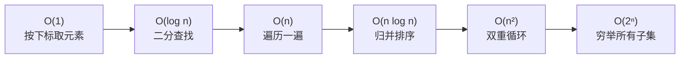

复杂度分析量的不是「这段代码跑几毫秒」，而是「数据量翻十倍，代价会涨多少」。把机器性能、常数因子和输入的具体形状剥掉，剩下的增长曲线才是选数据结构和换算法的依据。真正容易算错的往往不是大 O 这个记号，而是循环嵌套的次数、扩容这种偶发的高代价，以及递归里那截没人想起的栈空间。

## 一、为什么看增长，不看计时

计时测到的是「机器 + 输入 + 运行时状态」三者的乘积。同一段代码换台机器、数据恰好已经有序、或者中途赶上一次垃圾回收，结论就会变；数据量小的时候，常数因子还会盖过增长阶——一个 O(n²) 的双重循环在 n 很小时，完全可能比 O(n log n) 的归并排序更快，因为后者有递归和临时数组的开销。渐进复杂度主动丢掉这些信息，只保留「n 趋大时增长最快的那一项」，换来的是与机器无关、可以跨实现比较的结论。

三个符号各记一句话：

- **大 O 是上界**：代价不会超过这个量级。
- **大 Ω 是下界**：代价至少是这个量级。
- **大 Θ 是紧确界**：上下界同阶，既是 O 也是 Ω。

日常说「这段代码是 O(n)」时，多数人想表达的是 Θ(n)：既不会更慢，也不会更快。严格说 O 只承诺上限，一个 O(n) 的算法也可以同时是 O(n²)，所以「快排是 O(n²)」和「快排是 O(n log n)」都不算错，前者指最坏情况，后者指平均情况。

> [!TIP]
> 常数和低阶项在渐进记号里会被丢掉：log₂n 与 ln n 只差一个常数因子，2n 与 n 同阶。所以 O(2n) 写成 O(n)，O(n + n log n) 写成 O(n log n)。反过来，两个同为 O(n) 的实现，工程上的差距可以很大，需要时得回到实际常数。

**增长的阶梯：O(n log n) 和 O(n²) 差在哪。** 下表按基本运算次数估算，log 以 2 为底，不是任何一台机器上的实测耗时：

| 复杂度 | n = 10 | n = 1,000 | n = 1,000,000 | 典型来源 |
| --- | --- | --- | --- | --- |
| O(log n) | 3 | 10 | 20 | 二分查找、平衡树高度 |
| O(n) | 10 | 1,000 | 1,000,000 | 一次遍历 |
| O(n log n) | 33 | 10,000 | 20,000,000 | 归并排序、堆排序 |
| O(n²) | 100 | 1,000,000 | 1,000,000,000,000 | 双重循环、冒泡排序 |

差别不在 n 小的时候。n = 10 时，n log n 与 n² 只差三倍，常数因子动一动就盖过去了；n = 1,000 时差一百倍；n = 1,000,000 时差五万倍。这就是那条经验线：**数据量过千，先检查有没有 n²；数据量过十万，n² 基本等于不可用**。到了这个差距，换机器、调参数、加缓存都追不回来，只能换算法或换数据结构。



箭头只表示增长阶从低到高，不表示调用关系。

## 二、加法法则与乘法法则：嵌套循环怎么数

两条规则：并列的取最大，嵌套的取乘积。

- **加法**：两段代码先后执行，总复杂度取较大的那个。O(n) 的预处理接 O(n²) 的主循环，结果是 O(n²)，低阶项被吸收。
- **乘法**：外层执行 n 次，每次内层执行 m 次，总复杂度是 O(nm)。两层各自独立地跑 n 次，就是 n²。

真正的坑在内层次数依赖外层的时候，这时要把次数加起来，而不是直接相乘。内层跑 i 次，总次数是 0 + 1 + … + (n−1) = n(n−1)/2，仍然是 O(n²)，只是系数少了一半。

::: code-group labels=[内层跑满 n 次, 内层跑 i 次]

```java
for (int i = 0; i < n; i++) {
    for (int j = 0; j < n; j++) {
        work();                 // 共 n² 次
    }
}
```

```java
for (int i = 0; i < n; i++) {
    for (int j = 0; j < i; j++) {
        work();                 // 共 n(n-1)/2 次，仍是 O(n²)
    }
}
```

:::

指数级缩小的循环要反过来看：`for (int i = 1; i < n; i *= 2)` 每轮把范围折半，循环次数是 log₂n，所以是 O(log n)。判断依据是「循环变量怎么变」，不是「有几层 for」：两层 for、内层固定跑 100 次，仍然是 O(n)。

递归要分开算「每层做多少」和「有多少层」。归并排序把数组分成两半分别递归，再花 O(n) 合并：

$$T(n) = 2T(n/2) + O(n) = O(n\log n)$$

递归树有 log₂n 层，每层的合并总量都是 O(n)，相乘就是 O(n log n)。换成只递归一支、每层 O(1) 的写法，代价就退化成 O(n)。分析递归时先画递归树：看分几支、每层总代价、树有多高。

## 三、均摊复杂度：扩容为什么是 O(1)

动态数组的 add 看起来不像 O(1)：容量满了要申请更大的内存，把旧元素全部复制过去，这一次是 O(n)。但把连续 n 次 add 放在一起看，复制总次数是 1 + 2 + 4 + … + n，不到 2n：

$$\sum_{i=0}^{k} 2^{i} = 2^{k+1} - 1 < 2n$$

总代价 O(n) 摊到 n 次操作上，每次就是 O(1)。这就是均摊复杂度：分析的是一串操作的总代价，再平均到单次，而不是某一次的最坏情况。

均摊 O(1) 不等于每次 O(1)。某一次 add 确实可能卡一下，把当前全部元素复制一遍，只是这种卡顿间隔越来越长，平均下来被摊平了。它也不同于平均情况：均摊是对操作序列的确定性结论，不需要对输入分布做假设。

前提是「按固定倍数扩容」。如果每次只多申请固定 k 个位置，n 次 add 的复制总量是 k + 2k + …，量级到了 n²/k，均摊就退化成 O(n)。所以扩容策略的关键不是「扩」，而是「按比例扩」。Java 的 ArrayList 按 1.5 倍扩，不少实现按 2 倍，比例不同，阶相同。缩容同理：如果元素一降到一半就立刻缩，反复在阈值附近增删会来回复制，通常要留一段滞后区间，比如降到四分之一才缩一半。

## 四、空间复杂度：递归栈也要算

空间复杂度算的是「额外空间」：不随输入规模变化的记 O(1)，随 n 线性增长的记 O(n)。最常被漏掉的是递归栈——每深入一层就压一个栈帧，里面放着参数、局部变量和返回地址，深度为 d 的递归至少占 O(d) 的空间。代码里没有 new 数组，不代表没有占用。

几个容易记混的例子：

- **归并排序**：合并需要一个长度为 n 的临时数组，递归栈 O(log n)，加法取大，总额外空间 O(n)。
- **快速排序**：原地分区，但递归栈平均 O(log n)、最坏 O(n)。数组已经有序又固定取第一个元素当 pivot 时，递归退化成一条链，空间也跟着变成 O(n)；随机化 pivot 同时在修时间和空间。
- **朴素递归求斐波那契**：时间是指数级，栈深度却只有 O(n)。时间和空间可以完全不同阶，别用一个推另一个。
- **尾递归**：Java 不做尾调用优化，写成尾递归也不会把栈压缩成 O(1)，该爆栈还是会爆。

还有一点：O(1) 空间指的是「不随 n 增长」，不是「不用内存」。几个固定大小的数组、几个计数器都是 O(1)；一个长度等于 n 的布尔标记数组，就是 O(n)，哪怕它只存 0 和 1。

## 五、一张表：常见操作的复杂度

把前面的规则落到具体结构上。表里的 O(1) 如果没有特别说明，指均摊或期望，不是每次的硬保证。

| 结构 | 按下标或键访问 | 查找 | 插入 | 删除 | 说明 |
| --- | --- | --- | --- | --- | --- |
| 静态数组 | O(1) | O(n) | 不支持 | 不支持 | 长度固定，常数最小 |
| 动态数组 | O(1) | O(n) | 尾部均摊 O(1)，中间 O(n) | 尾部 O(1)，中间 O(n) | 扩容要整体复制 |
| 单链表 | O(n) | O(n) | 已持有位置 O(1) | 已持有前驱 O(1) | 找位置本身是 O(n) |
| 哈希表 | O(1) 期望 | O(1) 期望 | O(1) 均摊 | O(1) 均摊 | 冲突严重时退化到 O(n) |
| 平衡树 | O(log n) | O(log n) | O(log n) | O(log n) | 有序，可做范围查询 |
| 二叉堆 | 堆顶 O(1) | O(n) | O(log n) | 删堆顶 O(log n) | 只保证堆序，建堆 O(n) |

读这张表要小心三处。哈希表的 O(1) 是期望值，哈希函数差、负载因子高、或者有人刻意构造碰撞，都会退化到 O(n)。链表的 O(1) 插入删除有个前提：已经拿到了那个位置，找位置的过程仍然是 O(n)。堆的 O(log n) 删除只对堆顶成立，删中间元素得先花 O(n) 找到它。

> [!WARNING]
> 复杂度表只描述增长阶，不描述常数、内存布局和缓存命中。同一个 O(n) 的遍历，顺序扫数组和随机跳链表可以是完全不同的手感；表能帮你排除错误选项，不能替你测量。

## 自检清单

- 计时结论能复现吗？换机器、换输入顺序、跑第二遍之后还成立吗？
- 说的是 O 还是 Θ？「最坏 O(n²)」和「平均 O(n log n)」指的是同一件事吗？
- 嵌套循环的内层真的跑满 n 次吗？内层依赖外层时，是求和还是相乘？
- 递归式写出来了吗？递归树有几支、多高、每层总代价多少？
- 这个 O(1) 是均摊还是每次？扩容按固定倍数还是固定增量？
- 递归的栈深度算进空间了吗？最坏情况下会压多少层？
- 哈希表的 O(1) 在当前哈希函数和负载因子下还成立吗？
- 复杂度相同时，常数、内存布局和缓存命中比较过吗？
