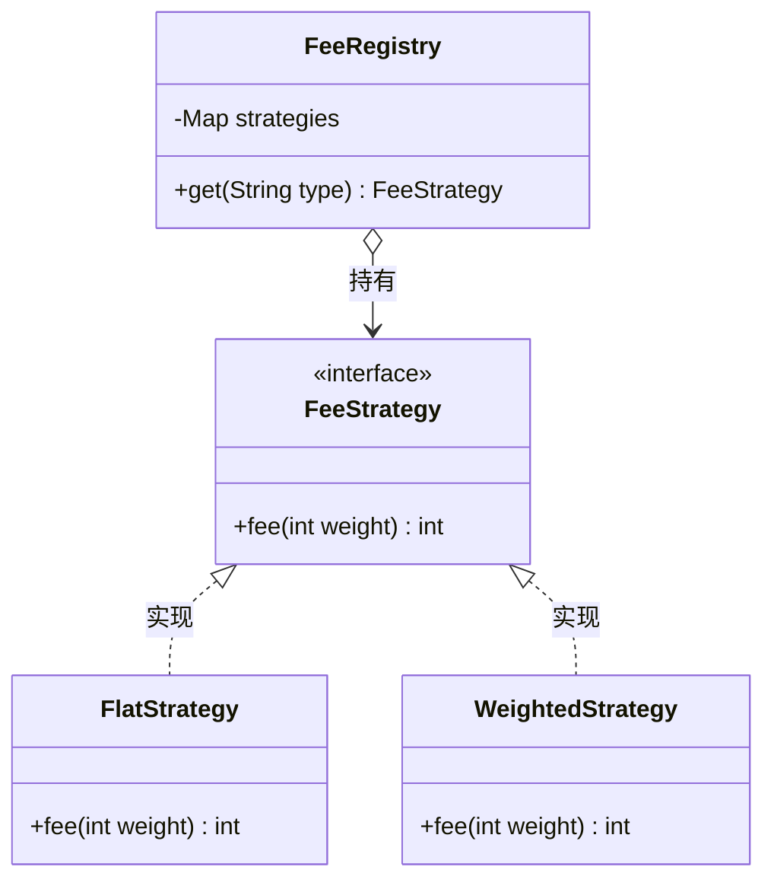
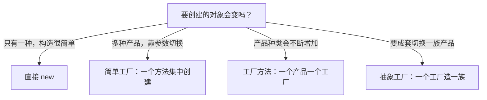

学设计模式最容易踩的坑，是把它当成"让代码显得专业"的手段。策略、工厂、单例之所以最常用，是因为它们各自只回答一个问题：变化发生在哪，边界就画在哪——策略隔离"算法的变化"，工厂隔离"创建的变化"，单例隔离"实例的数量"。判断该不该用，先问这种变化是否真实存在；用错模式的代价，几乎总是比不用更大。

## 铺垫：模式只是原则的落地形式

单一职责说的是"一个类只该有一个变化的原因"，依赖反转说的是"高层模块依赖抽象，而不是依赖具体实现"。策略把"换算法"从业务类里搬走，工厂把"换实现、改构造参数"从业务类里搬走，两者干的是同一件事：让业务类少依赖一种具体实现，也少一个变化的原因。

开闭原则说的是"对扩展开放、对修改关闭"。策略的判据很具体：加一种算法时，是新增一个实现类，还是再塞一个 if 分支。但要承认，没有设计能对所有变化关闭，只能对"已经识别出来、且会重复发生"的变化关闭。

还有两条方向相反的提醒。一是里氏替换：多态的前提是实现之间真的可替换，如果某个策略实现偷偷改约定（比如用返回 `null` 表示"不适用"），调用方就得多写一个判空分支，策略立刻退化成 if-else。二是 KISS 和 YAGNI：上面这些原则都在鼓励抽象，YAGNI 在踩刹车，抽象的前提是"变化已经发生或确定会发生"，而不是"可能会发生"。

## 策略模式：不是所有 if-else 都值得消灭

它解决的是：同一件事有多种算法，调用方按场景切换，而且这些算法会各自演化。下面这个计费例子把"用什么算法"和"算法怎么实现"拆开了。

::: code-group labels=[策略接口, 策略注册表]

```java
// 策略接口只声明"做什么"，不暴露"怎么做"
public interface FeeStrategy {
    int fee(int weight);
}

public class FlatStrategy implements FeeStrategy {
    @Override
    public int fee(int weight) {
        return 10;
    }
}

public class WeightedStrategy implements FeeStrategy {
    @Override
    public int fee(int weight) {
        return weight * 2;
    }
}
```

```java
// 注册表把"选哪个策略"也从业务代码里拿出来
public class FeeRegistry {
    private final Map<String, FeeStrategy> strategies = new HashMap<>();

    public FeeRegistry() {
        strategies.put("flat", new FlatStrategy());
        strategies.put("weighted", new WeightedStrategy());
    }

    public FeeStrategy get(String type) {
        FeeStrategy strategy = strategies.get(type);
        if (strategy == null) {
            throw new IllegalArgumentException("unknown fee type: " + type);
        }
        return strategy;
    }
}
```

:::

值不值得抽，看三条同时成立：分支数量在四个以上并且还会增加；每个分支是一段能被单独测试的算法；选择逻辑本身很简单，通常就是一个枚举或字符串。三条都满足时，抽成策略是净收益。反面的情况更常见：

- 只有两三个稳定分支。抽完之后代码从十行变成三个文件，读一次要在文件之间跳三次，可读性是负收益。
- 分支之间只是取值不同。那是参数或表驱动数据的问题，用一个 `Map<Type, Integer>` 或配置文件就够，不必为每个取值建一个类。
- 判断条件本身就是业务规则，比如金额区间、权限组合。拆成类之后，规则的全貌反而看不见了，排查时得把所有实现拼起来读。

还有两个容易被当成"策略"的东西：策略只解决"用哪个"，不解决"怎么选"，当选择逻辑比算法本身还复杂时，你真正需要的是表驱动或规则引擎，再加一层策略只是把 if 搬了个家；另外，算法数量有限且稳定时，一个带抽象方法的枚举比一堆类更轻，只有算法会各自演化时才值得建类。



真正会出事的细节是状态：无状态的策略实现可以缓存复用，有状态的策略必须每次新建，否则并发下状态会串，这是能上线的 bug 而不是理论问题。

## 工厂模式：三种工厂，一句话分清

工厂解决的是创建逻辑散落在业务代码里的问题：构造方式一改就要改很多处，或者调用方本来就不该知道具体类是谁。三种工厂的区别可以用一句话说完：

- **简单工厂**：一个方法里用 if/switch 造出所有产品。它不是 GoF 的正式成员，但业务代码里最常见。
- **工厂方法**：每个产品配一个工厂类，加产品就是新增一个工厂类，不改已有代码。
- **抽象工厂**：一个工厂造"一族"相关产品，换整套实现时只换工厂。



```java
// 简单工厂：创建逻辑集中到一个点
public final class SenderFactory {
    public static Sender create(String channel) {
        switch (channel) {
            case "sms":   return new SmsSender();
            case "email": return new EmailSender();
            default: throw new IllegalArgumentException("unknown channel: " + channel);
        }
    }
}
```

不该用和容易用错的地方，比用法更值得记：

- 只有一种产品、构造只有一行 `new`。这时工厂是个纯转发的壳，删掉更好。
- 简单工厂的 switch 会随产品增长而变长。它没有消除修改，只是把修改集中到了一个点；如果你要的是"加产品不改任何已有代码"，那才轮到工厂方法。
- 抽象工厂的破绽在另一半：加"新产品族"很舒服，加"单个新产品"却要改所有工厂接口和实现。这条经常被忽略，也是它被滥用最多的原因。
- 只想给构造器起个有意义的名字、复用参数校验，用类自己的静态工厂方法就够了，比如 `LocalDate.of(...)`、`List.of(...)`。它和"按参数切换产品"的简单工厂是两件事，很多文章混着讲。
- 工厂方法真正发光的地方是框架：框架掌握流程，但不认识具体子类，于是把创建延迟到子类。业务代码里提前备一个工厂，多数时候是过度设计。

## 单例：唯一实例的诱惑

单例解决的是：一个进程内确实只需要一份的东西，比如配置、日志句柄、线程池、注册表。它的问题不在写法，在语义太方便：

- 被当成全局变量的收纳箱。依赖从构造器签名里消失，半年后没人说得清谁用了它。
- 测试里换不掉。想要一个干净的实例，只能去改它的内部状态。
- 通常没有接口，扩展只能改源码，违背开闭；零散功能都往里塞，又违背单一职责。

写法依次演进。饿汉式在类加载时创建，线程安全由 ClassLoader 保证（类初始化本身是单线程的），简单可靠，代价是没有懒加载。裸懒汉式只判空不加锁，多线程下会造出多个实例，只在单测里"看起来正常"。双重检查锁是经典写法，也是经典的错法：

```java
public final class ConfigHolder {
    // 少了 volatile，这个写法就是错的
    private static volatile ConfigHolder instance;

    private ConfigHolder() {
        if (instance != null) {
            throw new IllegalStateException("already initialized");
        }
    }

    public static ConfigHolder getInstance() {
        if (instance == null) {
            synchronized (ConfigHolder.class) {
                if (instance == null) {
                    instance = new ConfigHolder();
                }
            }
        }
        return instance;
    }
}
```

> [!WARNING] 这里的 `volatile` 不是装饰。`instance = new ConfigHolder()` 不是一步完成的，它至少包含分配内存、初始化对象、把引用赋给变量三步，后两步可能被重排。没有 `volatile` 时，另一个线程可能在外层判空看到非 null 的引用，但对象的字段还是默认值，于是拿到一个"半成品"。`synchronized` 只保证互斥和退出时的可见性，禁止不了这个重排，必须靠 `volatile` 建立的 happens-before 关系兜住。

静态内部类是我日常的首选：延迟加载、无锁、线程安全，全靠 JVM 的类初始化机制，代码也短。枚举最省事，天然防反射、防反序列化，还能顺便承载状态：

```java
public enum ConfigRegistry {
    INSTANCE;

    private final Map<String, String> values = new ConcurrentHashMap<>();

    public String get(String key) {
        return values.get(key);
    }

    public void put(String key, String value) {
        values.put(key, value);
    }
}
```

单例真正的坑不在这几种写法，而在"唯一"这个承诺很容易被绕开：

- **反射**：`setAccessible(true)` 调私有构造就能再造一个。构造器里加 `if (instance != null) throw` 只能提高门槛，攻击者先把字段置空照样破；枚举会被 JVM 直接拦住，`Constructor.newInstance` 对枚举类型抛异常。
- **反序列化**：默认的 `readObject` 会创建一个新对象。加一个 `private Object readResolve()` 返回 `INSTANCE` 可以修好；枚举免疫。
- **克隆**：只要实现了 `Cloneable` 又没重写 `clone`，就能克隆出第二个实例。不实现，或者重写后直接抛异常。
- **多个 ClassLoader**：同一个类被不同的 ClassLoader 加载，各自持有一份静态字段，于是各有一个"单例"。热部署和插件容器里这很常见。

> [!TIP] Spring 里 `@Component` 默认是 singleton，但它和单例模式不是一回事。Spring 的 singleton 作用域是"每个 IoC 容器、每个 bean 定义一个实例"，不是 JVM 全局唯一：一个 JVM 可以起多个容器，同一个类也能被 `new` 出很多个对象，而单例模式做不到这一点。反过来，Spring 单例 Bean 通常有依赖、有可变状态，生命周期交给容器；单例模式的对象则往往要求无状态才是安全的。所以"用了 `@Service` 就是单例"是错的，你得到的是容器管理的共享实例，线程安全问题一点没少——Bean 上只要有一个可变成员变量，并发请求就会互相污染。

真需要"全局唯一"，优先让容器注入一个实例，用构造器注入，而不是在业务代码里写 `getInstance()`。只有确实需要一个不归容器管的进程级唯一对象时，才手写单例；要手写就选静态内部类或枚举。

## 自检清单

写完一个模式，回头问自己几句：

- 这个变化过去半年真的发生过吗？发生过几次？
- 抽出接口以后，加一个实现要改几个文件？如果还要改注册表、工厂、配置，那开闭原则只兑现了一半。
- 策略实现是无状态的吗？有没有被多个线程共享同一个实例？
- 工厂是不是只是个纯转发的壳？
- 单例有没有变成全局变量？能不能换成构造器注入？
- 单例的构造器、`readResolve`、`clone`、ClassLoader 这几条都想过吗？

模式的成本是"多一层抽象"，收益是"变化发生时少改几处"。变化没来时，成本立刻兑现，收益永远只是预期。所以更稳的顺序是：先写 if-else，等它开始变长、开始反复改同一处，再抽策略和工厂。到那时候，你才知道边界该画在哪。
