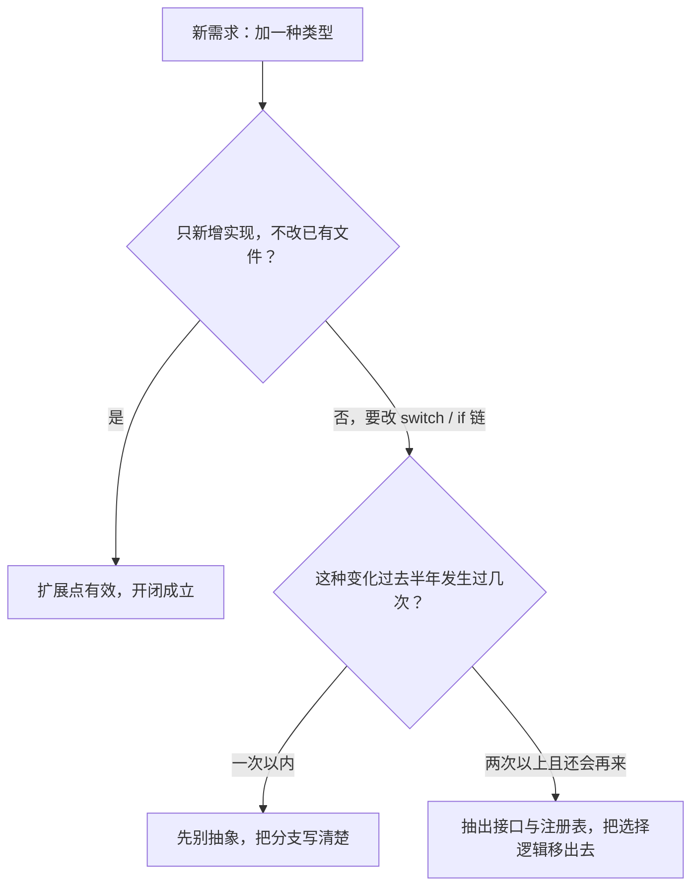
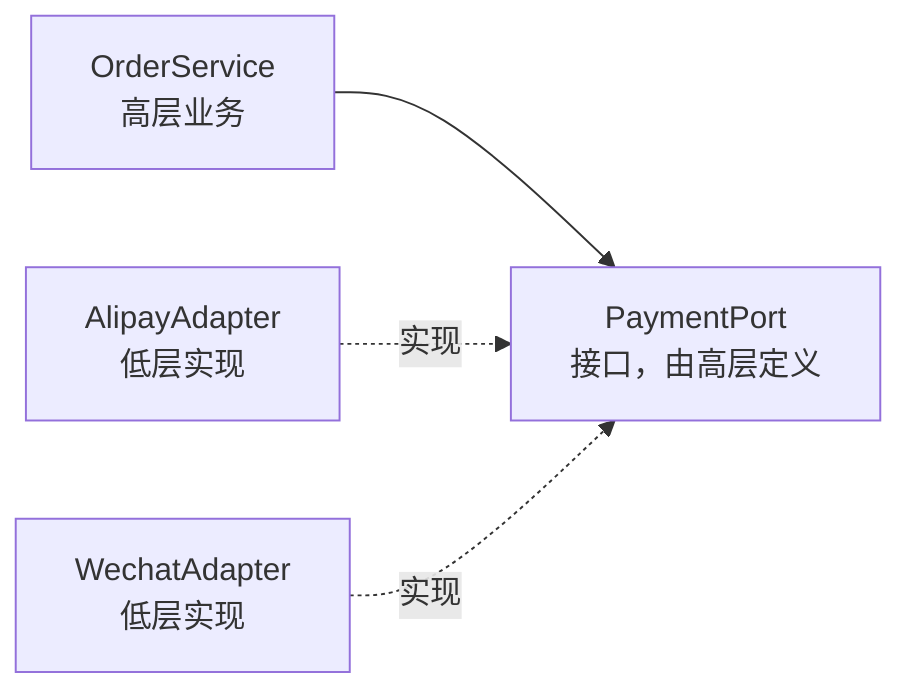

设计原则最常见的用法是背定义，最有用的用法是当诊断工具。判断自己违反了哪一条，不用回忆定义，只看代码里的具体症状：一个类有几个变化原因、加需求要不要改老代码、子类能不能跑过父类的测试。每条原则都对应一组可观察的信号，信号出现了再动手；信号没出现时的抽象，全是成本。

## 单一职责：数一数这个类有几种变化原因

「一个类只负责一件事」没法验证，因为没人说得清「一件事」的粒度。可验证的版本是：需求从几个不同方向来改它，一个方向就是一个变化原因，超过一个就该怀疑。

违反了会长这样：

- 类名要靠 `And`、`Manager`、`Util`、`Helper` 撑着，或者换三个名字都不满意
- 类注释里排着「校验、组装、持久化、发通知」，或者写着「负责订单相关的所有逻辑」
- 字段明显分堆，前后两半方法各碰一堆，中间靠一两个方法桥接
- 同一个类在最近几个互不相关的需求里被反复打开
- 私有方法比公开方法多得多，且分属几摊、互不调用

改法按「变化来源」切，不按「技术分层」切。订单模型同时服务运营编辑页和财务对账，就拆成两个模型，哪怕字段大半重叠；把查询和写入强行拆成两个类，如果它们总被同一批需求同时改，那是按层切，切完只多了跳转。切完要能一句话说清：这个类变了，是因为哪一类需求变了。

> [!TIP] 行数、方法数都不是判据。三十行的类可以同时管两件事，八百行的计算类可能只有一个变化原因——公式本身。职责是变化的维度，不是体积。

## 开闭与里氏替换：两个「不改老代码」的检验

开闭的判据很具体：加一个新需求，是新增文件，还是回老文件里加分支。违反了长这样——每加一个支付渠道、一种消息类型，都要改同一个 `switch`、同一条 if 链、同一个枚举；改的时候顺手复制一段老分支；改完不敢只测新逻辑，得跑全量回归，因为老分支也被动了。



关键在 D 这一问：开闭不是「任何代码都不许改」，而是「对已确认会重复发生的变化关闭修改」。只发生过一次的变化，抽象成本当场兑现，收益永远只是预期。

里氏替换的检验更省事：拿父类的单元测试去跑子类，失败就是违反。违反了长这样——

- 子类重写的方法抛 `UnsupportedOperationException`，或者空实现、返回 `null` 表示「不适用」
- 父类的调用处出现 `instanceof` 判断，或者按 `getClass()` 分支
- 子类要求调用方额外满足前置条件，父类允许的入参它拒绝
- 子类改了后置条件：父类承诺返回非空集合，子类返回 `null`

> [!WARNING] 这条原则破坏起来毫无痛感：编译通过、类型正确，只有跑到那个分支才炸。别靠 review 用眼睛看，靠继承体系上的测试复用——父类的用例就是子类的契约验收单。跑不过时只有两条路：把「子类不适用」的方法下移到真正需要它的子类型，或者承认这是组合关系，改成持有而不是继承。

## 接口隔离与依赖反转：一个看调用方，一个看箭头方向

接口隔离问的是调用方：它被迫依赖了哪些自己用不上的方法。违反了长这样——接口十个方法，某个实现类里六个是空实现或抛异常；接口因为一个调用方的需求加了方法，其他实现被迫跟着改。

改法是从调用方倒推接口，一个角色一个接口，让实现类去实现多个小接口，而不是让一个胖接口服务所有角色。接口隔离和单一职责容易混：单一职责看实现方「我该负几件事」，接口隔离看调用方「我被迫知道了多少」。同一个类实现三个小接口，职责没问题；把三个塞进一个大接口，调用方就被迫知道了三件事。

依赖反转看的是箭头：高层模块的源码里有没有具体实现。违反了长这样——

- 业务类里 `import` 的是具体实现类、具体框架类、某家云的 SDK 客户端
- `new` 散落在业务方法中间，而不是集中在装配处
- 单测要跑起来，必须先起数据库、连 MQ，或者去 mock 静态方法
- 换一家短信服务商，改动的文件落在业务逻辑旁边



反转的其实是源码依赖方向：接口由高层定义，低层去实现，于是高层不再 `import` 低层。运行时调用仍从上往下，这点没变。代价是多一层间接，调试时要在接口和实现之间跳一次，所以只在「实现真的会换」或「测试需要隔离」时才值得。

## 迪米特与 DRY：耦合和重复的两种伪装

迪米特违反了长这样：一长串 getter——`order.getUser().getAddress().getCity().getCode()`。调用方知道了订单里有用户、用户有地址、地址有城市，任何一环改结构，这行就断。

::: code-group labels=[违反迪米特, 改法：让对象自己回答]

```java
// 调用方沿着内部结构走三层，任何一层改结构都会断
public String shippingCode(Order order) {
    return order.getUser().getAddress().getCity().getCode();
}
```

```java
// 把「怎么算出来」还给数据的所有者，调用方只知道一件事
public class Order {
    private final User user;

    public String shippingCityCode() {
        return user.shippingCityCode();
    }
}
```

:::

但别把这条用成教条：DTO、`Map`、配置对象这类纯数据载体，链式取值不算违规，它们本来就没有行为可委托；为打断一条链专门加个只做透传的方法，那是把耦合挪了个位置。

DRY 最容易被误读，因为它写成了「不要重复」，实际判据是「这条知识要改的时候得改几处」。三段长得完全不同的代码，如果都在描述「什么算有效订单」，改规则要改三处，就是违反。反过来，两段一模一样的代码，一段校验订单金额、一段校验退款金额，只是此刻恰好相同，合并就是把两个会独立演化的东西焊死——那不是 DRY，是制造耦合。问一句「这两处的修改会同时发生吗」：同改同不改才合并，否则宁可留着重复，因为重复的成本是明确的，错误合并的成本是延迟爆发的。

还有第三种：代码重复执行。同一次请求里把同一份配置查了三遍、同一个远程调用打了两遍，也算违反 DRY，重复的是「事实的获取」，改法是缓存或上移，而不是抽个方法了事。

## 症状对照表：从现象往回找原则

| 症状 | 违反的原则 | 下手方向 |
| --- | --- | --- |
| 类名要靠 And / Manager 撑，注释里排着好几件事 | 单一职责 | 按变化来源切分，切完能一句话说清「谁变了它才变」 |
| 加一种类型就要改 switch / if 链，还要复制老分支 | 开闭 | 把变化点抽成接口加注册表，选择逻辑移出业务代码 |
| 子类抛 UnsupportedOperationException，或父类调用处出现 instanceof | 里氏替换 | 父类测试跑子类；拆掉这段继承，改组合或下移方法 |
| 接口十个方法、实现类六个空实现；调用方被迫 mock 一堆 | 接口隔离 | 按调用方角色拆小接口，让实现类实现多个 |
| 业务类 import 具体实现，单测必须起中间件 | 依赖反转 | 高层定义接口，构造器注入，new 收到装配处 |
| 三层 getter 链，内部结构一改就断 | 迪米特 | 让对象自己回答（Tell, don't ask），只对行为对象用 |
| 同一条业务规则写在三处，改一次要同步三遍 | DRY（语义重复） | 抽成一处知识，按业务规则命名而不是按代码形状 |
| 两段代码完全相同，但服务于不同业务概念 | 不是 DRY，是巧合 | 先不合并，等它们真的同向演化 |

表要横着看：同一个症状常能对上两条原则，因为原则本来就在描述同一个耦合的不同侧面。更要紧的是它们会互相打架。单一职责拆得越细，跳转越多，读一条链路要在五个文件之间来回；依赖反转每加一层接口，调试就多一次跳转；迪米特要求少知道对方，DRY 要求共用同一处知识，两者都推动逻辑收拢，收拢处就成了新的耦合中心；接口隔离拆得越多，实现类要背的签名也越多。

取舍按场景来，问三个问题：这种变化多久发生一次、发生一次要改几处、改错一次的代价多大。变化频繁且代价高的地方，值得付抽象的成本；只在一种场景里用过、半年没动过的代码，难看一点没关系。原则的用途是解释「这里为什么难改」，不是给代码打分。

## 自检清单

- 这个类最近三次改动，是因为同一类需求吗？加一种新类型，我要打开几个已有文件？
- 子类能跑过父类的测试吗？父类调用处有 `instanceof` 吗？
- 我实现的接口里，有多少方法从来没人调用过？
- 业务代码里还有 `new` 具体实现吗？单测能不起中间件跑通吗？
- 这串 getter 是在取数据，还是在做决策？
- 这两处重复，会同时修改吗？如果其中一处先变，另一处还能独立存在吗？
- 我为这条原则付的成本，换回来了什么？换不回来，就退回去。
