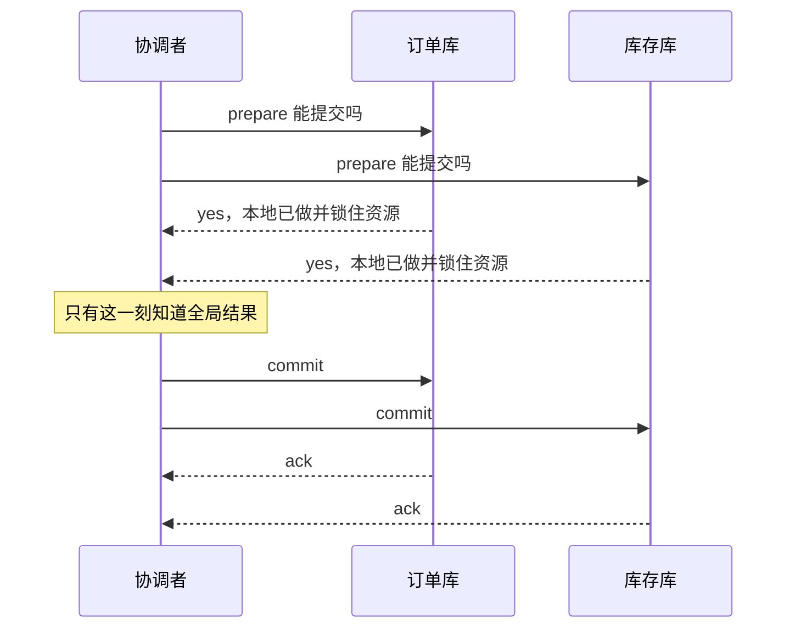
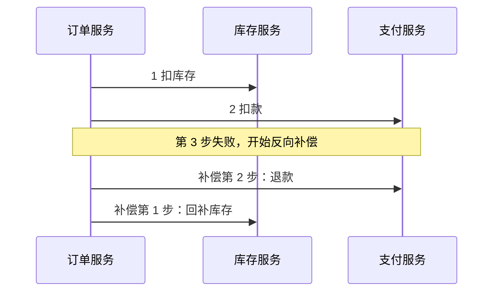

分布式事务没有银弹，能选的只是把不一致的窗口放在哪里、有多长、由谁兜底。选型的顺序常被讲反：绝大多数业务应该先用最终一致性，只有资金冻结、库存预占这类中间态要可见可撤的场景，才值得付 TCC 的代价；2PC 适合内部同构、并发不高的短事务；Saga 适合步骤长但每步都写得出补偿的流程。下面把四种方案的代价摊开，最后给一张选择表。

## 一、本地事务跨出单库就失效

单库事务之所以可靠，是因为提交和回滚由同一个引擎完成：undo log 记下每行改动前的值，失败时反向重放；redo log 保证提交过的改动不丢；锁管理器在同一份内存结构里判断谁能进。三样东西共享同一实例、同一份元数据、同一进程，"要么全做、要么全不做"才是一句能兑现的承诺。

一旦一次操作跨了两个无法共享本地事务的存储，这三根柱子会同时被抽掉：

- **没有统一的回滚入口。** 订单库的扣减已提交、库存库的扣减失败，前者对所有人可见，没有机制能撤回。
- **没有共同的锁。** 两个库的写互不可见，隔离性无从谈起，中间态必然被别人读到。
- **网络让结果不确定。** 超时可能是对方没执行，也可能执行成功而响应丢了；重试会重复执行，不重试会漏执行。

于是"要么全做要么全不做"只能降级成两种承诺：在提交点同步协调、让参与者一起表态，代价是阻塞；或者先记一笔账、事后补救，代价是中间态可见且每个环节都要能承受重复执行。后面的方案都只是这两条路的不同走法。

> [!NOTE]
> 算不算分布式事务，看的不是调用了几个服务，而是它是否跨了两个无法共享本地事务的存储——一个服务连两个库，也是。

## 二、2PC 与 3PC：等一个协调者的答复

两阶段提交的流程很短。第一阶段，协调者问所有参与者"能不能提交"，参与者各自执行本地事务但不提交、把资源锁住，然后回复 yes 或 no；第二阶段，协调者汇总结果，全 yes 就发 commit，否则发 rollback。



三个问题是结构性的，不是实现水平问题。

**同步阻塞。** 从 prepare 成功到 commit 到达，参与者一直持锁；协调者慢一点、网络抖一下，锁就不放。链路吞吐由最慢的参与者决定，事务越长，锁住的资源越多。

**协调者单点。** 协调者宕机后，已 prepare 的参与者不能提交也不能回滚，只能挂着等；若它日志没落盘就恢复，可能给一部分人发 commit、另一部分发 rollback，把数据撕成两半。

**数据不一致窗口。** commit 发出后，一部分参与者提交了，另一部分因网络没收到停在原地，系统既不是全提交也不是全回滚，只能靠协调者反复重试拉齐，这段就是不一致窗口。

XA 是 2PC 的工业实现，MySQL 的 `XA START`、`XA PREPARE`、`XA COMMIT` 就是它。问题不在协议，而在它按事务时长占用连接和行锁，叠加跨机房往返延迟，在线业务很难接受。

3PC 在 2PC 前面再加一轮 CanCommit，只问意愿不锁资源，PreCommit 真正执行，最后 DoCommit。改动在参与者侧：超时推进——PreCommit 后超时默认提交，CanCommit 后超时默认中止，协调者失联时不必无限期挂着。

但 3PC 只把"等"拆小了，没解决分区：网络一断，两边可能各自按超时去猜，一个提交一个回滚，不一致照旧。超时默认提交本质是一次猜测，猜错就是错，所以它更多出现在教材里。

## 三、TCC：Try/Confirm/Cancel 与三个必须处理的坑

TCC 把资源锁定从数据库行搬到业务语义上：Try 做预留（冻结额度、预占库存），Confirm 用预留完成扣减，Cancel 释放预留。三个接口都由业务实现，所以不需要全局锁，中间态是一条业务数据——能查询、能展示、能超时回收。

这也是它和 2PC 最本质的区别：2PC 的中间态是"这行被锁住了"，别人只能等；TCC 的中间态是"这笔钱被冻结了"，别人看得见、能绕开，甚至能显示成"处理中"。

代价是三个必须自己处理的问题，它们其实是同一件事的三张面孔：Try 与 Cancel 的到达顺序不确定，而网络会重试。

**空回滚。** Try 没执行（请求丢了、服务宕机、还没到），但事务管理器已判定失败并发出 Cancel。Cancel 要能识别"我从没 Try 过"并直接返回成功；若照参数反向操作，就会凭空多退一笔钱。

**幂等。** Cancel 和 Confirm 都可能被重试多次，第二次不能再动资源。靠状态机加唯一键：只有状态是 TRIED 的那次 Cancel 才真正解冻。

**悬挂。** Cancel 先到（空回滚），延迟的 Try 后到，若 Try 照做就会冻结一笔永远释放不掉的钱。解法是让 Cancel 的占位记录对后到的 Try 可见，看到 CANCELLED 就放弃。

三者的统一解法是一张分支事务表：先落记录，再动资源。

::: code-group labels=[Try, Cancel]

```java
@Transactional
public void tryDeduct(String xid, long userId, long amount) {
    // 唯一键 (xid, branch) 挡住重复 Try
    int inserted = jdbc.update(
        "insert ignore into tcc_branch (xid, branch, status) values (?, 'deduct', 'TRIED')", xid);
    if (inserted == 0) {
        String status = jdbc.queryForObject(
            "select status from tcc_branch where xid = ? and branch = 'deduct'", String.class, xid);
        if ("CANCELLED".equals(status)) return; // 悬挂：Cancel 已先到，不能再冻结
        return;                                  // 重复 Try：幂等返回
    }
    int rows = jdbc.update(
        "update account set frozen = frozen + ? where user_id = ? and balance - frozen >= ?",
        amount, userId, amount);
    if (rows == 0) throw new InsufficientBalanceException(); // 留给 Cancel 去空回滚
}
```

```java
@Transactional
public void cancelDeduct(String xid, long userId, long amount) {
    // 空回滚：Try 没留下记录，补一条占位，顺便挡住后到的 Try
    int inserted = jdbc.update(
        "insert ignore into tcc_branch (xid, branch, status) values (?, 'deduct', 'CANCELLED')", xid);
    if (inserted == 1) return;

    // 只有 TRIED 才解冻；重复 Cancel 抢不到这一行，什么也不做
    int rows = jdbc.update(
        "update tcc_branch set status = 'CANCELLED' where xid = ? and branch = 'deduct' and status = 'TRIED'", xid);
    if (rows == 0) return;
    jdbc.update("update account set frozen = frozen - ? where user_id = ?", amount, userId);
}
```

:::

TCC 的成本常被低估：三套接口、一张状态表，还要回答"预留的资源超时多久回收"。窗口里资源是死的——冻结的钱不能花，预占的库存卖不出去，所以它只适合窗口短、价值高的场景。

> [!WARNING]
> TCC 最难的不是写三个接口，而是判断 Cancel 在什么情况下不该做。空回滚、幂等、悬挂都不写，测试环境一切正常，线上一次超时重试就能把账做错。

## 四、Saga：正向补偿与前向恢复

Saga 把长事务拆成一串本地事务 T1、T2、…、Tn，每个 Ti 配一个补偿 Ci。全部成功就结束；第 k 步失败，就倒着执行 C(k-1) 直到 C1。关键在于补偿不是回滚，而是一次新的正向操作：退款是另一笔转账，回补库存是另一次入库。



失败之后有两条路。**反向补偿**是回头收拾，适合业务规则上的拒绝——库存不够、风控拦截、额度超限，重试多少次都不会成功。**前向恢复**是不回头，重试当前步骤或换条路径，适合超时、限流、下游临时不可用这类可自愈故障。真实系统通常混用：先前向重试若干次，仍失败再反向补偿。

编排上分协同式与编排式：前者靠服务互发事件，耦合松但链路难追踪；后者由中心状态机驱动，可观测性好、补偿顺序明确，代价是多一个要运维的组件。流程超过四五步，基本只能选编排式。

短板是没有隔离性：第 2 步执行时，别人已经能看到第 1 步扣掉的库存；补偿完成前，中间态一直对外可见。缓解只能靠业务手段——用"处理中"状态、把扣减改成预留、按业务键串行化。

还有个前提常被忽略：补偿只对可逆的步骤成立。短信发出去了、给外部系统转了账、券被用户核销了，都没有真正的逆操作。所以 Saga 适合订单、审批、出行这类流程型业务，不适合副作用不可逆的链路。

## 五、本地消息表、事务消息与怎么选

本地消息表把一致性交给本地事务：业务表和消息表同库，一次本地事务同时写入业务数据和一条待发消息，原子性由数据库保证——用的正是第一节那个"单库可靠"的事实。之后由投递器扫表或订阅 binlog，把消息发到 MQ，成功就标记，失败就重试，卡住就告警。语义因此是至少一次：投递器在"发成功"和"标记成功"之间宕机，重启后会再发一遍，所以消费端必须幂等——唯一键、去重表或状态机，任选其一，不能没有。

事务消息（RocketMQ 的半消息加回查）把消息表挪到 MQ 侧：先发一条消费者不可见的半消息，本地事务执行完再提交或回滚，Broker 收不到确认就回查。业务侵入更小，代价是绑定特定 MQ，且回查接口要能准确回答"这笔本地事务到底成没成"。

AT 模式一句话带过：Seata 的 AT 代理数据源拦截 SQL、自动生成反向 SQL，靠全局锁控制写冲突，业务几乎零改造，代价是全局锁和代理的性能与运维负担。

无论哪种，本地消息表保证的只是"消息发出去了"，不保证"下游做成了"。真正的兜底是对账：定时比对两边数据，把差异补单或退款。消息只是把不一致窗口从无限长压到秒级，对账才是把账做平的环节。

最后是选择表：

| 场景 | 一致性要求 | 推荐方案 | 业务侵入 | 落地成本 |
| --- | --- | --- | --- | --- |
| 同一个库里的多表操作 | 强一致 | 本地事务 | 无 | 无 |
| 内部系统、短事务、同构库、并发不高 | 强一致 | 2PC / XA | 低，改连接与协议 | 中，锁与连接占用久，要 DBA 陪跑 |
| 资金冻结、库存预占，中间态要能查、能撤 | 强一致，允许中间态 | TCC | 高，三套接口加状态表 | 高，要处理空回滚、幂等、悬挂 |
| 跨多个服务的长流程，每步都写得出补偿 | 最终一致 | Saga | 中高，每步要配补偿 | 中高，通常要上流程引擎 |
| 下单后发积分、发通知、建索引、同步数仓 | 最终一致 | 本地消息表 / 事务消息 | 低，多一张表加投递器 | 低，但消费端必须幂等 |
| 已经用了 Seata、想尽量少改代码 | 弱一致 | AT | 极低 | 中，全局锁与代理损性能 |

这张表最容易读错的地方，是把它当分级排行榜，以为越往下越"高级"；实际关系是反的——越往下能表达的业务越复杂，代价也越不可控。大部分业务应该先用最终一致性：跨服务的强一致成本随参与方上升，收益往往只是几秒的窗口；而真正的痛点是数据长期对不上，那得靠对账，2PC 解决不了。

真要动手选，先回答三个问题：不一致的窗口有多长？谁会看到错的数据？看到之后有什么损失？如果答案是几秒钟、只有内部系统、没什么损失，那本地消息表加对账就够了，不必上 TCC。

## 自检清单

- 这次操作真的跨了两个无法共享本地事务的存储吗？同库多表不叫分布式事务。
- 参与方有几个？超过三个，2PC 的阻塞成本基本不可接受。
- TCC 的 Cancel 写了空回滚判断吗？没写就等着多退钱。
- Confirm 和 Cancel 幂等吗？靠状态机加唯一键，不是靠"应该不会重试"。
- 悬挂防住了吗？Cancel 留下的占位记录，后到的 Try 能不能看见？
- Saga 每步都有逆操作吗？短信、外部转账、已核销的券，都收不回来。
- 失败后该重试还是补偿？超时类走前向恢复，业务规则拒绝才走反向补偿。
- 消息消费端幂等了吗？至少一次投递意味着至少一次重复执行。
- 有对账任务吗？没有对账的最终一致性，只是"希望它一致"。
