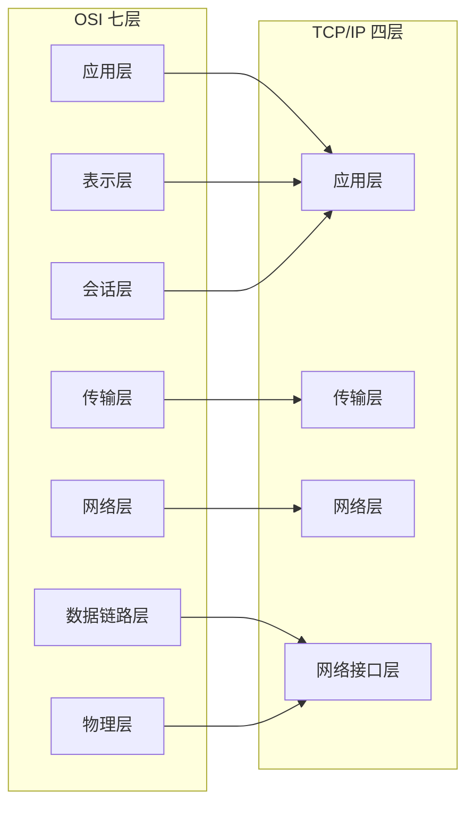
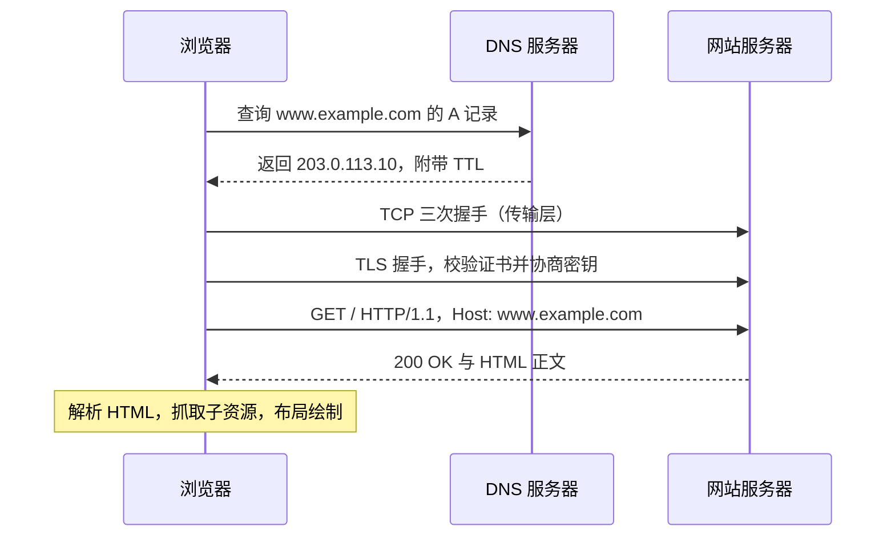

从地址栏敲下网址到看见页面，中间是一次五步接力：DNS 解析、TCP 连接、TLS 握手、HTTP 交互、浏览器渲染，每一棒都落在分层的某一层上。分层的意义是让每一层只依赖下一层的服务、只向上层暴露自己的能力，换掉一层不必牵动全部；因此排查网络问题时，先定位故障落在哪一层，比直接猜原因有效得多。

## 七层与四层：对应关系与分工

OSI 七层是描述用的参考模型：物理层、数据链路层、网络层、传输层、会话层、表示层、应用层。TCP/IP 四层是互联网实际运行的模型：网络接口层、网络层、传输层、应用层。两者并非一一对应，而是把 OSI 的上三层合并为应用层，下两层合并为网络接口层。



各层职责可以各压成一句话：物理层搬运比特，尽量屏蔽铜线、光纤与无线的差异；数据链路层把比特组成帧，用 MAC 地址在同一段链路内寻址并校验差错；网络层用 IP 地址做逻辑寻址，靠路由把包从一个子网送到另一个子网；传输层用端口区分进程，TCP 保证可靠有序，UDP 只尽力而为；会话层管理会话的建立与终止；表示层处理编码、压缩与加解密；应用层则是 HTTP、DNS、SMTP 这些业务协议。

其中最容易被忽略的一条分工是：**网络层解决"不同子网之间怎么走"，数据链路层只解决"这一段链路上交给谁"**。所以 MAC 地址和 IP 地址谁也替代不了谁，ARP 才需要在两者之间做一次翻译。

## 分层到底解决了什么问题

它解决三个实际问题。

一是解耦。HTTP 不关心数据跑在以太网还是 Wi-Fi 上，浏览器也不需要知道 TCP 怎样重传；只要下层承诺的服务不变，上层代码一行都不用改，这就是"向高层屏蔽细节"。

二是封装与解封装。发送时逐层加头：HTTP 报文加端口成为段，加 IP 成为包，加 MAC 成为帧，最后变成比特；接收端反向逐层拆头，每层只读自己那一段头部。抓包里"以太网头 + IP 头 + TCP 头 + HTTP 正文"的结构，就是分层的直接证据。

三是故障隔离。网线松了、路由不通、端口没监听、证书过期，落在不同的层，检查手段也完全不同。分层给排查提供了一个坐标系，让"打不开"这种模糊描述能被切成可以逐项验证的小问题。

> [!NOTE]
> 分层是逻辑抽象，不是物理边界。同一台机器上网卡、内核协议栈、浏览器进程分别承担不同层的工作；一台路由器也可能同时处理物理介质、帧转发和路由。OSI 说的是职责划分，不是七个互相独立的盒子。

## 一次访问的完整路径

1. **DNS 解析**：把域名换成 IP。浏览器缓存、系统缓存、hosts 文件、本地 DNS 逐级查，命中即返回，全都没有才继续向权威服务器追问。
2. **TCP 连接**：拿到 IP 后向 443 端口发起三次握手，确认双向可达，并同步双方的初始序列号。
3. **TLS 握手**：校验证书链、确认证书域名与访问域名一致、协商会话密钥；此后所有 HTTP 内容都在加密通道里传输。
4. **HTTP 交互**：浏览器发出 `GET / HTTP/1.1`，带上 Host、Cookie、Accept 等请求头；服务器返回状态码、响应头和 HTML。
5. **渲染**：浏览器解析 HTML 构建 DOM，再请求 CSS、JS、图片，最后完成布局、绘制与合成。



这五步的边界要分清：第一步只到"知道该找哪台机器"，第二步才建立连接，第三步才谈加密，第四步才是业务数据。任何一步失败，用户看到的都是"打不开"，但 DNS 失败通常提示找不到服务器 IP，TCP 失败多是超时或被拒绝，TLS 失败指向证书，HTTP 失败则是 4xx 或 5xx——这些提示本身就是分层的线索。

## DNS：递归查询、迭代查询与缓存

DNS 是把域名映射到 IP 的分布式数据库，查询有两种模式，区别在于谁负责追到底。

**递归查询**是委托：客户端把问题交给本地 DNS 服务器，要求"给我最终答案"；本地 DNS 查不到就替客户端去问别人，直到拿到结果或确认域名不存在。

**迭代查询**是给线索：被问的一方不替你跑腿，只回答"下一步该问谁"。根服务器指向 .com 顶级域服务器，顶级域指向 example.com 的权威服务器，只有权威服务器才给出最终记录。

所以真实链路是"客户端到本地 DNS 递归，本地 DNS 到根、顶级、权威迭代"。把这两段混成一句，排查时就容易找错对象。

缓存由 TTL 控制：TTL 内本地 DNS 直接返回缓存，不再向上游发问。TTL 越短，切换 IP 生效越快，查询压力越大；TTL 越长，命中率越高，故障切换也越迟钝。加上浏览器、操作系统、本地 DNS、CDN 边缘各有一层缓存，"改了 DNS 为什么不生效"往往只是某层缓存还没过期。

常见记录类型各管一段：

- **A**：域名到 IPv4 地址，最常见的一条。
- **AAAA**：域名到 IPv6 地址，与 A 记录并存。
- **CNAME**：指向另一个域名，解析器必须继续追下去；CDN 常用它把业务域名交给厂商的调度域名。
- **MX**：邮件交换记录，带优先级，决定邮件投递到哪台服务器。
- **TXT**：任意文本，常用于域名归属验证和 SPF、DKIM 等邮件策略。

::: code-group labels=[dig, 输出示例]

```bash
dig www.example.com A +short
dig www.example.com MX +short
dig +trace www.example.com
```

```text
203.0.113.10
10 mail.example.com.
.            518400  IN  NS  a.root-servers.net.
com.         172800  IN  NS  a.gtld-servers.net.
example.com. 3600    IN  A   203.0.113.10
```

:::

> [!WARNING]
> DNS 污染和 DNS 劫持常被混着说，但动手的位置不同。污染是在查询路径上抢先返回伪造应答，让解析器信以为真，明文 UDP 53 最容易中招；劫持则是把解析权或应答内容换掉，比如篡改本地 DNS 配置、入侵权威服务器，或者由运营商直接替换返回的 IP。共同点是"拿到的 IP 不是权威记录"，区别在于伪造发生在链路上，还是发生在源头与配置里。DoH、DoT 把查询本身加密，能挡掉链路上的伪造，但解析器本身不可信时，加密也救不了。

## 从现象定位层：一张排查对照表

排查的第一步永远是分层，然后才是动手。同一句"网站打不开"，落在不同层，验证方式完全不同。

| 现象 | 可能出问题的层 | 先验证什么 |
| --- | --- | --- |
| 完全上不了网，连 IP 都不通 | 物理层 / 数据链路层 | 网线、Wi-Fi 关联、网卡状态、链路指示灯 |
| 同网段能通，跨网段不通 | 网络层 | 路由表、默认网关、ICMP 是否可达 |
| 能 ping 通 IP，但域名解析失败 | 应用层（DNS） | `dig` 是否返回记录、TTL 与缓存层级 |
| 域名能解析，连接被拒绝 | 传输层 | 目标端口是否监听、防火墙是否放行、`ss -lnt` |
| 连接超时而不是被拒绝 | 网络层 / 传输层 | 路由是否可达、是否被安全组静默丢弃 |
| 握手成功但报证书错误 | 表示层 / 应用层（TLS） | 有效期、域名是否匹配、证书链是否完整 |
| 页面返回 4xx 或 5xx | 应用层（HTTP） | 状态码、响应头、服务端日志 |
| 请求都成功但首屏很慢 | 应用层 / 传输层 | 资源大小、是否复用连接、是否命中 CDN |

表里有两个易错点：能 ping 通只证明网络层可达，既不证明端口开着，更不证明应用层正常；"DNS 改了没生效"多数时候不是解析故障，而是 TTL 还没到期。定位层是为了把范围缩到能用一条命令验证，而不是给现象贴一个标签就结束。

## 自检清单

- 能否说出 OSI 七层与 TCP/IP 四层的对应关系，以及哪三层、哪两层分别被合并
- 能否解释 MAC 地址与 IP 地址分别在哪一层使用，为什么不能互相替代
- 能否按顺序复述 DNS → TCP → TLS → HTTP → 渲染，并说出每步失败时的典型现象
- 能否区分递归查询与迭代查询，并指出它们分别发生在链路的哪一段
- 能否说清 A、AAAA、CNAME、MX、TXT 的用途，以及 CNAME 为什么要继续追
- 能否解释 TTL 与多层缓存的关系，以及"改了 DNS 不生效"该先查什么
- 拿到一个故障现象时，能否先判断它落在哪一层，再决定敲哪条命令
