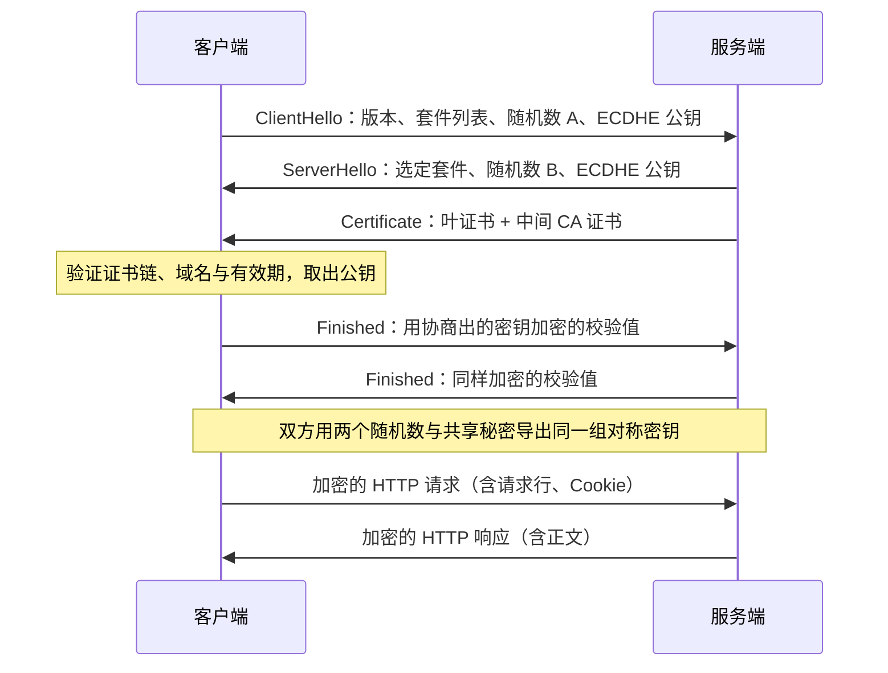

HTTP 的报文说到底就是一串纯文本，服务器读完就忘，任何一次请求都不携带「上一条请求」的记忆；cookie 和 session 不是 HTTP 的组成部分，而是给这份失忆打的两块补丁。HTTP/1.1 用持久连接和 Host 头省掉了重复建连与「一个 IP 只能放一个站点」的限制，HTTP/2 再用二进制分帧把一条连接切成并行的流，把应用层的排队问题绕开。HTTPS 没有改动 HTTP 的任何一个字节，它只是把整个 HTTP 报文塞进 TLS 里加密：握手阶段先验明对方身份、协商出一把对称密钥，之后才用这把密钥搬数据。所以多出来的那一层保护的是报文本身——请求行、Cookie、响应正文都在内，而不只是登录框里的密码。

## 一条 HTTP 报文就是一页文本

HTTP 消息固定分成四段：起始行、首部字段、一个空行、可选的消息体。空行是分界符——首部读到这里结束，后面的一律算 body。请求的起始行是「方法 + 目标 + 版本」，响应的起始行是「版本 + 状态码 + 原因短语」。

::: code-group labels=[请求, 响应]

```text
GET /posts/http-and-https HTTP/1.1
Host: example.com
Cookie: sid=8f3c2b
Accept: text/html
```

```text
HTTP/1.1 200 OK
Content-Type: text/html; charset=utf-8
Content-Length: 5321
Cache-Control: max-age=3600

<!doctype html>...
```

:::

没有二进制魔数，也没有定长头部，所以用 `nc example.com 80` 手敲一段也能拿到响应。消息体的边界靠 `Content-Length` 或 `Transfer-Encoding: chunked` 来界定，这意味着 HTTP/1.x 的「分帧」是文本约定，而不是协议帧——这一点要和后面 HTTP/2 的帧区分开。

而这套格式里没有一个字段用来记录「你是谁、刚才聊到哪」。服务器处理完一个请求就把上下文丢掉，这就是**无状态**。这个设计不是偷懒：正因为协议不要求服务器记住上一次对话，任何一台机器才能处理任何一次请求。扩容只是加机器，负载均衡不需要粘性会话，某台挂了换一台顶上也不用同步内存里的状态。

代价是登录态、购物车、验证码这些天然有状态的东西没处安放。

**cookie 是第一个补丁**：服务器用 `Set-Cookie` 下发一小段文本，浏览器在之后同源的每个请求里自动带回去。它把状态搬到了客户端，所以只能当线索、不能当凭据——用户可以随手改。**session 是第二个补丁**：状态留在服务端，cookie 里只放一个 session id。这等于把问题从「客户端不可信」换成了「服务端怎么共享」：单机放内存，多机就得外置到 Redis，还要处理过期、续期、并发登录和 session id 固定攻击。

> [!NOTE]
> 无状态说的不是「服务器不许存东西」，而是「协议本身不要求服务器记住这次对话」。把会话状态推到独立的存储层之后，HTTP 这一层依然是无状态的，横向扩容的能力也就保住了。

## 从 1.0 到 1.1：少建几次连接，多一个 Host

HTTP/1.0 的默认行为是「一个请求一条连接」：建立、请求、响应、关闭。代价不只在于三次握手的那个 RTT，更在于 TCP 慢启动——每条新连接都要从很小的拥塞窗口重新爬坡。一个页面几十个资源，这套成本就要付几十遍。

HTTP/1.1 默认开启持久连接，一条连接上可以连续发多个请求响应。注意这里的方向：keep-alive 在 1.1 里已经不需要显式声明，想关掉才要写 `Connection: close`。

第二个变化是 Host 头，1.1 规定请求必须带它，缺了直接回 400。原因很实在：1.0 时代的隐含假设是一个 IP 对应一个站点，而虚拟主机让几十个域名共享同一个 IP。服务器收到请求后，只能靠 Host 判断该把请求交给哪个站点。Host 也是今天所有「同源」判断的起点。

再往下是一些体感不强的改进：Range 允许只取资源的一段，配 206 实现断点续传和视频拖动；缓存判断从 `If-Modified-Since`、`Expires` 扩展到 `ETag`、`If-None-Match`，有了内容指纹就不用靠时间猜；状态码一次性补了一批。

1.1 还提出过流水线：不必等上一个响应就能连着发下一个请求。但它没解决根本问题——**响应必须按请求顺序返回**。前面那个请求在服务端算得慢，后面已经算好的响应也只能排队等着。这就是 HTTP/1.x 的应用层队头阻塞。

## HTTP/2：把「排队」换成「编号」

HTTP/2 在 HTTP 和 TCP 之间插了一个二进制分帧层，把消息切成帧，每帧带一个 stream id。抓包看到的是一串二进制帧，不再是可读文本；文本解析的歧义、大小写不一致、逐字符扫描的开销，都在这一层消失。

分帧带来的第一个收益是真正的**多路复用**：一条 TCP 连接上可以有多个并行的 stream，帧交错发送，接收端按 stream id 重组。慢请求只会堵住自己那条流，不再拖住整条连接。连接数也从「每域名六条」塌缩成一条，握手和慢启动的成本一次性摊平。

第二个收益是**头部压缩**（HPACK）。1.x 每个请求都要重复送 Cookie、User-Agent、Accept，几百字节乘以请求数，纯粹是浪费。HPACK 维护一张静态表加一张动态表，双方各存一份：第一次发全量，之后只发索引，再叠一层哈夫曼编码压掉字面量。压缩在这里不是可选项，因为首部往往比正文还大。

> [!NOTE]
> HTTP/2 解决的只是 HTTP 应用层的队头阻塞，TCP 层的那个还在。所有 stream 共用一条 TCP 连接，而 TCP 承诺按序交付：任何一个段丢了，后面已经到达的字节也得在内核缓冲区里等它重传。一条连接上承载的流越多，一次丢包牵连的范围就越大。这正是 QUIC 把可靠传输搬到 UDP 上的动机——流与流之间不再共享同一个重传队列。

顺带说一句服务端推送：它一度是 HTTP/2 的招牌特性，但服务端很难猜准客户端接下来要什么，推早了浪费带宽、推错了还和缓存打架，主流浏览器已经把它移除了。

## HTTPS：HTTP 前面多了一层 TLS

HTTPS 就是 HTTP 跑在 TLS 上，默认端口 443。分层上它夹在应用层和传输层之间：HTTP 报文原样交给 TLS，TLS 加密后交给 TCP。对上层来说什么都没变，方法、状态码、首部、Cookie 一样不少，只是外面套了个信封。

握手的目标只有三个：确认对方是谁、协商出一把只有双方知道的对称密钥、对齐协议版本与密码套件。



**证书验证**是第一步。客户端拿服务端发来的叶证书，用链上一级的公钥验签，一路验到本地信任库里的根证书；同时检查证书里的域名是否匹配 SAN、是否在有效期内、用途是否允许做服务器认证。任何一步不过，浏览器就拦下来。

**密钥协商**是第二步。以 ECDHE 为例，双方各生成一对临时密钥，交换公钥后各自算出同一个共享秘密；再把它和两个随机数一起喂进 KDF，得到会话密钥。临时密钥用完即弃，所以即使服务器的长期私钥将来泄露，也解不开此前录下的流量——这叫前向保密。

**之后才是数据**。所有应用数据走对称加密（AES-GCM 或 ChaCha20-Poly1305），每条记录带认证标签，再加上隐式序列号防重放。TLS 1.3 把上面的往返压到 1-RTT，把证书也放进加密通道，顺手砍掉了 RC4、静态 RSA 这些老套件。

## 非对称只负责发钥匙，剩下的交给对称

一个常见的误解是「HTTPS 全程用非对称加密」。真这么做，性能先撑不住：RSA 一次运算比 AES 慢上几个数量级，而握手只发生一次、数据却要传几百 KB 到几 MB，把贵的算法用在量大的地方是纯粹的浪费。还有一个硬约束是长度——RSA 2048 位一次最多加密两百多字节，连个响应头都装不下。

所以分工很明确：非对称加密只用来解决「怎么在不安全的信道上让双方得到同一把密钥」和「怎么证明对面确实是这个域名的主人」，都是几十个字节的事。真正搬数据用对称加密，现代 CPU 有 AES-NI 指令，吞吐能到 GB/s 量级。这套组合叫混合加密，TLS 的性能账全在这一句里。

证书链则是身份认证的实现方式。服务器不会只发一张证书，而是发一串：自己的叶证书，加上签发它的中间 CA 证书。浏览器不需要认识中间 CA，它只需要认识根 CA，而根证书是预装在操作系统或浏览器信任库里的。验证时逐级向上：用中间 CA 的公钥验叶证书的签名，用根 CA 的公钥验中间 CA 的签名，到根证书就停下——根证书只能自己签自己，信任在这里是预先给定的，不是被证明出来的。

中间人攻击要成立，必须在握手时把证书换掉。但攻击者没有那个域名的私钥，也拿不到 CA 给这个域名签发的证书；伪造一张，验签就过不去。所以证书链的作用不是加密，而是让「冒充」必须偷到一个受信任 CA 的签名，成本被抬到了 CA 的审核流程上。抓包工具（Charles、Fiddler）能看 HTTPS 明文，靠的正是往你的设备里装一张自己的根证书，把整条链引到它身上——这反倒证明了防线设在哪。

> [!WARNING]
> 浏览器报证书错误时点「继续访问」，等于亲手把这层防线拆掉。会报错说明链已经断了：要么有人站在中间，要么证书过期、域名不匹配，要么设备上被装了不该有的根证书。先看清错误类型，再决定要不要例外。

想亲眼看一遍链条，不必装抓包工具：

```bash
# 打印服务端发回的整条证书链，看叶证书由谁签发
openssl s_client -connect example.com:443 -servername example.com -showcerts </dev/null
```

## 自检清单

- 能否说出 HTTP 报文四段的边界，以及空行在其中的作用
- 能否解释「无状态」为什么让水平扩容更容易，cookie 和 session 分别把状态放在了哪一侧
- 能否说出 1.1 相比 1.0 的两个关键变化：默认持久连接、强制 Host
- 能否区分 HTTP/1.x 的应用层队头阻塞与 HTTP/2 之后依然存在的 TCP 层队头阻塞
- 能否说明 HPACK 压缩的是哪一部分数据，为什么它必须做成有状态的表
- 能否按顺序讲出 TLS 握手的几个报文，并指出证书验证发生在哪一步
- 能否解释非对称加密为什么只用于握手，以及握手结束后用什么算法传数据
- 能否说明证书链为什么终止于本地信任库，中间人卡在哪一步
