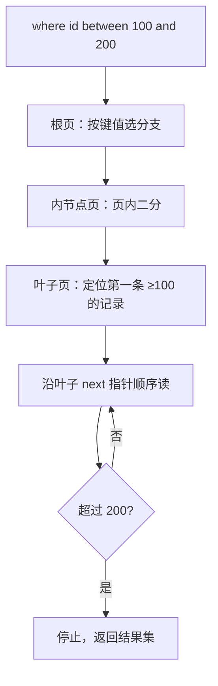

被追问到第三层时卡住，通常不是知识不够，而是准备方式只覆盖了第一层。第一层是结论，第二层是机制，第三层是取舍与边界；前两层可以靠背诵通过，第三层只能靠真的想过。下面把三道常见题的三种答法摆在一起对照，最后给一套两周内能跑完的准备方法。

## 一、三层追问，考的其实是三种能力

顺着一个点往下问，目的不是挖到你不会，而是判断知识是记下来的还是推出来的。

| 层次 | 典型问法 | 合格的回答长什么样 | 常见失分 |
| --- | --- | --- | --- |
| 第一层 | 是什么、用哪个 | 术语准确，一句因果 | 只报名词，没有因为所以 |
| 第二层 | 怎么实现、数据怎么走 | 点出关键结构、调用顺序、失败路径 | 背得出流程，说不清谁触发谁 |
| 第三层 | 为什么不用另一个、什么情况失效、代价多大 | 给出替代方案、量化代价、失效条件 | 绝对化，或答"官方就是这么设计的" |

判据很简单：答案里没有"因为……所以……但如果……"，基本就停在第一层。第三层的问题常以"为什么不用""如果……会怎样""代价是什么"开头，听到这三种句式就该换答法。

## 二、例子一：MySQL 索引为什么用 B+ 树

**第一层**只需要一句：B+ 树矮，磁盘 IO 少，叶子节点有链表，范围查询快。这句话不算错，但只值一句话的分，追问"矮多少、省了哪次 IO"就断。

**第二层**要把 IO 单位说清楚。InnoDB 以 16KB 的页为单位读写，非叶子节点只存键值和页指针，一个页按主键 8 字节加指针 6 字节算能放上千个分支，分支一多，三层通常就够覆盖千万行级数据。所以查一行读几个页约等于树高，瓶颈在页访问次数而不是比较次数。叶子页之间用双向链表串起来，范围扫描定位到起点之后就是顺序读。

**第三层**是从"为什么不用跳表"开始的。跳表在内存里是很好的结构，Redis 的有序集合就用它：平均 O(log N)，范围查询天然，实现简单，改起来只动局部指针。搬到磁盘上，问题出在"跳"这个动作——跳表每推进一层都是一次指针追逐，节点散落各处，换成磁盘就是一次随机页读。千万级数据的跳表按每层各半的概率往上长，约二十多层，最坏就是二十多次随机读；B+ 树用一次页读换掉上千次比较，把"跳"压进了一个 16KB 的页里。

取舍的根子是量级差：内存随机访问在百纳秒级，SSD 随机读在百微秒级，差三个数量级。内存结构能忍受指针追逐，磁盘结构不能。

边界也要说。索引若全常驻缓冲池，B+ 树相对跳表的优势只剩空间和局部性；若写多读少、随机写密集，页分裂会带来写放大，LSM 树反而更合适，InnoDB 只能靠 change buffer 缓解二级索引的随机写。完整的答案是：在这个 IO 粒度下它最省页读，而不是任何维度都最优。

同一道题再往下问一层：范围查询在聚簇索引上怎么走。



页读次数是树高加扫描的叶子页数。如果范围条件落在二级索引上，事情就变了：二级索引的叶子只存索引列和主键，取其他列要逐行回表，每次回表都是一次按主键的随机读。MySQL 会用 MRR 把主键排序后批量回表来减少随机 IO，能覆盖索引时干脆不回表。边界在选择性：范围命中全表很大比例（经验上两三成以上）时，优化器会认为回表不如直接全扫，于是索引明明存在却没走。深分页是同一问题的极端，`limit 100000, 10` 要回表十万次，通常改成延迟关联或按主键游标翻页。

同一道题，两种答法的差别：

::: code-group labels=[第一层, 第三层]

```text
B+ 树比二叉树矮，所以 IO 次数少；叶子节点有链表，所以范围查询快。
```

```text
叶子链表把范围扫描变成顺序读。跳表在磁盘上每推进一层就是一次随机页读，而内存百纳秒、SSD 百微秒，差三个数量级，所以结构必须把"跳"压进一个页。
代价是页分裂和写放大，写多读少时 LSM 更合适；命中行数占比高时优化器会放弃回表，索引就"有却不用"。
```

:::

## 三、例子二：Spring 循环依赖为什么非要三级缓存

**第一层**：用三级缓存提前暴露半成品对象，让 B 能先注入 A。

**第二层**要说清三个容器的分工。`singletonObjects` 放成品，`earlySingletonObjects` 放提前暴露的对象，`singletonFactories` 放对象工厂。A 实例化完、还没填充属性时，先把一个 `ObjectFactory` 放进三级；B 创建时注入 A，`getSingleton` 依次查一级、二级、三级，三级命中就调用工厂拿到早期引用挪进二级，B 完成；A 再填充属性，最后进一级。

为什么两级不够，才是真正的分水岭。如果二级直接存对象，那这个对象在放入之前必须已经是最终形态——需要 AOP 代理的，就得在属性填充之前把代理创建出来。但代理本该由 BeanPostProcessor 在初始化之后生成，提前创建会打乱生命周期，而且会让所有 bean 都被提前代理，哪怕没有循环依赖。三级存的是工厂，把"要不要代理、什么时候代理"推迟到真有人提前引用时才决定；`getEarlyBeanReference` 里会先查是否已经生成过早期代理，保证只创建一个。二级缓存的意义则是性能：工厂只调用一次，之后都从二级拿。

**第三层**要能说出它救不了什么。构造器注入的循环依赖没有实例，没有东西可提前暴露，直接抛 `BeanCurrentlyInCreationException`；prototype 作用域的 bean 不进缓存，循环引用直接失败；如果代理不由自动代理器生成，而是 @Async 这类不参与提前暴露的后置处理器生成，注入方拿到的早期引用仍是原始对象，表现为 @Async 不生效。

Spring Boot 2.6 之后默认禁止循环依赖不是拍脑袋：官方态度是循环依赖本身该被重构掉，三级缓存只是容错，不是设计目标。取舍很清楚——兼容老代码就留着这套机制，要干净就拆 bean、抽第三个组件或用 `@Lazy` 打断。

## 四、例子三：synchronized 的锁升级，今天还成立吗

**第一层**：无竞争偏向锁，有竞争轻量级锁，竞争再激烈膨胀成重量级锁。

**第二层**：状态记在对象头 Mark Word 里。偏向锁把线程 ID 用 CAS 写进去，之后同一线程进入同步块只比较 ID，不再 CAS；别的线程来竞争就要撤销偏向，而撤销要等安全点（safepoint），开销可能比加锁本身还大。轻量级锁把 Mark Word 复制到栈帧的 Lock Record 里，用 CAS 抢，失败就自旋；自旋在 JDK 6 之后是自适应的，次数由上一次的成功率决定。自旋还失败，膨胀成重量级锁，进 ObjectMonitor 的等待队列，靠 park/unpark 阻塞。

**第三层**要知道这套模型本身在退化。JDK 15 起偏向锁默认关闭，之后相关实现被移除。原因不神秘：撤销偏向要等 safepoint，批量重偏向和撤销在高并发下会拖慢整个 JVM；而现代应用里对象多在线程池里跨线程流转，偏向命中率大不如前。顺带一个容易露馅的数字：不少资料还在说"自旋 10 次"，那是 `-XX:PreBlockSpin` 时代的说法，自适应自旋之后这个参数早就不起作用了。

另一面是虚拟线程：JDK 21 上 synchronized 阻塞会把载体线程一起 pin 住，调度器被占死；JDK 24 才解决。所以虚拟线程代码应优先 ReentrantLock，而不是一句"新版本 synchronized 够快"。

取舍是：无竞争或低竞争的同步块，synchronized 足够，JIT 还会做锁消除和锁粗化；需要可中断、超时、公平锁、多个条件队列时，ReentrantLock 才有价值。

## 五、哪种回答一问就露馅

- **背结论不背因果。** 能说出"B+ 树矮"，说不出矮换来了哪一次 IO 的节省，追问结构差异就卡住。
- **把机制当理由。** 能背出 AQS 的 state 和 CLH 队列，但说不出这里为什么需要它，换个场景就套不上。
- **数字没有前提。** "自旋 10 次""队列长度 1000""三层千万行"，被问一句"这个数在什么假设下成立"就断。
- **绝对化。** "一定会走索引""volatile 保证原子性""加了缓存就没有穿透"。几乎每个结论都有反例，面试官举一个就能确认你没想过边界。

> [!NOTE]
> 判据：把答案里的每个"因为"往前推一步，看能不能接上"所以"，再看能不能接上"但如果"。三步都接得上才算到第三层；只接得上第一步，就是背了一段话。

## 六、可执行的准备方法

三个动作，一两周能做完。

**一、把知识点连成因果链。** 每复习一个点写四行：结论、机制、替代方案、失效条件。四行接不上就是没懂，不用再往下背。比如：B+ 树 → 一次页读换掉上千次比较 → 跳表在磁盘上每层都是随机读 → 数据全在内存时结论反转。


**二、准备失败案例。** 每个方向备两三个，按"现象—当时的误判—拿到什么证据—怎么修—付出什么代价"讲。价值在误判那一步：能说清"我以为是 X，证据显示是 Y"，对方就知道你真排查过。最没用的案例是"上了 Redis 所以变快了"，没有误判就没有信息量。

**三、准备边界数字。** 每个主题记五个左右，带量级和前提：页 16KB、三层覆盖千万行、跳表二十多层、内存百纳秒对 SSD 百微秒、偏向锁撤销要等 safepoint。数字的作用是让"快"和"慢"可比，不是显得精确。

> [!WARNING]
> 别背小数点。被问"这个数哪来的"时，答"按每页 16KB、主键 8 字节估的，量级在这个范围"比背一个精确值更可信；答不上来源的数字，反而会成为下一个追问的入口。

练习方法是自问三连，限时九十秒：为什么是它、为什么不是另一个、什么时候它会失效。三问都能在九十秒内讲完，第三层就稳了。

## 自检清单

- [ ] 每个知识点都能说出"因为……所以……但如果……"
- [ ] 至少准备两个失败案例，讲得出当时的误判和代价
- [ ] 每个数字都能说出假设和来源，说不出的就别背
- [ ] 能主动讲出替代方案的缺点，而不是只说它好
- [ ] 遇到真不会的，说清边界（"这块我只到第二层"），不现场编机制
- [ ] 九十秒内讲完一层，不靠重复结论凑时间
