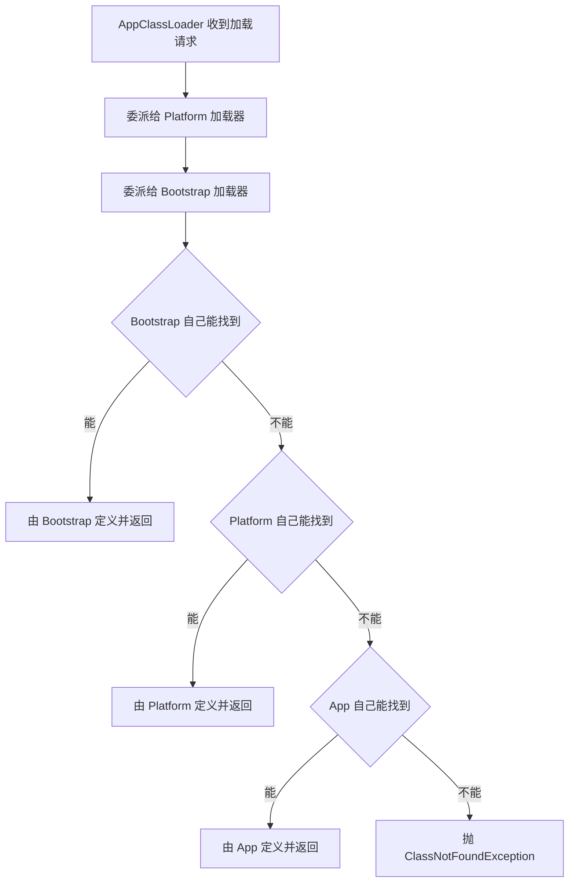
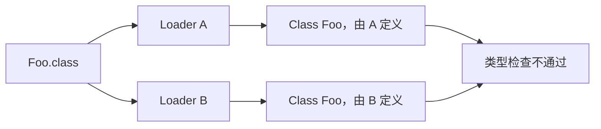

一个 `.class` 文件想进 JVM，必须先过加载、验证、准备、解析、初始化五道关，其中最容易被记混的是准备和初始化。跨过这五关靠的是 `ClassLoader`，而它默认走双亲委派：请求先往上递，只有所有父加载器都交不出来，才轮到自己动手。双亲委派不是不可动的铁律，SPI、Tomcat 的应用隔离、热部署都在明确地绕开它。绕开的代价是类的身份不再由类名单独决定，而由「类名 + 定义它的加载器」共同决定，这正是同类之间出现 `ClassCastException` 的源头。

## 五个阶段：加载、验证、准备、解析、初始化

类的生命周期从「被加载」开始，但加载和初始化是两件事，中间隔着三段。理解这条分界线，比背五个词有用得多。

**加载**做三件事：通过类的全限定名取到二进制字节流；把字节流里的静态存储结构转成方法区里的运行时数据结构；在内存中生成一个 `java.lang.Class` 对象，作为访问这份数据的入口。取字节流的途径不止读文件——jar 包、网络、动态生成的字节数组都可以，这是自定义 `ClassLoader` 的切入点。

**验证**确认字节流不会把虚拟机搞坏：魔数 `0xCAFEBABE`、版本号、常量池引用是否合法，属于文件格式验证；有无合法父类、抽象方法是否漏实现，属于元数据验证；操作数栈与局部变量表的类型能否对上，属于字节码验证；符号引用指向的类、字段、方法是否真的存在且可访问，属于符号引用验证。

**准备**为类变量（`static`）在方法区分配内存并赋零值。`int` 是 0，`boolean` 是 `false`，引用是 `null`。这里有个例外必须记住：被 `static final` 修饰、且属于编译期常量的字段，编译器会生成 `ConstantValue` 属性，准备阶段就直接赋成真值。所以 `static final int MAX = 100` 在准备阶段就是 100，而 `static int count = 100` 在准备阶段是 0。

**解析**把常量池里的符号引用换成直接引用。解析并不要求紧挨着初始化完成，JVM 允许惰性解析，只在实际用到时才做——常见实现里，字段和方法的多数字节码第一次执行时才触发解析，也就可能连带触发别的类加载。

**初始化**才轮到执行类构造器 `<clinit>()`。它由编译器收集静态变量的赋值语句和 `static` 块合并生成，顺序就是源码顺序，所以才会有「静态块写在字段声明前面，字段拿到的是零值」这类坑。`<clinit>` 不需要显式调用父类，JVM 保证父类的 `<clinit>` 先执行完；接口不要求先执行父接口的 `<clinit>`，除非实现类用到了父接口的字段。JVM 还会给 `<clinit>` 加锁，保证它在多线程下只执行一次。

> [!NOTE] 准备和初始化的区别可以压成一句话：准备阶段是 JVM 给类变量一个「安全但没用」的零值，初始化阶段才是源码里的赋值真正生效。所以「`static int a = 1` 在准备阶段就是 1」是错的，它先 0 后 1；而 `static final` 的编译期常量另存于常量池，走的是 `ConstantValue` 那条路，甚至不触发所在类的初始化。

## 类初始化的六个时机

规范里的说法是「有且只有」这几种情况会触发初始化，俗称主动引用：

1. 执行 `new`、`getstatic`、`putstatic`、`invokestatic` 四条指令时。对应「new 一个对象、读写非编译期常量的静态字段、调用静态方法」，被 `final` 修饰且已进常量池的静态字段除外。
2. 用 `java.lang.reflect` 包的方法对类做反射调用，而类还没初始化时，先初始化。
3. 初始化一个类时，如果父类还没初始化，先初始化父类。接口是例外，见第六条。
4. 虚拟机启动时，用户指定的主类（带 `main` 的那个）先初始化。
5. `MethodHandle` 把 `REF_getStatic`、`REF_putStatic`、`REF_invokeStatic` 三种方法句柄解析出来时，对应的类若未初始化则先初始化。这是 Java 7 引入动态语言支持后补的一条。
6. 接口声明了 `default` 方法时，实现类初始化之前，必须先把声明该方法的接口初始化。这是 Java 8 之后的行为。

反过来，三种常见写法不触发初始化，也常被当成考点：通过子类引用父类的静态字段，只初始化父类，子类不动；声明一个类的数组，例如 `new Foo[10]`，只创建数组对象，`Foo` 本身不初始化；引用 `static final` 的编译期常量，编译时已被内联，连类的加载都能省掉。

## 双亲委派：先向上，再向下

双亲委派描述的是一条上下往返的路径：加载请求从当前 `ClassLoader` 出发，不断交给父加载器，一直到最顶层；顶层在自己的范围里找不到，才逐级回退，由下一级尝试。



对应的实现只有几行，全在 `ClassLoader.loadClass` 里：先 `findLoadedClass` 查自己有没有加载过；没有就问 `parent`；`parent` 也交不出来，才调用自己的 `findClass`，最后 `defineClass` 把字节流转成 `Class` 对象。默认顺序是父加载器优先，所以扩展点也分成两个：`findClass` 管「去哪找字节」，`loadClass` 管「按什么顺序找」。

JDK 8 及以前的三层结构是：Bootstrap 加载 `JAVA_HOME/lib` 下的核心类库，也接受 `-Xbootclasspath` 追加；Extension 加载 `lib/ext` 与 `java.ext.dirs` 指定的目录；Application 加载 classpath。JDK 9 之后扩展类加载器变成 Platform ClassLoader，Bootstrap 不再绑死在 `rt.jar` 上，改由模块系统负责核心模块，但委派的形状没变，还是三层。

它要解决的问题只有一个：同一个类在 JVM 里只能有一份「官方定义」。假如不做委派，我在项目里写一个 `java.lang.String`，塞进一个偷偷打印参数的构造方法，那所有字符串都会经过可疑代码。有了委派，加载 `String` 的请求一路上递到 Bootstrap，命中核心库里的那份就直接返回，自己写的版本永远走不到 `defineClass`。这道防线还有第二层：即便绕过委派强行 `defineClass` 一个 `java.lang` 包下的类，也会被 `SecurityException: Prohibited package name` 拦住。

## 为什么要打破双亲委派

双亲委派的隐含假设是「父加载器什么都能看见」，可现实里有两类场景让它失灵：父加载器需要子加载器手里的东西，或者子加载器必须拥有自己的私有副本。

**SPI 是第一种。** `java.sql.DriverManager` 由 Bootstrap 加载，它要去加载各数据库厂商的 `Driver` 实现，而那些实现在 classpath 上，Bootstrap 根本看不见。JDK 的解法是线程上下文类加载器：`Thread.currentThread().getContextClassLoader()`，默认就是 Application 加载器。父加载器把自己的加载任务「反向」交给子加载器，委派的方向被倒过来了。JDBC 4 之后改走 `META-INF/services/java.sql.Driver` 加 `ServiceLoader`，机制不变，`ServiceLoader` 内部用的还是上下文类加载器。

**Tomcat 是第二种。** 一个 Tomcat 里可能同时跑着依赖 Spring 3 和 Spring 6 的两个应用，共用一套加载器的话，同名的类只能有一份，必然有一个应用挂掉。所以 Tomcat 给每个 Web 应用一个 `WebAppClassLoader`，并把顺序改成「先自己找，找不到再委派父」：先查 `WEB-INF/classes`，再查 `WEB-INF/lib`，都落空才往上递。这样每个应用都有自己那份 Spring，互不干扰。但 `java.`、`javax.` 开头的包名会直接跳过本地查找、无条件委派——不跳过，Web 应用里随便一个同名类就能顶替核心类，隔离就变成了漏洞。

**热部署是第三种。** 想不重启 JVM 就换掉一个模块，本质上就是丢掉它的 `ClassLoader`，再新建一个从头加载。旧加载器连同它定义的类、常量池、静态变量一起等着被回收，能不能收回，取决于类的实例、`Class` 对象以及加载器自身是否都已无人引用。这也是热部署最容易翻车的地方：一个存活的线程、一处缓存、一个 `ThreadLocal`，就能把旧加载器钉在元空间里。

自己写加载器时，两种取向的差别就落在覆写哪个方法上：

::: code-group labels=[守住委派, 打破委派]

```java
import java.io.IOException;
import java.nio.file.Files;
import java.nio.file.Path;

// 只接管「去哪找字节」，查找顺序仍交给父类
public class DirClassLoader extends ClassLoader {

    private final Path root;

    public DirClassLoader(Path root) {
        super("dir-loader", ClassLoader.getSystemClassLoader());
        this.root = root;
    }

    @Override
    protected Class<?> findClass(String name) throws ClassNotFoundException {
        Path file = root.resolve(name.replace('.', '/') + ".class");
        try {
            byte[] bytes = Files.readAllBytes(file);
            return defineClass(name, bytes, 0, bytes.length);
        } catch (IOException e) {
            throw new ClassNotFoundException(name, e);
        }
    }
}
```

```java
// 先自己找，找不到再委派父加载器，核心包始终让路
public class ChildFirstLoader extends ClassLoader {

    @Override
    protected Class<?> loadClass(String name, boolean resolve) throws ClassNotFoundException {
        if (name.startsWith("java.") || name.startsWith("javax.")) {
            return super.loadClass(name, resolve);   // 核心类无条件委派
        }
        synchronized (getClassLoadingLock(name)) {
            Class<?> loaded = findLoadedClass(name);
            if (loaded == null) {
                try {
                    loaded = findClass(name);                 // 先本地
                } catch (ClassNotFoundException e) {
                    loaded = super.loadClass(name, false);    // 再往上兜底
                }
            }
            if (resolve) {
                resolveClass(loaded);
            }
            return loaded;
        }
    }
}
```

:::

第二种写法里，`super.loadClass` 那段兜底不能省。全部自己加载，意味着 `java.lang.Object` 也可能被自己的加载器定义一份，那才是真正的灾难。

## 同一个类，两个加载器，两种类型

JVM 判断「这两个是不是同一个类」的标准不是类名，是「类名 + 定义它的类加载器」。同一个 `.class` 被两个加载器分别 `defineClass`，会产生两个互不相干的 `Class` 对象，各自的静态变量、常量池、类型信息完全独立。



所以 `(Foo) obj` 抛 `ClassCastException` 时，先别怀疑对象类型，先怀疑这个 `Foo` 是从哪来的：调用方用的 `Foo` 和对象实际的 `Foo`，是不是同一个加载器定义的？`instanceof` 同理，它在字节码里退化成一次类型检查，比对的仍是加载器命名空间下的那个 `Class`。

> [!WARNING] 这条规则解释了三个高频现象：Tomcat 的 `common/lib` 和 `WEB-INF/lib` 各放一份同名 jar，就会出现「明明都是 Foo，就是转不过去」；插件化架构里，插件之间交换的对象只能用父加载器共享的接口类型，否则调用方拿到的类型用不了；热部署替换加载器之后，新类与旧类的实例完全不兼容，缓存里留着的旧实例必须先清掉。

类卸载需要三个条件同时成立：该类的实例全被回收、`Class` 对象无引用、加载它的 `ClassLoader` 也被回收。所以「加载器泄漏」比「对象泄漏」更难查——后者只占一块堆，前者会把整个类的元数据一起挂在元空间里。

## 自检清单

- 能说清 `static int a = 1` 在准备阶段是 0、初始化后是 1，而 `static final` 编译期常量为什么在准备阶段就已经有值。
- 能列出触发初始化的六种情况，并解释子类引用父类静态字段为何不初始化子类。
- 能默写 `loadClass` 的查找顺序，并说明自己写的 `java.lang.String` 为什么进不来。
- SPI 加载实现类失败时，会先想到线程上下文类加载器，而不是先怀疑 classpath 配错。
- 遇到「同名类转不过去」，先确认是不是两个加载器各定义了一份，别先怀疑泛型。
- 自己写加载器时，默认覆写 `findClass`；真要打破委派，先给 `java.` 开头的包名留出无条件委派。
