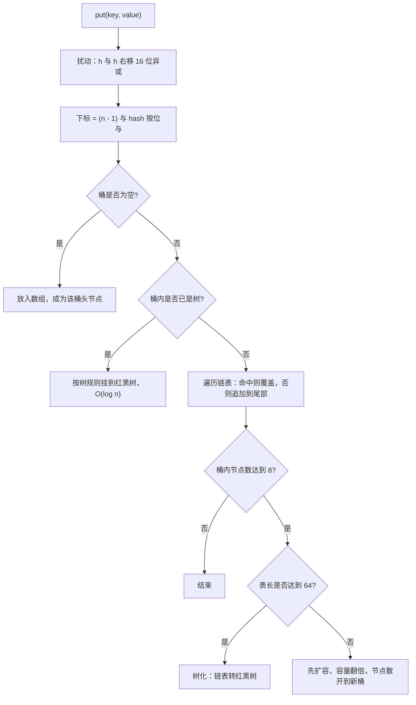

选集合只看两个问题：要不要按键取值，要不要顺序。按键取值就是 Map，按位置或迭代用 Collection；要顺序再分成「插入顺序」和「排序顺序」，前者交给 LinkedHashMap、LinkedHashSet，后者交给 TreeMap、TreeSet。ArrayList 和 LinkedList 的差异常被背反：绝大多数场景 ArrayList 更快，LinkedList 的优势只在头尾操作和「已经持有节点」时成立。HashMap 则是数组、链表、红黑树三者的混合，2 的幂、0.75、8 和 64 这几个数字彼此咬合，拆开看每一个都有理由。

## 先用一张表把方向定下来

大部分选型问题在这张表里就能收敛，剩下的才是细节。

| 实现 | 底层结构 | 顺序 | 判重依据 | 查找 | 适合什么 |
| --- | --- | --- | --- | --- | --- |
| ArrayList | 动态数组 | 插入顺序 | 不判重 | 下标 O(1) | 默认选它 |
| LinkedList | 双向链表 | 插入顺序 | 不判重 | 下标 O(n) | 当 Deque 用 |
| HashMap | 数组 + 链表 / 红黑树 | 不保证 | hashCode + equals | O(1) 均摊 | 按键取值 |
| LinkedHashMap | HashMap + 双向链表 | 插入或访问顺序 | 同上 | O(1) 均摊 | 遍历要可预测、LRU |
| TreeMap | 红黑树 | 键排序 | compareTo 为 0 | O(log n) | 范围查询、有序遍历 |
| HashSet | HashMap 的 key 集 | 不保证 | hashCode + equals | O(1) 均摊 | 去重 |
| TreeSet | TreeMap 的 key 集 | 排序 | compareTo 为 0 | O(log n) | 去重且有序 |

三条判断标准，按顺序问自己：

- **要不要键**：需要 `get(key)` 就进 Map 那半边，其余都是 Collection。
- **要不要序**：无所谓的选 Hash 系；要插入顺序选 Linked 系；要按大小排序或用范围查询选 Tree 系。
- **是不是只当队列用**：需要头尾进出、当栈或双端队列，才轮到 LinkedList 和 ArrayDeque。

## ArrayList 与 LinkedList：真正的差异不在增删

两者的差别不止是「数组 vs 链表」这个标签，而是三次成本的比较：找位置、搬数据、占内存。

ArrayList 底层是 `Object[] elementData`，默认构造只是给一个空数组，第一次 add 才扩到 10，此后每次不够用按 1.5 倍扩（`oldCapacity + (oldCapacity >> 1)`），并把旧数据整体复制过去。下标访问是一步到位的地址计算；中间插入和删除要 `System.arraycopy` 把后续元素整体挪一格，代价是 O(n)，但这是纯内存拷贝，单位成本极低。

LinkedList 是双向链表，节点 `Node` 里除了数据还存 prev、next 两个引用，同样实现了 Deque，所以头尾进出都是 O(1)。按索引取元素要走 `node(int)`：先比较 index 和 size/2，从前半段或后半段折半遍历过去，越靠近中间越慢。

把这两点放在一起，就有了几个常被忽略的结论。

- **插入位置的查找成本常常盖过插入本身**。`add(index, e)` 在 LinkedList 上要先遍历到 index，O(n)；ArrayList 上是一次数组拷贝，O(n)。同一个量级，但拷贝是连续内存的顺序读写，链表是随机跳指针，前者往往快一个数量级。
- **内存密度决定缓存命中率**。ArrayList 每个元素只占一个引用（压缩指针下 4 字节），LinkedList 每个元素是一个独立对象，对象头加两个引用，通常二三十字节起步。遍历同样一万个元素，前者几乎全在 CPU 缓存里，后者可能在反复追不连续的地址，还要制造更多 GC 压力。
- **按下标遍历是 LinkedList 的经典陷阱**。`for (int i = 0; i < list.size(); i++) list.get(i)` 会退化成 O(n²)，而 `for (Integer x : list)` 走迭代器，是 O(n)。

```java
// 反例：LinkedList 上用下标遍历，复杂度是 O(n²)
for (int i = 0; i < list.size(); i++) {
    process(list.get(i));
}
```

所以 LinkedList 的合理位置很窄：确实需要 Deque 语义（`offerFirst`、`pollLast`），并且操作集中在两端；或者手里已经拿着迭代器 / 节点，需要就地删除。除此之外，ArrayList 几乎总是更优的选择。

## HashMap 到底做了什么

### 一个数组，桶里挂链表，长了变红黑树

主体是一个 `Node[] table`，数组的每个槽位叫桶。键值对被打包成 `Node`（hash、key、value、next），哈希到同一个桶的节点用 next 串成单向链表。当某个桶的链表太长，链表会转成红黑树，最坏查找从 O(n) 降到 O(log n)。JDK 8 把新节点追加到链表尾部，JDK 7 是插到头部——这个改动后面会解释。



读一次 put 的路径也就清楚了：算 hash，算下标，桶空就直接放；桶里已经是树就按树插入；否则遍历链表，key 相同就覆盖 value，不同就追加到尾部，追加完再判断要不要树化。

### 哈希扰动与 2 的幂：一次位运算解决两件事

下标的计算是 `(n - 1) & hash`。容量为 16 时 `n - 1` 是 `0b1111`，只用到 hash 的最低 4 位，其余 28 位白算了。所以 HashMap 先做一次扰动：

```java
static final int hash(Object key) {
    int h;
    return (key == null) ? 0 : (h = key.hashCode()) ^ (h >>> 16);
}
```

把高 16 位异或到低 16 位，让高位也参与下标计算。这一步很便宜，一次移位加一次异或，却把「只有低位相似就会撞桶」的概率显著压下来。很多对象的 `hashCode` 低位规律性很强，比如自增 id 或字符串拼接的结果，不扰动的话冲突会很集中。

容量必须是 2 的幂，理由也在这里：只有当 n 是 2 的幂时，`n - 1` 的低位才全是 1，`(n - 1) & hash` 才恰好等价于 `hash % n`，而位与比取模快得多。如果 n 不是 2 的幂，掩码里会出现 0 位，对应的桶永远空着，数组被浪费，冲突反而更集中。因此 `tableSizeFor` 会把任何传入的容量向上取整到最近的 2 的幂，扩容也只做 ×2，好让这个性质一直成立。

> [!NOTE]
> `new HashMap<>(1000)` 的实际容量是 1024，不是 1000；而阈值 768 也不是构造时就定下来的，它要等第一次 put 触发真正的数组分配时才按「容量 × 负载因子」算出来。所以传初始容量时，传的是预估元素数，不是预估元素数除以 0.75。

负载因子定在 0.75，是空间与冲突的折中：调小则桶更容易空着、内存浪费，调大则链表更容易变长、查找变慢。还有一个实际考虑——0.75 乘以任何 2 的幂都是整数，阈值不会被截断成小数。

### 扩容与 8/64：两个阈值其实是一件事

元素个数超过阈值（默认 16 × 0.75 = 12）时触发扩容，容量翻倍，所有节点要重新分布到新表。JDK 8 在这里做了一个很漂亮的优化：不需要重新计算哈希和下标。因为容量翻倍只多出来一个参与下标计算的高位，用 `e.hash & oldCap` 一看便知——结果为 0 就留在原下标，否则落到「原下标 + oldCap」。一条链被拆成 lo、hi 两条，相对顺序保持不变。

::: code-group labels=[JDK 8 的拆分, JDK 7 的做法]

```java
// 只看新增的那一位：0 留在原位，1 移到原位 + oldCap
if ((e.hash & oldCap) == 0) {
    if (loTail == null) loHead = e;
    else loTail.next = e;
    loTail = e;
} else {
    if (hiTail == null) hiHead = e;
    else hiTail.next = e;
    hiTail = e;
}
```

```java
// 每个节点重新算一次下标，头插法把它挪到新桶的头部
int i = indexFor(e.hash, newCapacity);
e.next = newTable[i];
newTable[i] = e;
e = next;
```

:::

树化的一对阈值容易背混，其实是两件事：

- **8 是「桶内节点数」的门槛**。put 时如果某个桶的节点数达到 8，会去尝试树化。
- **64 是「表长」的门槛**。尝试树化前先看 `table.length`，小于 64 就不树化，直接扩容。因为小表里的长链，多半是桶太少导致的，把节点摊到更多桶里比维护一棵树更划算。
- **6 是退化门槛**。树节点数降到 6 及以下，红黑树转回链表。留出 7 这个缓冲带，避免在 8 附近反复树化、退化。

所以完整的判断顺序是：桶里到 8 → 表还没到 64 就先扩容 → 表到 64 了才真正树化。容量 16 时某个桶里堆了 8 个节点，实际发生的是扩容到 32、节点被拆散，而不是变成红黑树。

为什么是 8 而不是 5？源码注释给出的依据是泊松分布：负载因子 0.75 下，一个桶里的节点数达到 8 的概率约为 0.00000006，正常使用几乎不会触发树化。而 TreeNode 要额外维护 parent、left、right、prev 和颜色标记，内存约为普通 Node 的两倍，只在冲突极端时才值得付这个代价。

## 非线程安全长什么样，ConcurrentHashMap 又做对了什么

HashMap 的注释里写得很直接：不是线程安全的，多线程并发写必须外部同步。它的「不安全」有三种具体形态，危害依次递增。

- **成环**。JDK 7 的头插法加上并发扩容，两个线程同时搬迁同一条链，节点的 next 可能互相指回对方，链表变成环。之后任何一次 get 落到这个桶，就是死循环，CPU 一个核直接打满，栈里只剩 `HashMap.getEntry`。这是最出名的那种。
- **丢更新**。两个线程同时判断某个桶为空，各自 new 一个 Node 挂上去，后写的覆盖先写的，一条记录就这么没了。`++size` 也不是原子操作，计数同样会少。JDK 8 把插入改成尾插，环的问题基本消失，但覆盖和计数丢失一点没少。
- **读到中间状态**。扩容时 table 引用、节点的 next、value 都可能被其他线程看到半成品；迭代过程中结构被改，`modCount` 对不上，直接抛 `ConcurrentModificationException`。注意 fail-fast 只是尽力检测，不是并发保证——没抛异常不代表读到的数据是对的。

> [!WARNING]
> JDK 8 之后，HashMap 在并发下不再死循环，代价是从「明显挂死」变成「静默丢数据」。后者难查得多：接口不报错，监控没抖动，只是偶尔少一条订单、少一次计数。判断依据不是「有没有抛异常」，而是「有没有第二个线程在写」。

ConcurrentHashMap 的思路是缩小锁的范围，而不是消灭锁。

- **JDK 7 是分段锁**：内部拆成若干 Segment，每个 Segment 是一把可重入锁加一小段哈希表，不同段之间可以并行写。默认 16 段，理论并发度 16，但段划死之后扩容只能逐段来做。
- **JDK 8 去掉了 Segment，锁粒度落到桶**：桶为空时用 CAS 直接把新节点放上去，完全不加锁；桶非空时只 `synchronized` 锁住这个桶的首节点，再走链表或树的插入。锁的范围从一个段缩到一条链，并发度随桶数增长。
- **读基本无锁**：节点的 value 和 next 声明为 volatile，保证可见性，get 不需要加锁，也不会阻塞写。
- **扩容可以帮忙**：搬迁过的桶会放一个特殊占位节点（hash 为 -1，也叫 MOVED），其他线程撞见这个标记，就跟着一起搬，而不是干等。
- **size 是估计值**：用 baseCount 加一组计数单元分散累加，避免所有线程抢同一个字段。要精确值就得遍历整张表，代价太大，所以 `size()` 只承诺一个近似结果。
- **不允许 null**：键和值都不能为 null。并发下无法用一个 null 同时表达「键不存在」和「值就是 null」，这个歧义在单线程里靠 `containsKey` 绕得过去，在多线程里绕不过去。

选型上可以记成一句话：读多写少、只需要单次操作原子，用 ConcurrentHashMap；需要「先查再写」这种复合逻辑的原子性，用 `computeIfAbsent`、`merge`、`compute` 这些自带原子的方法，而不是自己 get 完再 put。

## HashSet、TreeSet 与 LinkedHashMap：顺序从哪里来

HashSet 就是一个只用到了 key 的 HashMap：value 统一放一个静态的 `PRESENT` 占位对象，`add` 返回 true 等价于 `put` 返回 null。所以它的全部特性都继承自 HashMap——O(1) 均摊、不保证顺序、判重靠 hashCode 加 equals、允许一个 null。不保证顺序的意思是「不保证存放和取出的顺序一致」，不是「每次遍历顺序都不同」：同一个对象、同样的插入操作，遍历顺序是稳定的，只是这个顺序对使用者没有意义。

TreeSet 基于 TreeMap，底层是红黑树，三个关键差异都和「比较」有关。

- **判重不看 equals，看 compareTo 或 Comparator 是否为 0**。两个 equals 为 false、compareTo 返回 0 的对象，TreeSet 视为同一个元素。用「只比较 id」的 Comparator 去装内容不同的对象，会静默吞掉后进来的那个。
- **不接受 null**。自然排序下，第一个 null 插入时比较就会 NPE；就算用自定义比较器勉强放进去，后续的排序和查找也很容易出问题。
- **要求参与比较的字段不可变**。元素放进去之后改了排序字段，树的结构就和元素的实际大小对不上了，查找、删除都会失灵。

换来的能力是排序和范围操作：`first`、`last`、`ceiling`、`floor`、`higher`、`lower`，以及 `headSet`、`tailSet`、`subSet`。代价是每次操作 O(log n)，并且每次比较都要走一遍 compareTo。所以「只是去重」用 HashSet，「去重且要按序遍历或取区间」才用 TreeSet。

LinkedHashMap 继承 HashMap，只多了一样东西：每个 Entry 增加 before、after 两个引用，把所有 entry 串成一条双向链表，哈希表负责快速定位，链表负责记住顺序。默认是插入顺序——第一次插入的位置决定遍历顺序，重复 put 同一个 key 只更新 value、不改变位置，remove 之后再 put 会排到末尾。

把构造参数 `accessOrder` 传成 true，顺序就变成访问顺序：每次 get 或 put 命中的节点会被移到链表尾部，于是链表头就是「最久没被访问」的那个。再重写 `removeEldestEntry`，就是一个现成的 LRU。

```java
// 容量 128 的 LRU：accessOrder = true，超限时自动淘汰最久未访问的节点
Map<String, Integer> lru = new LinkedHashMap<>(16, 0.75f, true) {
    @Override
    protected boolean removeEldestEntry(Map.Entry<String, Integer> eldest) {
        return size() > 128;
    }
};
```

LinkedHashSet 则是 LinkedHashMap 的 key 集，所以它同时具备去重和插入顺序。三者的分工可以这样记：Hash 系管快，Linked 系管顺序可预测（遍历时不必扫描整张表，也省一点开销），Tree 系管排序和范围。

## 自检清单

- 选 LinkedList 的理由是「增删快」吗？插入位置是怎么找到的，遍历用的是 `get(i)` 还是迭代器？
- 预估容量时，传的是元素个数，还是元素个数除以 0.75？知道 `new HashMap<>(1000)` 实际是 1024 吗？
- 能说清 8 和 64 分别约束什么、谁先触发吗？容量 16 时某个桶到了 8 个节点，接下来发生的是树化还是扩容？
- 容量为什么必须是 2 的幂？扩容时为什么可以不重新计算哈希和下标？
- 这个 HashMap 会被多个线程写吗？如果会，在 JDK 8 上是死循环还是静默丢数据？
- 用 ConcurrentHashMap 的地方，`get` 之后 `put` 的两步判断换成 `computeIfAbsent` 了吗？
- TreeSet 里的比较器和 equals 一致吗？参与比较的字段是不可变的吗？
- 需要 LRU 时，是引了第三方缓存，还是 LinkedHashMap 加 `removeEldestEntry` 就够了？

这几条答得上大半，集合的选型和 HashMap 的边界基本就不会踩坑；答不上来的那条，通常就是线上那个「偶尔少一条数据」的来源。
