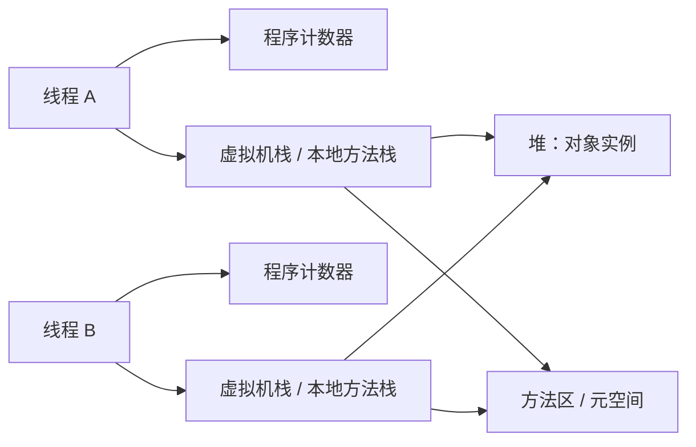
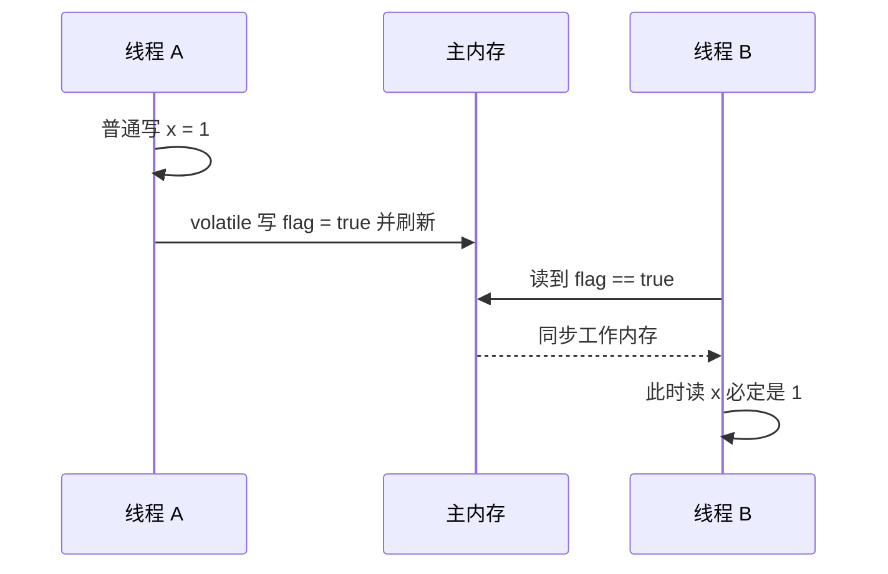

一段代码在单线程里跑得好好的，放进两个线程就开始时对时错：A 线程改了标志位，B 线程却像没看见一样继续用旧值；单例的空判断偶尔失效，于是被构造了两次。这类问题的根源往往不在语法，而在于我们默认了「写在前面就一定先被看到」。JMM 真正规定的是「一个线程的写入，在什么条件下对另一个线程可见」，而不是「对象该放堆还是放栈」。把内存区域和 JMM 当成两个层次来看，很多困惑会立刻消失。

## 内存区域回答「放在哪」，JMM 回答「看得见什么」

JVM 的运行时数据区通常划分为五块，按线程是否共享可以分成两组。

- **程序计数器**：当前线程所执行字节码的行号指示器，是规范中唯一不会抛出 `OutOfMemoryError` 的区域。
- **虚拟机栈**：线程私有，每次方法调用创建一个栈帧，存放局部变量表、操作数栈、动态链接和方法出口信息。栈深度超限时抛出 `StackOverflowError`。
- **本地方法栈**：为 `native` 方法服务。HotSpot 通常把它和虚拟机栈合并实现，但这是实现选择，不是规范强制。
- **堆**：所有线程共享，存放对象实例和数组，是垃圾收集的主要区域。
- **方法区**：线程共享，保存类的元信息、运行时常量池、静态变量等。较新的实现用元空间（Metaspace）来落地方法区，它占用的是本地内存而不是堆内存。



这张图只回答了「数据存在哪里」，但并发 bug 几乎都发生在下一步：一个线程写进去的值，另一个线程什么时候能读到。JMM 是更高一层的抽象，它把每个线程想象成拥有自己的工作内存，共享变量放在主内存，线程的读写先落在工作内存，再由 JMM 规定何时同步回主内存、何时从主内存刷新。要注意这是规范层面的模型，不等同于真实的 CPU 缓存结构，但用它来推理可见性足够可靠。

## 并发的三大特性：原子性、可见性、有序性

排查并发问题时，先判断被破坏的是哪一条特性，比漫无目的地加锁有效得多。

**原子性**指一个或多个操作要么全部完成且中间不被中断，要么都不执行。`count++` 看起来是一行，实际是「读—改—写」三步，任何两步之间都可能被线程切换打断。语言规范只保证基本类型的单次读写是原子的（`long`、`double` 这类 64 位类型在 32 位实现上曾被允许拆成两次写），引用赋值也是原子的；只要涉及复合操作，就必须靠锁、`AtomicInteger` 或 CAS 来保证。

**可见性**指一个线程修改了共享变量后，另一个线程能否读到新值。CPU 缓存、编译器优化、指令重排都可能让修改「停在半路」。`volatile`、`synchronized` 以及正确构造后不再逃逸的 `final` 字段，是 Java 里主要的可见性保障手段。

**有序性**指程序的实际执行顺序与代码书写顺序一致。出于性能考虑，编译器和处理器会在不改变单线程语义的前提下重排序指令，这就是 `as-if-serial` 约定：单线程内结果不变，但多线程下看到的中间状态可能完全出乎意料。Java 通过 happens-before 规则来告诉开发者「哪些重排序被禁止」。

> [!NOTE]
> 「单线程下结果正确」不能证明并发下安全。`as-if-serial` 只对单线程负责，它允许重排序改变其他线程观察到的中间状态。

## happens-before：一份可操作的可见性约定

happens-before 是 JMM 交给开发者的推理工具。它的含义是：如果操作 A happens-before 操作 B，那么 A 的结果对 B 可见，并且 A 的执行顺序排在 B 之前——这里的「之前」是 JMM 语义下的顺序，不一定是 CPU 实际执行的时间顺序。

常用的规则有这么几条：

- **程序次序规则**：同一线程内，书写在前的操作 happens-before 书写在后的操作。
- **监视器锁规则**：对同一个锁的解锁操作 happens-before 后续对它的加锁操作。
- **volatile 规则**：对 `volatile` 变量的写 happens-before 后续对同一变量的读。
- **线程启动规则**：`Thread.start()` happens-before 新线程中的任何操作。
- **线程终止规则**：线程中的所有操作 happens-before 其他线程从 `join()` 返回或观察到 `isAlive()` 为 `false`。
- **中断规则**：对线程 `interrupt()` 的调用 happens-before 被中断线程检测到中断事件。
- **传递性**：若 A happens-before B，B happens-before C，则 A happens-before C。



这套规则的价值在于：它把「猜测硬件会不会乱序」变成了「检查两个操作之间有没有 hb 关系」。没有 hb 关系的两个操作，JMM 允许它们以任意顺序被观察到，数据竞争就诞生在这里。传递性则是最常被忽略的一条——`volatile` 只保护它自己那次读写，前面那个普通写之所以安全，是靠「程序次序 + volatile 规则 + 传递性」串起来的。

## volatile：可见性与禁止重排序，但不保证原子性

`volatile` 的两条核心语义需要分开记：

1. **可见性**：对 `volatile` 变量的写会立即刷新到主内存，读之前会从主内存刷新，因此写的结果对后续的读可见。
2. **禁止重排序**：`volatile` 写之前的读写不能排到写之后，`volatile` 读之后的读写不能排到读之前。实现上通常是在读写前后插入内存屏障。

它不保证原子性。`volatile int count` 上的 `count++` 依然是三步，多线程同时自增照样丢更新。`volatile` 适合表达状态标志、一次性安全发布这类「一个线程写、多个线程读」的场景，而不是计数器。

最经典的用法是双重检查锁的单例。只有加上 `volatile`，这个写法才真正成立：

::: code-group labels=[Java, 说明]

```java
public class Config {

    private static volatile Config instance;

    public static Config getInstance() {
        if (instance == null) {                 // 第一次检查，避免每次都加锁
            synchronized (Config.class) {
                if (instance == null) {         // 第二次检查，防止重复创建
                    instance = new Config();
                }
            }
        }
        return instance;
    }
}
```

```text
没有 volatile 时，instance = new Config() 可能被拆成三步：
分配内存 -> 初始化对象 -> 把引用赋给 instance。
重排序可能把它变成：分配内存 -> 赋引用 -> 初始化。

此时另一个线程在第一次判空时看到 instance 非 null，
拿到的却是一个尚未初始化完成的对象。

volatile 禁止这种重排序，同时保证引用赋值后的可见性。
```

:::

需要提醒的是：`volatile` 不提供互斥。两个线程同时写同一个 `volatile` 变量，结果仍然取决于谁最后写，中间过程无法原子化。

## synchronized：锁的语义里已经包含内存语义

`synchronized` 常被当成「互斥」的同义词，但它同时解决了三大特性中的另外两个。

- **原子性**：同一时刻只有一个线程能进入临界区，临界区内的复合操作自然成为整体。
- **可见性**：解锁前对共享变量的修改会刷新到主内存，加锁后会清空本地副本、重新从主内存读取。这正是监视器锁 happens-before 规则的直接体现。
- **有序性**：临界区内部的指令仍可重排序，但重排序不能把临界区内的操作挪到锁外面去，所以「解锁之前的写」一定发生在「加锁之后的读」之前。

使用时有几个容易踩的点：锁的是对象而不是代码块，静态方法上的 `synchronized` 锁的是 `Class` 对象；多个互相关联的变量要用同一把锁保护，用两把锁分别保护反而更糟；锁的粒度要按临界区实际范围来定，过粗会拖慢吞吐，过细则容易漏锁。

`synchronized` 与 `volatile` 的取舍可以这样判断：只需要「发布一个状态给其他线程看」，用 `volatile`；需要「多个线程按顺序、互斥地修改一组状态」，用锁。现代 JVM 通常会对 `synchronized` 做锁消除、锁粗化等优化，在大多数场景下不必因为性能顾虑而刻意回避它。

## 自检清单

- 这段共享可变状态，是由哪个操作「发布」出去的？发布动作有没有 hb 关系兜底？
- 涉及读—改—写的复合操作，是否用了锁或原子类，而不是 `volatile`？
- `volatile` 变量是否只承担状态标志和一次性发布的职责，没有被当成计数器？
- 两个有约束关系的变量，是否被同一把锁保护？
- 能否用 happens-before 规则，逐步说清「为什么另一个线程一定看得到这个值」？

如果最后一条答不上来，说明这段代码的正确性还依赖运气，值得回头补一补 JMM 这块地基。
