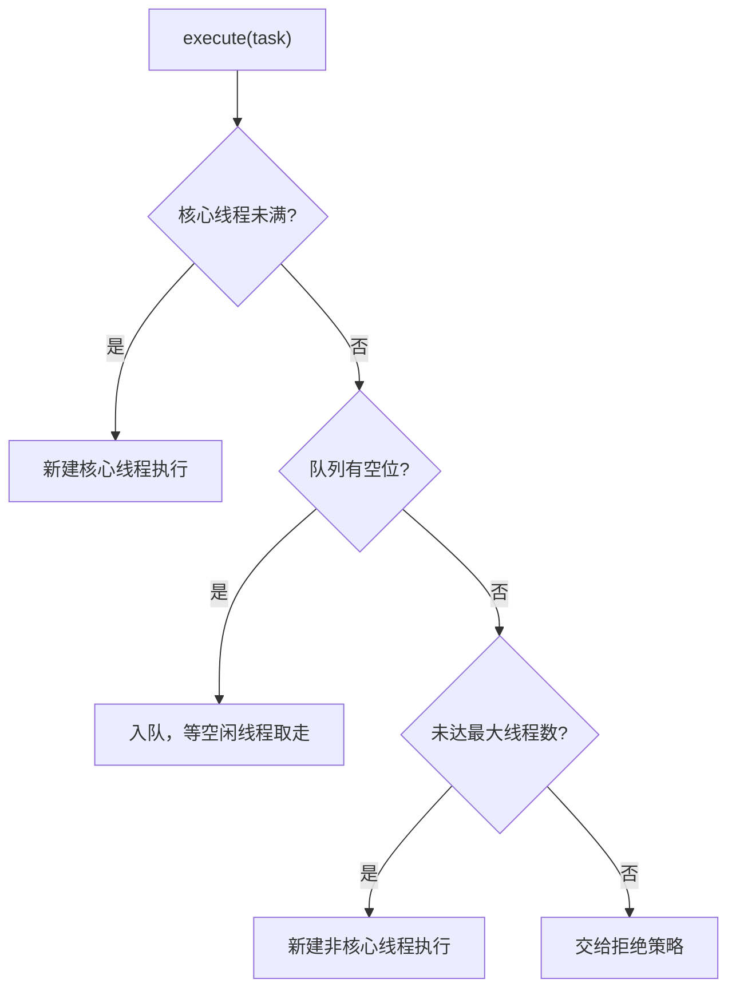
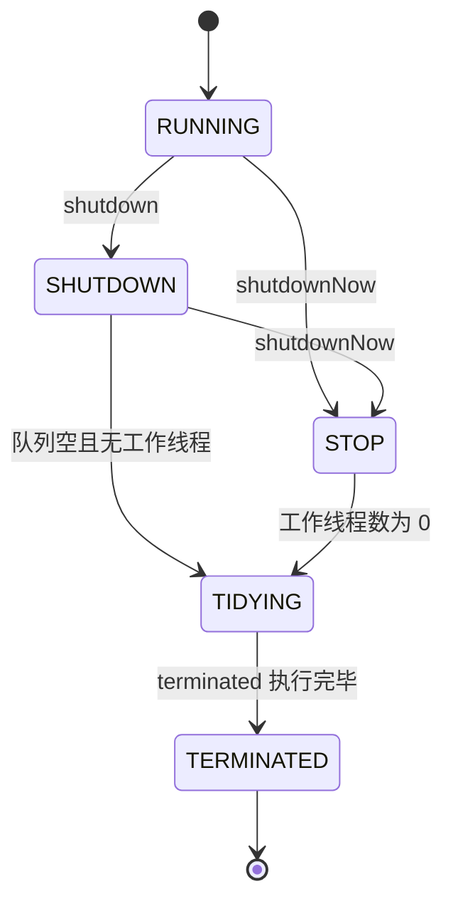

线程池的七个参数里，真正需要判断的只有两个：队列有没有界、拒绝策略怎么兜。其余五个要么跟着这两个走，要么在默认值上悄悄失效。更反直觉的是提交顺序——任务先占核心线程，再进队列，队列满了才扩线程，最后才轮到拒绝策略。把这个顺序记牢，七个参数就不需要背。

## 七个参数，先分成「管线程」与「管任务」两组

core、max、keepAlive 与 unit 管线程，workQueue 与 handler 管任务去处，threadFactory 负责把线程造出来。

- **corePoolSize**：常驻线程数。即使全部空闲，池也保留这么多线程，默认不回收。
- **maximumPoolSize**：线程数上限，必须不小于 core。它约束线程数量，不是队列长度。
- **keepAliveTime / unit**：超出 core 的那部分空闲线程能活多久，unit 是时间单位。
- **workQueue**：已提交未执行任务的容器，容量决定 maximumPoolSize 有没有机会被用到。
- **threadFactory**：创建线程的地方。默认工厂的线程名形如 `pool-1-thread-1`，非守护，异常直接打到标准错误；生产上至少改成能认出业务的，否则 jstack 里满屏线程编号。
- **handler**：饱和时的出口，四个内置策略后面展开。

容易记错的是 keepAliveTime 只管「超出 core 的那部分空闲线程多久被回收」，不是任何线程空闲多久都会被回收。核心线程默认永生，想让它也超时得额外打开 `allowCoreThreadTimeOut`。

顺带记一个等式：池能同时容纳的任务上限是 maximumPoolSize 加队列容量，两者不是二选一的关系。

## 提交顺序：核心线程 → 队列 → 非核心线程 → 拒绝策略

`ThreadPoolExecutor.execute` 的主体只有三步，但和直觉刚好相反。

1. 线程数小于 corePoolSize：新建一个核心线程执行，即使此刻有空闲线程也照样新建，它不排队。
2. 已达 corePoolSize：尝试入队。入队成功后还会再查一次池状态，如果池已关闭或工作线程意外归零，就补一个线程兜底。
3. 入队失败，即队列满了：才尝试新建线程，一路建到 maximumPoolSize；仍失败，交给拒绝策略。



换个说法：队列的优先级高于扩容。人不够时，线程池第一反应是让任务排队，而不是加人；只有队伍排不下，它才开始加人。这个顺序解释了几件平时看着奇怪的事。

- core=8、max=64、队列容量 10000：线程数几乎永远停在 8，要摸到 9 到 64 这段，得先堆满 10000 个任务。
- 队列无界：`new LinkedBlockingQueue<>()` 不传容量就是 `Integer.MAX_VALUE`，第 3 步永不发生，maximumPoolSize 与 keepAliveTime 双双失效，池退化成「固定 8 线程 + 无限积压」。
- 队列是 `SynchronousQueue`：容量 0，入队必定失败，每个任务都走第 3 步，来一个扩一个直到 max——`newCachedThreadPool` 就是这么拼出来的。

这也解释了为什么 core 设得很小、队列又很大时，吞吐会被 core 死死卡住：线程数上不去，队列再长也只是让任务多等一会儿。

> [!WARNING]
> 在有界大队列下，把 maximumPoolSize 从 16 调到 64 大概率什么都不会变。先看队列容量，再谈扩容。

## 四种拒绝策略：默认的最吵，也最安全

- **AbortPolicy（默认）**：抛 `RejectedExecutionException`。任务丢了，但调用方立刻知道，失败可见是它最大的优点。
- **CallerRunsPolicy**：不抛也不丢，让提交线程自己跑。提交方变慢，队列自然不再涨，等于自带背压。代价是提交线程被占住，若它是 Web 容器的工作线程，一个慢任务就能拖住整条链路；池已 shutdown 时，JDK 还会直接丢弃任务。
- **DiscardOldestPolicy**：扔掉队头等得最久的那个，再重试提交当前任务。丢得无声无息；队列若是 `PriorityBlockingQueue`，`poll()` 取走的恰恰是优先级最高的，丢的是最不该丢的。
- **DiscardPolicy**：直接丢，连异常都不给。只有「任务可丢」成立时才合理，比如采样日志。

自定义 handler 是这里最省事的改法：把被拒任务的类型和数量记下来，再决定抛异常、降级还是转异步入队重试。

还有一处与 `submit()` 相连的坑：它把任务包成 FutureTask，一旦被丢弃策略静默丢掉，FutureTask 永远停在未完成状态，之后 `get()` 便无限阻塞。要么统一用 `execute()`，要么给 `get()` 加超时，要么在自定义 handler 里把它 `cancel` 掉。

## 有界还是无界：队列选错，另外两个参数就换了含义

无界队列的坑不在「会不会满」，而在「满之前会发生什么」：任务一直堆到 OOM，期间接口不报错，只是越来越慢、GC 越来越频繁。这类故障最难定位，因为没有环节明确失败。

有界队列也不自动等于安全，容量要算。起点是 core 乘单任务平均耗时，估出「允许积压多久」；再乘每秒到达量得到容量，回头核对内存：单个任务多大，乘以容量就是最坏情况下多出来的堆。

队列类型会直接改写参数语义：`ArrayBlockingQueue` 的容量是硬上限，满了才扩容、才拒绝；`SynchronousQueue` 只做交接，配大 max 就是缓存池风格；优先级队列则要注意 `poll()` 取的是队列头，不是最早进来的那个。

`Executors` 的快捷方法正好踩在这些坑上：`newFixedThreadPool` 与 `newSingleThreadExecutor` 用无界队列，`newCachedThreadPool` 的 max 是 `Integer.MAX_VALUE`。所以生产代码更常见的写法是直接构造，把七个参数写清楚：

::: code-group labels=[快捷工厂, 手动构造]

```java
// core = max = 8，队列是无界的 LinkedBlockingQueue
ExecutorService pool = Executors.newFixedThreadPool(8);
```

```java
ThreadPoolExecutor pool = new ThreadPoolExecutor(
    8, 16, 60L, TimeUnit.SECONDS,
    new ArrayBlockingQueue<>(200),
    r -> {
        Thread t = new Thread(r, "order-worker");
        t.setDaemon(false);
        return t;
    },
    new ThreadPoolExecutor.AbortPolicy());
```

:::

## 配多少与怎么收：估算公式与优雅关闭

线程数没有标准答案，只有估算起点。

- CPU 密集型（计算、序列化、加解密）：`N = 核数 + 1`，多出的那个用来在偶发缺页、短暂阻塞时补位。
- IO 密集型（RPC、数据库、文件）：`N = 核数 × (1 + 等待时间 / 计算时间)`。等待比靠实测，APM 的耗时分布或 arthas 的调用栈都能拿到，凭感觉填 0.9 只会得到一个好看的数字。
- 再用 Little 定律校验：并发数 = 吞吐 × 延迟。2000 QPS 配 50ms 的单请求，至少要 100 个并发在跑。

core 也不建议设成 0，除非队列是 `SynchronousQueue` 且你接受「来一个任务建一个线程」的代价。

两个约束比公式更硬：池大小不能超过下游的并发容量，数据库连接池只有 20 个连接时，开 200 个线程只是把排队挪到了连接池；线程本身也占内存，默认栈约 1MB，池大加上队列大，堆内堆外一起涨。公式只是起点，上线后拿 `getActiveCount()`、`getQueue().size()` 和拒绝次数回来校正。

> [!TIP]
> 参数是猜出来的，容量是量出来的。至少把队列长度和拒绝次数打到监控里，否则无法判断离饱和还有多远。

收尾同样容易被忽略。线程池的状态只有五个，流转方向是固定的。



`shutdown()` 把状态置为 SHUTDOWN，不再接收新任务，队列里的任务继续跑完；`shutdownNow()` 置为 STOP，中断所有工作线程，并返回队列里还没开始的任务。中断只是「打个招呼」，不响应中断的任务照样跑完，所以它替代不了「任务本身可中断」的设计。

```java
pool.shutdown();
if (!pool.awaitTermination(30, TimeUnit.SECONDS)) {
    List<Runnable> dropped = pool.shutdownNow();
    log.warn("{} tasks never started", dropped.size());
}
```

顺序是：先停止接流量，再 `shutdown()`，再 `awaitTermination` 等一个明确的超时，最后才 `shutdownNow()`。反过来做，队列里排着的任务会被成批丢掉。另外 shutdown 之后再 `execute` 提交任务会被直接拒绝，所以「先切流量」不是风格问题，而是顺序问题；进程退出前没等待，队列里的任务就真的消失了。

## 自检清单

- 队列有界吗？容量是按什么算出来的，还是随手填的 1024？队列很大时，maximumPoolSize 还有机会生效吗？
- 拒绝策略是默认的 AbortPolicy 吗？提交方接住了 `RejectedExecutionException` 吗？
- 用 `submit()` 的地方，任务被静默丢弃后，`Future.get()` 会不会永久卡住？
- 线程工厂给了可读的名字吗？jstack 里能一眼认出是哪个池吗？
- 线程数是按核数与等待比推出来的，还是抄的？队列长度和拒绝次数有监控吗？
- 关闭走的是 `shutdown` → `awaitTermination` → `shutdownNow`，还是直接 `shutdownNow`？

这七条能答上五条，配置基本不会出大问题；答不上来的那几条，通常就是下次故障的位置。
