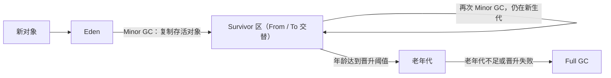
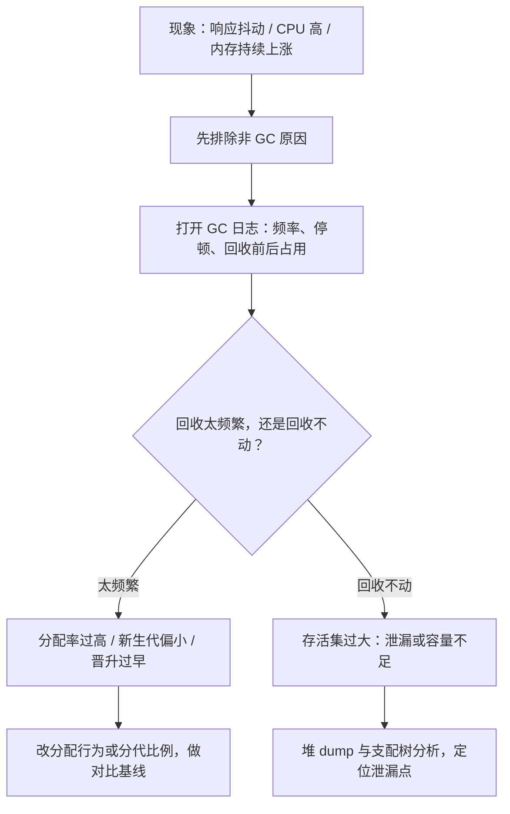

垃圾回收要解决的不是「怎么把内存清干净」，而是「用尽可能小的代价识别出没用的对象，并收回它们的空间」。分代不是装饰，而是把「对象大多朝生夕灭」这条经验折成工程折中：新生代用复制换效率，老年代用标记-整理换空间利用率。三种算法的取舍、几个收集器的定位、Full GC 的触发条件，最终都指向同一个问题：你怕的是停顿，还是吞吐。

## 为什么分代：弱代假设与朝生夕灭

判断对象是否存活，主流实现用可达性分析，而不是引用计数。从 GC Roots 出发遍历引用链——栈上的局部变量、静态属性、常量池、JNI 引用都是根——走不到的对象就是垃圾。引用计数更直观，但每次赋值都要维护计数，也处理不了循环引用，所以 HotSpot 没采用它。

分代来自两条经验假设：

- **弱代假设**：绝大多数对象在创建后很快就不再使用——临时拼接的字符串、循环里的中间结果、一次请求的 DTO。
- **强代假设**：熬过越多次回收的对象，越可能继续活下去——缓存、连接池、单例、框架元数据。

两条合起来，回收的性价比就清楚了：只扫「大概率是垃圾」的区域，能用很小的成本换回大量空间；几乎不会死的对象，扫一百遍也回收不到几 KB。于是堆被切成新生代和老年代，前者频繁、小步回收，后者不频繁、但单次代价大。



分代的代价在跨代引用。老年代对象可能引用新生代对象，Minor GC 若只看新生代就会误杀。做法是在老年代一侧记录「哪些对象指向新生代」，也就是记忆集（通常用卡表实现），Minor GC 时并入 GC Roots 一起扫。分代的真正成本在这里，不在划分本身。

## 三种回收算法的取舍

三种基本算法的差别，归到三个维度：内存整不整齐、利用率高不高、回收要付多少额外工作。

**标记-清除**最直白：先标记所有可达对象，再遍历堆把没标记的清掉。好处是不移动对象，地址不变、引用不用更新；代价是两遍完整遍历，且清完留下大量不连续空洞，分配大数组时可能明明有空间却找不到连续的一段。

**复制**把内存分成两块轮换使用，回收时把存活对象复制到另一块，再整块释放原区域。成本只与存活对象数量有关，复制完天然紧凑，分配只需挪一下指针。缺点是必须预留空闲区、利用率打折，存活率高时几乎等于把所有对象搬家并逐条修正引用。

**标记-整理**是折中：标记后把可达对象向一端压实，清掉边界之外的部分。既无碎片，也不必预留一半空间，代价是移动对象要更新引用、多次遍历堆，停顿通常更长。

| 算法 | 内存整齐度 | 内存利用率 | 主要代价 | 划算的前提 |
| --- | --- | --- | --- | --- |
| 标记-清除 | 差，有碎片 | 高 | 两遍全堆遍历 | 能接受碎片 |
| 复制 | 好，天然紧凑 | 低，要留空闲区 | 复制并修正引用 | 存活率低 |
| 标记-整理 | 好，无碎片 | 高 | 移动对象，停顿长 | 存活率高 |

> [!NOTE]
> 算法没有优劣，只有匹配。判断标准不是「哪个更先进」，而是「这块区域的存活率有多高」：存活率低，复制的成本趋近于零；存活率高，复制就等于搬走整个区域。

## 新生代用复制，老年代用标记-整理

这正对应上面那条标准。

新生代的对象几乎活不过第一次回收。用复制，回收时只需搬走那一小撮幸存者，其余整块丢弃。实现上并不真的对半分：新生代由一块 Eden 和两块 Survivor 组成（默认 8:1:1），平时只用 Eden 加其中一块分配对象，回收时把存活者复制到另一块，保留空间只占一成。对象每熬过一次 Minor GC 就长一岁，年龄够了就晋升，避免在新生代里被反复搬运。

老年代相反：能在这里安家的，本就熬过多轮回收，存活率很高。再用复制，等于每次把老年代整体搬一遍，还要额外预留同样大的空闲区。所以只能用标记-整理，或者像 CMS 那样退一步用标记-清除，用碎片和更长的单次停顿换空间利用率。

有个例外值得记住：超大对象可以直接进老年代。它在 Eden 和 Survivor 之间被反复复制，代价远大于直接占位。批量任务里「很快死亡但体积不小」的对象，看着短命，却容易因体积直接落到老年代，把它提前推满——很多「全是短命对象却频繁 Full GC」的怪现象就出在这里。

## 常见收集器：各自的目标与适用场景

收集器的分歧，说到底是「愿意为停顿付出多少吞吐」。

- **Serial**：单线程、全程 Stop The World。堆小、核少的场景仍然够用，也是其他收集器某些阶段的兜底。
- **Parallel**：多线程并行回收，目标是吞吐量——把 GC 占的时间比例压到最低，允许较长停顿。批处理、离线计算、报表导出适合它；判断标准很直接：用户等不等得起。
- **CMS**：以最短停顿为目标，标记和清除的大部分阶段与用户线程并发。代价是碎片、浮动垃圾，以及老年代填满时退回 Full GC。它后来被移出 JDK，但「并发标记加并发清除」的思路被继承了下来。
- **G1**：把堆切成等大的 Region，按允许的停顿时间挑回收价值最高的区域来收，因此停顿可预测；整体标记-整理，局部复制。适合大堆、停顿要求明确的服务端应用。
- **ZGC**：标记和对象转移都做成并发，停顿只与 GC Roots 的规模有关，基本不随堆变大、存活对象变多而放大。适合超大堆加极低延迟，代价是更高的 CPU 和内存开销。

选择思路一句话：先确认怕的是停顿还是吞吐。怕停顿，在 G1 和 ZGC 之间按堆大小选；怕吞吐、能接受长停顿，Parallel 往往更划算；只在堆很小或求极简部署时才考虑 Serial。CMS 没有理由在新项目里用。

## Full GC 什么时候发生，以及怎么排查

### 触发 Full GC 的常见原因

- **老年代装不下晋升对象**：晋升速率超过回收速率，或单次晋升量太大，找不到连续空间容纳。
- **并发收集来不及**：CMS 的并发模式失败、G1 的疏散失败与大对象分配失败，都指预留空间不够，只能停下来做整堆回收。
- **元空间不足**：加载新类时顶到上限，会先回收再尝试扩容；动态生成类、反射、热部署、字节码增强都会加速这一过程。
- **显式调用 `System.gc()`**：不少中间件靠它清理直接内存，是否禁用要先确认依赖。
- **日志标签含义不同**：G1 的 Full GC 往往是退化后的整堆回收，代价远高于常规 Young GC，看到就该查原因，而不是当成正常现象。

> [!NOTE]
> 启动和发布阶段反复出现由元空间触发的 Full GC，通常不是堆的问题：类加载把元空间推过阈值，回收后类还在，于是隔一会儿再来一次。与其调堆，不如先给元空间一个合理的初始值和上限。

### 排查顺序

先把「是不是 GC 的问题」确认下来，再谈调优。GC 只是嫌疑之一，下游超时、线程池打满、慢查询都会表现成相似的抖动。



1. **对齐时间点**：抖动发生在固定周期、流量高峰，还是发布之后？周期指向定时任务，高峰指向容量，发布之后先看元空间和类加载。
2. **打开 GC 日志**：先有数据再谈结论。看频率、单次停顿时长的分布、回收后老年代能否回落。平均值会骗人，尾部停顿才是用户感知到的卡顿。
3. **判断是「太频繁」还是「回收不动」**：回落明显又快速涨回，是分配率或新生代偏小；几乎不回落，是存活集真的变大了。
4. **看对象分布**：直方图和堆 dump 会告诉你哪类对象在占空间；没有这一步，后面的调整全是猜。
5. **区分泄漏与容量不足**：泄漏要改代码——无界缓存、ThreadLocal 用完不 remove、监听器不注销、静态集合只增不减；容量不足才轮到调堆和换收集器。
6. **一次只改一个变量，并留下基线**：同样的流量、同样的压测脚本，对比改前改后的停顿分布。同时改三个参数，等于什么也没验证。

::: code-group labels=[诊断命令, 该看什么]

```bash
# JDK 9+ 统一日志：GC 基本信息、停顿与晋升情况
java -Xlog:gc*:file=gc.log:time,uptime,level,tags -jar app.jar

# 运行中查看堆与各分代的占用概况
jcmd <pid> GC.heap_info

# 每秒采样一次分代使用率，观察增长趋势
jstat -gcutil <pid> 1000
```

```text
频率：Minor GC 多久一次，Full GC 是否周期性出现。
停顿：看分布而不是平均值，尾部才是用户感知到的卡顿。
效果：每次回收后老年代占用是否回落。

回落又快速涨回 —— 分配率或新生代容量的问题。
几乎不回落       —— 存活集变大，先怀疑泄漏。
每次都在涨       —— 泄漏几乎可以确定。
```

:::

## 自检清单

- 这个应用怕的是停顿还是吞吐，收集器的选择有没有对上这个目标？
- 看到 Full GC 时，是先查触发原因，还是直接去调堆大小？
- 新生代与老年代的容量比，是按存活率估的，还是照抄了别人的配置？
- 代码里有没有无界缓存、静态集合、未注销的监听器、未 remove 的 ThreadLocal？
- 这轮调优留下了改前改后的对比基线吗，还是只凭「感觉快了一点」？

如果几条答不上来，问题多半不在参数上，而在对「对象活多久、活多少」还没有判断。先把存活率看清，收集器和参数的选择自然就收敛了。
