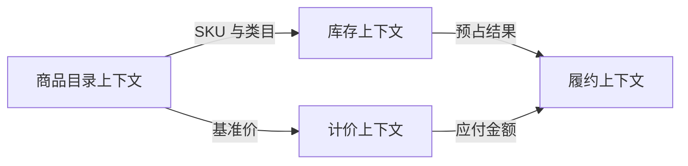
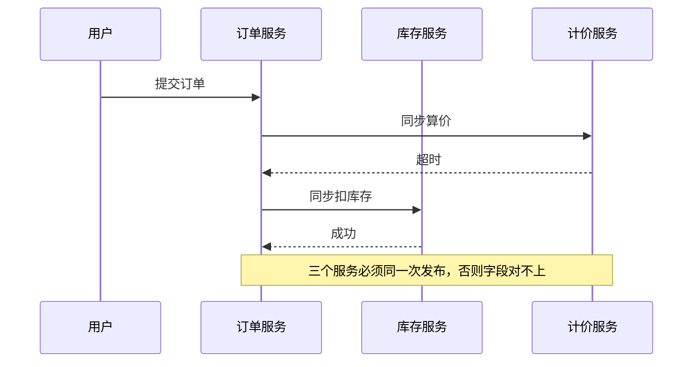

微服务不是架构升级的默认答案，它本质上是一次置换：把「进程内的方法调用」换成「跨网络的远程调用」，用运维复杂度去换独立演进的能力。该拆的信号从来不是代码行数，而是发布开始互相拖累、团队开始互相等、某一段负载扛不住却只能整包扩容。反过来，如果还没有清晰的业务边界、可观测性和自动化部署，拆完得到的不是微服务，而是一个更难排查的分布式单体。

## 一、单体真正的痛点不是「代码多」

代码多只会让编译慢一点、新人上手久一点，这些成本能靠模块化和规范缓解。真正让人想拆的是三件事。

**发布耦合。** 一行改动要和全团队的改动打成一个包发布，发布窗口成了公共资源，频率只能降到「最慢那个模块」的水平。更麻烦的是失败面：一次发布出错，回滚的是所有人的改动，没人说得清是哪一段引入的。

**团队互相阻塞。** 共享一个代码库、一条主干，A 组改订单表结构，B 组的集成测试就红了；所有权模糊，评审变成跨组谈判；一个需求什么时候上线，取决于最慢的那条链路。

**局部扩容困难。** 秒杀流量只压在一个详情接口上，单体却只能整包加机器：热点被复制，冷的也被复制，成本按最热的那段付。

所以判断要不要拆，只看这三条有没有一条已经影响到交付；一条都不严重，单体就是当下的正确选择。

> [!NOTE]
> 一个比代码行数更可靠的口径：过去一段时间发了几次版、每次发布要几个人确认、扩容时是不是被迫复制整个应用。这三条里若已有两条很难受，才轮到讨论拆分。

## 二、拆之前必须先还的三笔债

**第一笔：明确的业务边界。** 边界不清就拆，只是把进程内的耦合搬到网络上，调用还从「编译期能查错」退化成「运行时才报错」。判断边界是否清楚看两点：能不能一句话说清这个服务不做什么；数据有没有唯一的主人。两块数据必须由同一个事务改，大概率属于同一个边界。

**第二笔：可观测性。** 单体里一次请求就在一个进程内，一个日志文件加断点基本够用。拆开后一次请求跨多个进程，没有贯穿的 trace id、没有统一的指标和日志聚合，排障会从「看日志」变成「拼线索」。最低要求三样齐备：调用链能串起一次请求，每个服务都有延迟与错误率指标，日志能按请求 id 聚合。

**第三笔：自动化部署。** 服务一多，靠人登录机器改配置、重启进程，发布就会变成没人敢做的事。需要可复现的构建产物、可重复的部署流程、一条命令完成回滚。CI/CD 在这里不是提效工具，而是拆分的安全带。

顺序上，边界决定拆什么，可观测性决定拆完能不能运维，自动化决定拆完敢不敢改——三笔债没还就先拆，相当于在没有刹车的车上换发动机。

## 三、用限界上下文找边界

DDD 的限界上下文回答的正是「边界画在哪」：不按技术分层拆（controller、service、dao 各一个服务是最典型的错法），也不按表拆，而是按「同一个词在这里是什么意思」拆。

同一个「商品」，在商品目录里是标题、图片、类目；在库存里是可用量、锁定量的账本；在计价里是价格策略和优惠规则。一个词有三套字段、三种生命周期、三个负责人，说明这里至少有三个上下文。语言的分歧是最可靠的边界信号，比任何架构图都诚实。几个可操作的识别办法：

- **看变化频率。** 一处改需求、另一处从不需要跟着改，就是两个上下文。
- **看事务边界。** 必须强一致一起提交的数据优先放进同一个上下文，这条直接决定后面要不要引入分布式事务。
- **看组织。** 谁拥有数据、谁对它的正确性负责，边界通常跟着责任走。



关系画出来，很多东西就明确了：谁提供、谁消费、上游改字段时下游会不会挂。跨上下文取数据要么走接口，要么走事件，要么在本地留只读副本，但绝不该直接读写对方的表。

## 四、拆开之后必须自己补的六件事

拆分之后，下面六件事都要自己实现、自己运维，它们的成本才是微服务真正的账单。

**服务发现与负载均衡。** 实例地址会漂移，扩缩容、发布、故障迁移都会改变它，需要注册中心、服务网格或 DNS 解析；还要定义健康检查语义——注册表里有、进程已半死，是最难查的一类故障。

**配置管理。** 配置从代码里的文件变成跨环境、跨服务的分发问题，需要版本、灰度和变更审计。配置改错是线上事故的高频来源，常常一次影响一片。

**链路追踪。** trace id 要透传过 HTTP header、消息属性、线程池和异步任务，断一环链路就断；采样策略也得提前定，全采样扛不住，低采样查不到偶发问题。

**分布式事务。** 原来一个本地事务加注解就能保证的事，现在要么用 TCC、Saga、本地消息表去换，要么承认最终一致。难点不在选框架，而在业务能不能接受中间态被别人看见。

**数据一致性。** 每服务一库之后跨服务 join 消失，报表和复杂查询要重新设计：冗余字段、宽表、CQRS 总要选一条；还要面对「两边都改了，谁对」的对账问题，这部分成本通常比拆分本身更高。

**灰度与回滚。** 一次发布只影响一个服务，听起来更安全，但契约变化时新旧实例必须共存。规则要写进规范：加字段可以，改语义不行；消费者先升级，提供者后下线。回滚还要多想一层——代码能回去，写进库的数据回不去，所以变更要拆成「可回滚的代码」和「单独执行的数据迁移」。

> [!WARNING]
> 这六件事缺任何一件，拆分的收益都会被运维成本吃掉。很多团队不是拆错了，而是拆完之后把「谁来运维」这个问题留给了下一个人。

## 五、分布式单体，以及「继续单体」这个选项

有一种结果比不拆更糟：服务被拆开了，边界一点没变。

- 所有服务共用一个库，集成靠「改表」而不是接口。
- 一次需求要同时改三个服务、同一次发布，否则字段对不上。
- 调用链是长长的同步依赖，一个抖动就让整条链失败，且没有降级。
- 没有独立的数据所有权，也没有独立部署的可能，团队仍按技术分层。



判断办法只有一句话：能不能独立部署。两个服务永远同一次发布、共享同一张表、由同一个团队按同一节奏改，实质上仍是一个服务，只是中间多了一次网络往返——延迟变高、故障变多、事务没了，收益没拿到。

所以「模块化单体」是常被低估的选项：一个部署单元，内部模块边界硬性隔离——独立包、只通过公开接口通信、数据表不被别人直接读写，再用编译期规则（ArchUnit 之类）把违规变成构建失败。它保住了本地事务、一次部署、简单排障，同时拿到了边界。

::: code-group labels=[模块化单体里, 拆成服务后]

```java
// order 模块只认库存模块公开的端口，不碰它的实现
public interface StockPort {
    Reservation reserve(String sku, int qty);
}

// 包级约束：order 不得 import inventory.internal.*
// 一条 ArchUnit 规则就能把这条约定变成构建失败
```

```java
// 同一个边界换成进程间调用，契约从接口变成报文
@FeignClient(name = "inventory", path = "/stock")
public interface StockClient {
    @PostMapping("/reservations")
    Reservation reserve(@RequestBody ReserveCmd cmd); // 幂等键必带
}
```

:::

以下情况继续单体更理性：团队还小、沟通成本本来就低；领域在探索期、边界一季度一变——此时拆出来的边界几乎一定是错的，错误的边界比不拆更贵；负载曲线平坦，没有独立扩容需求；瓶颈不在架构，而在需求拆解和测试流程。

| 信号 | 该拆 | 先别拆 |
| --- | --- | --- |
| 发布 | 一次发布要全团队排队，频率被最慢的模块拖住 | 一周发一次也够用，发布不是瓶颈 |
| 边界 | 边界稳定，术语在团队之间已经分化 | 领域还在探索，边界三个月一变 |
| 团队 | 多个团队各有交付目标，互相等排期 | 一个团队，一句话就能对齐 |
| 扩容 | 只有一小段负载高，其余很闲 | 负载均匀，整包加机器就够 |
| 一致性 | 跨边界操作能接受最终一致 | 核心链路必须强一致，拆不出干净的事务边界 |
| 运维 | 有 CI/CD、集中日志、指标、链路追踪 | 还在手工部署，日志要登录机器看 |
| 数据 | 每块数据有唯一 owner | 多个模块共写同一批表，拆之前得先拆表 |

拆分的正确顺序是先模块化、再服务化：先在进程内把边界跑通、把依赖方向理顺、把数据归属划清，等某块确实需要独立扩容或发布时再挪出去。那时拆的是一个成熟的边界，而不是没想清楚的猜测。

## 自检清单

- 我们的痛点是发布排队、团队阻塞，还是局部扩容？能举出最近的例子吗？
- 这个边界能不能用一句话说清「不做什么」？它的数据有唯一 owner 吗？
- 拆完之后，一次请求的链路能不能用一个 id 串起来？出故障时几分钟能定位到哪个服务？
- 部署和回滚是不是一条命令？代码回去了，数据库里的数据怎么办？
- 这两个服务有没有「必须同一次发布」的经历？如果有，它们真的该分开吗？
- 跨服务的那笔操作，业务能接受中间态可见吗？不能的话，是不是该留在同一个事务边界里？
- 如果继续单体，模块边界是靠编译期规则焊死的，还是只是口头约定？
