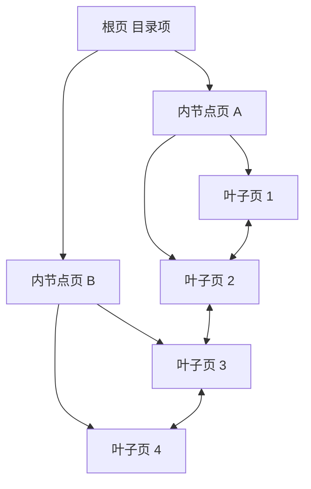

一条本该走索引的 `select * from orders where user_id = ?` 忽然变慢，原因往往不是数据涨了，而是索引没被用上——列上套了函数、传来的参数类型和列不匹配，或者从一开始就没建索引。索引的本质不是「查得更快」这种模糊说法，而是把「逐页扫完整张表」换成「沿着几层页目录走下去」。要讲清楚这件事，得先看 InnoDB 怎么把数据放在磁盘上，再回头看它为什么选 B+ 树，而不是二叉树、哈希或 B 树。

## 一、索引优化的本质，是减少要读的页

InnoDB 读写磁盘以页为单位，一个页通常是 16KB。表数据和索引最终都按页落在磁盘上；查询某一行时，引擎先把它所在的那个页整体读进缓冲池，再从页内部定位记录。

页内部有两个值得记住的细节：

- 记录按主键从小到大串成一条单向链表，页头还有一块「页目录」，记录着若干分组的位置，可以在页内做二分查找。
- 页与页之间也是有序的：每个页的文件头里存着上一页和下一页的页号，所有页因此构成一条双向链表。

所以磁盘 IO 的粒度是页，不是行。要定位一行需要读几个页，由索引结构决定；索引结构的选择，本质上是在回答一个问题：给定一个键值，能不能用最少的页访问次数走到目标。

## 二、为什么不是二叉树、红黑树或哈希

只看比较次数的话，二叉搜索树挺合适。但索引是给磁盘用的，瓶颈在树高而不是比较次数。

二叉搜索树的问题很好理解：索引列若是自增主键，新值永远插在右侧，树会单边增长成一条链，查找退化成全表扫描。

红黑树用旋转维持平衡，解决了退化问题，可每个节点只有两个分叉。节点一多，树高就上去了，而树高每加一层，通常就多一次页读取。对磁盘来说这个代价太重。

哈希表的等值查找理论上一次定位，代价是彻底放弃有序性：范围查询、`order by`、最左前缀匹配、`like 'abc%'` 全都做不了。InnoDB 里也没有可供用户显式创建的哈希索引，自适应哈希只是内部的等值查找优化。

多路平衡树走的是另一条路：把一个节点放大成一个页，让每个节点有上千个分叉。分叉越多，容纳同样行数所需的层数越少，也就是常说的「矮胖」。这里衡量结构好坏的标准也随之变了——不是比较了多少次键值，而是找到目标要读多少个页。

## 三、B 树与 B+ 树：差别在叶子节点

B 树是平衡多路查找树：节点内键值递增排列，n 个键对应 n+1 个子树，所有叶子在同一层，而它的非叶子节点里也存着数据行。

B+ 树改了两件事。一是非叶子节点只存键值和页指针，不再存数据行，于是同一个 16KB 的页能塞下更多目录项，分叉更多，树更矮；二是所有数据行都落在叶子节点，叶子之间用双向链表串起来，同层的非叶子节点之间也有链表。

改变带来三个结果：

- **范围扫描变成顺序读。** `where id between 100 and 200` 只需定位到 100 所在的叶子页，再沿叶子链表往后读，越过 200 就停。B 树做不到这么顺，要么回根重找，要么在层级之间来回回溯。
- **查询路径稳定。** 任何一次查找都从根走到叶子，访问页数等于树高，不会出现「运气好一层就命中」的情况，执行计划更容易预期。
- **全表遍历只需扫叶子链表。** 聚簇索引的叶子页本身就装着整行数据，顺着链表走就是一次顺序全表扫描，不必递归整棵树。



三层树能装多少行？按主键 8 字节、页指针 6 字节粗算，一个 16KB 的非叶子页大约能放上千个目录项，乘上叶子页里的行数，三层覆盖千万级记录并不夸张。这也是很少听到「MySQL 索引层数太深」的原因。

对照之下，B 树的非叶子节点带着数据，范围查询要在层之间来回跳，页访问的顺序不如 B+ 树友好。它唯一的优势是「目标行正好落在靠近根的节点上，能少走一层」，但在以范围查询和排序为主的业务里，这点收益抵不过上面的整体代价。

## 四、聚簇索引、二级索引与回表

InnoDB 是索引组织表：数据行本身按主键顺序存放在 B+ 树的叶子节点里，这棵树就叫聚簇索引，也就是主键索引。所以「主键即聚簇索引」不是比喻，而是物理事实。

规则很简单：定义了主键，主键就是聚簇索引；没有主键，就选第一个所有列都 `not null` 的唯一索引；两者都没有，InnoDB 会生成一个隐藏的聚簇索引。每张表有且只有一个聚簇索引，因为数据页只能按一棵 B+ 树组织。

其他索引——唯一索引、普通索引、联合索引——都是二级索引（辅助索引）。它的叶子节点只存两样东西：索引列的值，以及该行记录的主键值。这个书签是主键而不是物理地址，所以行在页之间搬动时，二级索引不需要跟着改。

于是用二级索引查一条完整记录，要爬两棵树：先在二级索引上定位到主键，再拿主键去聚簇索引取整行。这一步叫回表。

```sql
-- 需要 name，而 idx_phone 里没有 name，只能回表
select id, name from users where phone = '13800000000';

-- 只要 id 和 phone，两者都在 idx_phone 的叶子节点上，不需要回表
select id, phone from users where phone = '13800000000';
```

覆盖索引就是绕开回表的办法：查询需要的列如果全在这棵二级索引里，引擎就不必再回聚簇索引。`explain` 的 Extra 列出现 `Using index`，表达的就是这件事。

> [!NOTE]
> 覆盖索引之所以有效，不只是「少一次查找」。二级索引的叶子页比聚簇索引窄得多，一页能放更多条目，扫描同样多的行所需读的页更少，省下的是回表带来的随机 IO。

这也解释了「主键要短」：每个二级索引的叶子节点都要带一份主键值，主键越长，索引越大，一页能装的条目越少。

## 五、联合索引与最左前缀

联合索引是把多个列拼在一起排序。`(user_id, status, created_at)` 的含义是：先按 user_id 排，user_id 相同的再按 status 排，还相同的再按 created_at 排。可以类比成一本按「姓、名、年龄」排序的通讯录。

因为排序从左到右逐列生效，匹配也只能从左往右进行：

- `where user_id = ?` 能用到索引；
- `where user_id = ? and status = ?` 也能用到，而且第二列是在第一列的等值区间内继续有序；
- 只写 `where status = ?` 用不上，因为跳过了第一列，status 在整张索引里并不是整体有序的。

规则不是「必须用上所有列」，而是「必须从最左列开始、连续地使用」。范围条件会截断后面的列：`where user_id = ? and status = ? and created_at > ?` 之后若还有其他列，那些列就无法再靠索引缩小范围，只能在页内过滤。

设计联合索引时，几个实用的判断：

1. 等值条件放前面，范围条件放后面。范围列一旦出现，它右边的列基本只承担过滤作用，不再承担定位作用。
2. 区分度高的列靠前，但「等值优先于区分度」更重要——先保证等值列连续，再考虑区分度。
3. 把 `order by`、`group by` 的列接在等值条件之后，顺序一致时可以直接沿索引取有序结果，省掉一次排序。

## 六、索引失效的常见场景

需要先说明一个前提：优化器按代价选路，索引存在并不代表一定被用；下面这些情况属于「语法上就让索引不可用」，与代价无关。

1. **列上做函数运算。** `where date(created_at) = '2026-11-01'` 把列变成了函数的参数，索引里存的是 created_at 的原值，没法直接比较。改成范围写法：`where created_at >= '2026-11-01' and created_at < '2026-11-02'`。
2. **隐式类型转换。** phone 是 `varchar`，却写成 `where phone = 13800000000`，MySQL 会把列值转成数字再比较，等价于在列上套了一次转换，索引失效。反过来 int 列与字符串比较通常没问题，因为转换发生在常量那一侧。
3. **前导模糊。** `like '张%'` 可以走索引，前缀确定就能在树里定位区间；`like '%张'`、`like '%张%'` 不行，前缀不定只能逐页扫。
4. **OR 连接的条件。** 只要 OR 的某一侧没有可用索引，整个条件就可能退化成全表扫描。两侧都有索引时，优化器也许会用索引合并，但别默认它一定划算。
5. **联合索引没从最左列开始**，或者范围条件之后还想靠索引继续定位。
6. **`!=`、`not in`、`is not null` 这类条件。** 能不能用索引取决于选择性，优化器经常直接放弃——这是成本判断，不是语法限制。

> [!WARNING]
> 最容易被忽略的是隐式类型转换：参数从接口传进来是字符串还是数字，往往由框架的序列化决定。表结构里是 `varchar`，代码里传了数字，索引就白建了，而 `explain` 看起来一切正常。

## 自检清单

慢查询排查时，按顺序问自己几个问题：

- 条件里的列，是否构成了某个索引的最左前缀，并且有等值条件打头？
- 列上有没有套函数、表达式，或者发生了隐式类型转换？
- `like` 是否以 `%` 开头？能不能改成前缀匹配或范围条件？
- 查询涉及的列是否都在索引里，有没有机会做成覆盖索引？
- OR 的每一侧是否都有可用索引？
- `order by`、`group by` 的列顺序，是否和索引顺序一致？
- 最后用 `explain` 确认：`key` 是不是预期的索引，`type` 有没有落到 `ALL`，`rows` 和 Extra 是否符合预期。

索引不是越多越好：每个索引都要占空间、增加写开销，也让优化器在更多执行计划之间比较。先弄清「这条查询为什么没走索引」，再决定加不加，通常比一上来堆索引有效。
