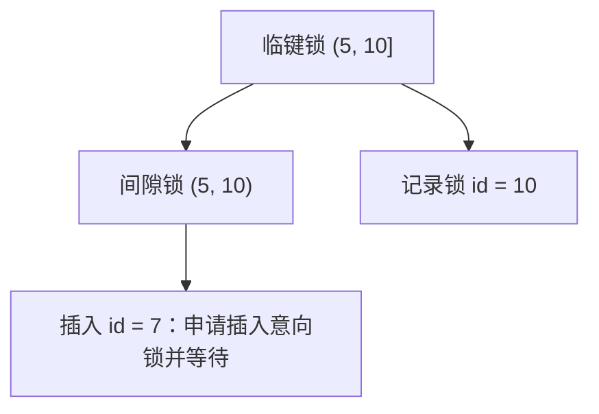

MySQL 的锁加在索引记录和记录之间的空隙上，而不是锁住「一行数据」这个概念本身：`update` 一旦用不上索引，行锁就会顺着主键索引的扫描路径落到每一条扫过的记录上，效果接近锁表。间隙锁存在的理由很窄，只为了在 RR 下挡住「往空隙里插入」这个动作，代价是更大的锁定范围和更高的死锁概率。而死锁多数不是 InnoDB 的 bug，是两个事务用相反的顺序去够同一批锁。

## 一、X 锁与 S 锁：互斥只发生在写那一侧

InnoDB 的行锁只有两种模式：排他锁（X，写锁）和共享锁（S，读锁）。规则很短：S 与 S 兼容，S 与 X 冲突，X 与 X 冲突。多个事务可以同时持有一行的 S 锁，但只要有人持 X，其他人连 S 都拿不到。

落地到 SQL 上，`select ... for update` 加 X 锁，`select ... for share`（5.7 写作 `lock in share mode`）加 S 锁，`update` 和 `delete` 不需要显式声明，执行时自带 X 锁。

容易误解的是 S 锁的用途。它不是用来「读快照」的——S 锁读的同样是当前最新已提交的版本，和 `for update` 一样是当前读。S 锁真正的意思是：在我读完之前，谁都别改这一行；别人可以同时读，但不能写。所以「用 S 锁替代 MVCC 省事」是个陷阱：它把并发读留住了，却把所有写都堵在门外。

## 二、意向锁：把「表里有没有行锁」变成一次查表

如果没有意向锁，一个事务想给整张表加 X 锁，就得逐行检查有没有行锁，这显然不可接受。InnoDB 的做法是在行锁之前先在表级留个标记：要对某行加 S 锁，先给表加 IS；要加 X 锁，先给表加 IX。

意向锁之间几乎不互斥：IS 与 IS、IX 与 IX、IS 与 IX 都兼容。原因也简单，它们只是「某个事务在表里加了行锁」的声明，多个事务各自在不同行上加锁本来就不冲突。真正被它们挡住的是表级锁——表级 S 锁要求表里没有排他行锁（IS 可以共存，IX 不行），表级 X 锁则与两者都冲突。

所以意向锁从不阻塞普通的行操作，它的全部价值在于让「加表锁」这个动作 O(1) 判断完。顺带一句：DDL 与 DML 之间的互斥是 Server 层的元数据锁（MDL）在管，和意向锁不是一回事，别混。

## 三、行锁加在索引上：没走索引时锁的是什么

InnoDB 的行锁加在索引记录上，聚簇索引也好，二级索引也好。就算表上没定义任何索引，也不代表没有索引可用——InnoDB 会建一个隐藏的聚簇索引，锁照样加在它上面，这就是「记录锁其实是索引记录锁」的由来。

关键在于锁的落点是扫描路径，不是最终结果。一条 `update t set cnt = cnt + 1 where name = 'bob'`，如果 `name` 上没有索引，优化器只能全表扫聚簇索引，扫描到的每一行都会被加 X 锁，RR 下连记录之间的间隙一起锁；条件是不是匹配，要等锁加完、回表判断之后才知道。并发一上来，别的会话改任何一行都要排队，看上去就成了「锁表」。

```sql
-- name 无索引：扫描路径是整个聚簇索引，锁范围约等于全表
update t set cnt = cnt + 1 where name = 'bob';

-- 加索引后，锁的只是命中的二级索引记录和对应的主键记录
alter table t add index idx_name (name);
```

> [!NOTE]
> 判断一条语句会锁多少行，先看 `explain` 的 `key` 是不是 null、`rows` 有多大，再看 `where` 里写了几列。前者决定扫描路径，后者只决定过滤条件，而锁是跟着前者走的。

## 四、记录锁、间隙锁、临键锁：三种边界

按锁住的对象分，RR 下有这三种：

- **记录锁（Record Lock）**：锁一条索引记录，比如 `id = 10` 这一行。
- **间隙锁（Gap Lock）**：锁两条记录之间的开区间，比如 `(5, 10)`，不含两端。
- **临键锁（Next-Key Lock）**：记录锁加它前面的间隙，锁成前开后闭的 `(5, 10]`，InnoDB 默认用的就是它。



间隙锁有几条反直觉的性质。第一，它只和「插入到这个间隙」这个动作冲突，不和其他间隙锁冲突，所以两个事务可以同时持有同一段空隙的间隙锁。第二，它锁的是不存在的行——正因为不存在，才只能靠锁空隙来拦。第三，它是 RR 防幻读的主要手段：当前读要看到最新数据，MVCC 帮不上忙，只能把「范围里不许插新行」这件事用锁写下来。

也正因为如此，RC 下间隙锁基本退场（外键检查和唯一性检查是例外），代价是接受幻读。这是很多线上系统把隔离级别降到 RC、同时把 `binlog_format` 设为 `row` 的原因。

唯一索引的等值查询命中已有记录时，临键锁会退化成纯记录锁，因为唯一性已经保证了「这个值只有一条」，再锁间隙没有意义。范围查询和普通索引的等值查询，就老老实实用临键锁。

**插入意向锁**是间隙锁的一个特殊形态，不属于表级的意向锁。一个事务往 `(5, 10)` 里插 `7` 时，会先申请这段间隙的插入意向锁；如果间隙已被别的事务锁住，它以等待状态挂着，`performance_schema.data_locks` 里能看到 `INSERT_INTENTION` 配 `WAITING`。多个事务插不同的值时，插入意向锁彼此兼容，只要记录本身（主键、唯一索引）不撞，就不会互相阻塞。

## 五、死锁：成因、排查与三种典型模式

死锁的教科书定义是四个条件同时成立：互斥、请求并保持、不可剥夺、循环等待。前三个是锁的本性，改不动；能改的只有第四个——让等待关系不再成环。


InnoDB 有两种应对。一是等超时，`innodb_lock_wait_timeout` 默认 50 秒，超时的事务回滚并报 1205；对在线业务来说 50 秒太长，调小又容易误伤正常等待。二是主动检测，`innodb_deadlock_detect` 默认开启，用 wait-for graph 找环，找到就回滚代价较小的那个事务（一般是影响行数少的），报 1213。检测不是免费的，同一行被大量并发更新时，每次加锁都要走一遍图，CPU 会被吃掉，这时候该做的是把热点行的并发压下去，而不是关掉检测。

排查入口就两条：死锁现场看 InnoDB 状态，实时等待看事务表。

::: code-group labels=[死锁现场, 实时等待]

```sql
-- 找 LATEST DETECTED DEADLOCK 段：两个事务各持有什么、在等什么、回滚了谁
show engine innodb status\G

-- 死锁不会只来一次，把每次现场落到错误日志更省事
-- [mysqld] innodb_print_all_deadlocks = on
```

```sql
-- 当前事务：trx_started 很早、trx_query 为 null 的，往往是握锁不放的长事务
select trx_id, trx_state, trx_started, trx_mysql_thread_id, trx_query
from information_schema.innodb_trx order by trx_started;

-- 8.0 起用 performance_schema，information_schema.innodb_locks 已被移除
select * from performance_schema.data_locks\G
select * from performance_schema.data_lock_waits\G
```

:::

典型的死锁有三种形状。

**一是加锁顺序相反。** 事务 A 先改 `id = 1` 再改 `id = 2`，事务 B 反过来。到第二步时，两人各持一把、各等一把，环就闭上了。这类死锁最好治：把要改的行按主键排序后再依次更新，顺序一致，环就不可能形成。

**二是唯一索引冲突。** 两个事务插入同一个尚不存在的唯一键：先到的持有新记录的 X 锁，后到的在重复键检查里对该记录加 S 锁并等待；等前者回滚，等待者拿到 S 后再申请 X 去完成自己的插入，此时若还有第三个事务也持着 S，S 到 X 的升级就互相卡死。

**三是间隙锁互等。** 事务 A 执行 `select * from t where id > 5 and id < 10 for update`，区间里没有记录，锁住的其实是 `(5, 10)` 这段间隙；事务 B 执行同一条语句，间隙锁之间不冲突，两人都拿到了。接着 A 插 `7`、B 插 `8`，各自的插入意向锁都要等对方手里的间隙锁。两个事务谁都没碰到同一行，却谁也走不了。

避免手段可以归结成四条：固定加锁顺序；把事务写短，RPC、循环、批处理都挪到事务外面；给 DML 的过滤列建对索引，别让锁范围从几行扩散到整表；对真正的热点行做串行化（排队、分片或分布式锁），而不是让几百个并发在 InnoDB 里抢。真要让间隙锁退场，降 RC 是最直接的一步，但要先确认业务能接受幻读，并且 binlog 是 row。

> [!WARNING]
> `Deadlock found` 之后的重试必须幂等：整个事务重做，而不是从失败的那条 SQL 接着往下跑。死锁只说明加锁顺序有问题，不代表前面的写没有生效——只重试后半段，很容易写出重复数据。

## 自检清单

- 这条 DML 或加锁读的 `where` 列上有索引吗？`explain` 的 `key` 是 null，基本等于在锁全表。
- 加锁条件是范围还是等值唯一？前者锁临键，后者可能只锁记录，锁范围差一个量级。
- 事务里有没有 RPC、消息发送、循环查询？有就先挪出去，别让锁等网络。
- 多条记录要改时，顺序固定了吗？跨表的话，表之间要不要也固定顺序？
- 隔离级别是 RR 还是 RC？RR 下间隙锁大量存在，RC 下要接受幻读。
- 死锁报的是 1213 还是 1205？前者是检测到环，后者是等超时，排查方向不同。
- 重试逻辑是整事务重放吗？会不会把已经成功的部分再执行一遍。
- 最后确认 `innodb_print_all_deadlocks` 开了没有：没开的话，`show engine innodb status` 只留最后一次现场。
