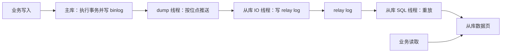

主从延迟很少能用「网络慢」三个字解释：它多半来自主库上一个大事务、从库的单线程重放、以及从库被自己的查询压住。读写分离把读流量分走的同时，也把「写完立刻读」变成了一次跨机器的一致性赌注。所以要设计的不是「要不要上主从」，而是延迟怎么观测、哪些读必须回主库、切换时能接受丢多少。

## 一、binlog 的三种格式，是在选可复现性

binlog 是 Server 层的逻辑日志，记录 DDL 和除 `select`、`show` 之外的 DML，事务提交时写入，用于按时间点恢复和复制。它和 InnoDB 的 redo log 不同：redo 是物理日志，管崩溃恢复；binlog 是逻辑日志，管「把同一个操作在另一台机器上再做一遍」。选格式，本质是在选记到什么程度，才能保证从库重放出同样的结果。

**statement** 只记 SQL 原文。日志小、顺序写省 IO，批量更新时优势明显；风险是不确定性函数（`now()`、`rand()`、`uuid()`）、不带 `order by` 的 `limit`、依赖自增值的插入，重放时可能落到别的值上，主从就此分叉。

**row** 记每行修改前后的镜像，记全量还是只记变化列由 `binlog_row_image` 决定。它不依赖执行环境，确定性最强；代价是体积，一条 `update` 命中十万行就写十万行镜像，带大字段的表和全表条件的 `update` 最容易把 binlog 撑大。

**mixed** 默认按 statement 记，遇到可能不确定的语句再切 row。折中，但「什么时候切」并不透明，排查不一致时反而多一层不确定。

默认建议 row 配 `binlog_row_image=minimal`，用磁盘换确定性；statement 留给特殊功能少、日志量敏感的批处理；mixed 只在确实要压体积、又能接受不可预测时选。另外，RC 隔离级别下间隙锁基本退场，row 重放出的结果更稳，这两者经常一起出现在线上配置里。

## 二、复制的三步：主库写、从库搬、从库做

1. **主库执行事务并写 binlog。** 提交时按组提交刷盘，一次 fsync 可能带上多个事务。
2. **从库 IO 线程把日志搬过来。** 它与主库建立长连接，主库的 dump 线程按位点或 GTID 推送 binlog 事件；IO 线程落地成 relay log，同时记下读到哪儿。
3. **从库 SQL 线程照着做。** 顺序读 relay log、按事务重放、更新数据页，并更新自己的执行位点。



三步一拆，延迟就有了三段：传输、IO 线程落盘、SQL 线程重放。`Seconds_Behind_Master` 把这三种混在一起，还会被主库时钟、长事务、线程停摆干扰，所以它等于 0 不代表一致，很大也不一定说明网络差。

## 三、延迟从哪来，就往哪里压

**大事务。** 提交时 binlog 才完整可见，从库要等整个事务传完才能开始重放，而重放又以事务为单位。一个跑十分钟的 `delete`，会把延迟瞬间抬到十分钟以上，而且是台阶式的——不是慢慢变差，是忽然就有，之后还得用同样长的时间才追得回来。对策是拆：按主键范围分批，每批几千行提交一次，大批导入切小批。代价是原子性被拆散，必须配幂等设计和进度记录，否则重试会改两遍。

**从库单线程重放。** 5.6 之前从库只有一个 SQL 线程，主库上几百个并发事务，到从库变成一条队列。对策是并行复制：5.7 的 `LOGICAL_CLOCK` 按组提交分组，8.0 的 `WRITESET` 按行级冲突判断，让 `slave_parallel_workers` 大于 0，再配 `slave_preserve_commit_order=1` 保住提交顺序。它的收益受主库并发度约束——主库写入若是一个接一个的小事务，攒不起批次，并行度就上不去。半同步复制（`after_sync`）不解决重放，它把切换时的 RPO 压到「最多丢一个未确认事务」，代价是写路径多一次网络往返。

**从库压力。** 读流量下沉后，一条没走索引的报表查询、一次全表扫描、一个加全局锁的备份、一次 DDL，都在和 SQL 线程抢 CPU 与 IO。从库不是「只读所以更闲」，它在同时重放和查询。对策是把备份、报表挪到独立的延迟从库，业务读只有明确了容忍度才下沉。

**网络与硬件。** 跨机房 RTT、带宽打满、从库磁盘写入弱于主库，都会让 IO 线程追不上。这类延迟通常有周期性，和流量高峰对齐。

> [!NOTE]
> `Seconds_Behind_Master` 只能当个粗略信号。更可靠的是在主库定期写心跳表（如 pt-heartbeat），在从库读这条记录的时间戳算差值，传输和重放两段的落后都能覆盖到。

判断卡在哪一段，先看位点是否推进，再看 relay log 是否堆积：

::: code-group labels=[看位点, 看堆积]

```sql
-- Read_Master_Log_Pos 在涨而 Exec_Master_Log_Pos 不动，说明卡在重放
show slave status\G
```

```bash
# relay log 的数量与最后修改时间，能看出 SQL 线程跟不跟得上
ls -lht /var/lib/mysql/relay-bin.* | head -n 5
```

:::

## 四、读写分离之后：写后读不到

读请求被分到多个从库，每个从库的重放进度还不一样。于是「我刚提交，为什么查不到」几乎必然发生：写走主库、读走从库，而那个从库可能落后几百毫秒；如果读请求又被均衡到不同从库，同一个用户连刷两次甚至能看到数据「回退」。

处理方式按成本从低到高排：

1. **按业务容忍度分流。** 商品列表、评价、历史订单这类晚几百毫秒无所谓的读交给从库；余额、库存、券核销必须读主库。这条线要写进接口设计，而不是靠开发临时判断。
2. **强制走主库。** 把「必须读到自己的写」的读标出来：写后的详情页、事务内的读、支付校验。实现上用注解或 AOP 加 ThreadLocal 标记切数据源，或让中间件识别 hint。代价是主库读压力回来，所以范围要小，最好带几十秒的过期时间。
3. **等到位点。** 写入时记住当时的 GTID 或位点，读从库前先等它被重放（8.0 可用 `wait_for_executed_gtid_set`）。这比「N 秒内走主库」精确，代价是读请求可能被阻塞，等待时间必须有上限。
4. **会话内固定快照。** 若业务能接受「这次会话看到的都是同一时刻的数据」，用只读事务加一致性视图，把多次读钉在一个快照上。

> [!WARNING]
> 缓存会让问题更隐蔽。「写主库 → 删缓存 → 读从库回填」这个顺序里，如果读从库时尚未重放，就会把旧值写回缓存，之后一直读到旧值。缓存回填要么走主库，要么等位点，别让它成为延迟的放大器。

## 五、主从切换时该确认的事

切换的本质是「选一个数据最全的从库当新主」，所以第一步永远是看延迟和位点，而不是先改配置。异步复制下，主库崩溃时还在 binlog 里、没传到从库的那部分事务一定会丢，这就是 RPO；半同步能把它压到一个事务，前提是 ack 的那个从库没有一起挂。

流程上必须卡住写入：把旧主设为 `read_only`，等候选从库追平（位点一致，或 GTID 集合已包含），再提升。少了这一步，容易出现两个节点都接受写入的脑裂，或者丢掉一批已经返回给客户端的确认。

切换后还有一串事：旧主降级为从库时往往需要重建，因为它的数据比新主多，直接 `change master` 会冲突；应用侧要确认连接串、DNS、连接池、中间件后端列表都更新了——连接池里缓存的旧连接，是最常见的「切了但没生效」；用 GTID 时 `change master to master_auto_position=1` 比手算位点可靠。

演练比工具重要。MHA、Orchestrator、ProxySQL 都能自动切，但判定条件（延迟阈值、多数派）得在自己的延迟曲线下验证过，否则一次抖动就可能误切。切换也不是终点：自增步长、`server_id`、半同步插件、监控告警，都要在新主上重新确认。

## 自检清单

- binlog 格式选 row 还是 statement？理由是一致性优先，还是日志体积优先？
- 现在延迟卡在传输、IO 线程落盘，还是 SQL 线程重放？能说出依据吗？
- 有没有大事务在跑：批量 `delete`、批量导入、DDL？
- 并行复制开了吗？主库的组提交并发度撑得起这个并行度吗？
- 从库上有没有报表、备份、临时查询这类抢资源的读？
- 每个「写后立刻读」的接口，是走主库、等位点，还是明确接受旧值？
- 缓存回填读的是主库还是从库？
- 切换演练过吗？候选怎么选、旧主怎么降级、连接池怎么刷新，分别由谁负责？
