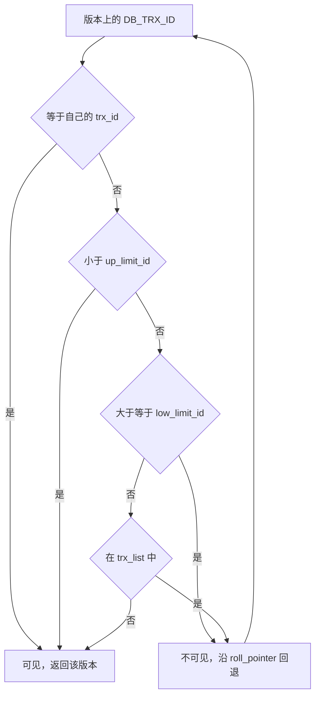

事务常被讲成四条并列的性质，好像 InnoDB 为 ACID 各准备了一个开关。实际上真正干活的是三种机制：redo log 管持久性，undo log 一份日志同时支撑原子性和 MVCC 需要的旧版本，锁管隔离性。MVCC 要解决的不是笼统的「并发读写」，而是让读不加锁也能拿到一个稳定快照，代价是每行数据背着一条版本链、每次快照读都要做一次可见性判断。至于「MySQL 的 RR 没有幻读」这句流传很广的话，只对普通 select 成立。

## 一、ACID 背后是三种机制，不是四套开关

**原子性靠 undo log。** 它是逻辑日志，记的不是页的物理变化，而是「这条 SQL 做过什么」，回滚时按相反的方向重放：insert 对应 delete，delete 对应 insert，update 对应一次把值换回去的 update。所以 undo log 里必须留下被改行的主键、改了哪些列、以及这些列改动前后的值。

**持久性靠 redo log。** 修改先写 redo log，再改缓冲池，事务提交时 fsync 落盘，这就是 WAL。它比直接刷脏快，原因有两个：刷脏是随机 IO，写 redo log 是追加的顺序 IO；刷脏以 16KB 的页为单位，页上改一个字节也得整页写，而 redo log 只记真正变更的那部分。宕机重启后按 redo 重放，已提交的事务就不会丢。

**隔离性靠锁和 MVCC 分担。** 写与写之间互斥，只能靠锁；写与读之间互不阻塞，靠的是 MVCC。这也解释了为什么隔离级别可以「调」：它调的正是读这一侧愿意接受多少不一致。

**一致性不是单独一条机制。** 它是 A、I、D 共同作用的结果，再加上约束（主键唯一、外键、列类型与长度）和应用层的校验。把它当成第四种日志去找，是找不到的。

顺带分清容易混的 redo log 与 binlog：redo 是 InnoDB 层的物理日志，用于崩溃恢复；binlog 是 Server 层的逻辑日志，用于归档和主从复制。两者在提交时用两阶段提交对齐，才不至于出现「主库有新数据、从库没有」的错位。

## 二、四种隔离级别，差异在「允许你看到多少」

三个异常要先分清楚，它们的区别在于被谁干扰：

- **脏读**：读到了别的事务还没提交的写。前提是「读」根本不看提交状态。
- **不可重复读**：同一事务内两次读同一行，值变了。罪魁是别的事务 `update` 并提交。
- **幻读**：同一事务内两次按同一条件读，行数变了。罪魁是别的事务 `insert` / `delete` 并提交，多出来或少掉的不是同一行，而是「凭空出现的一行」。

| 隔离级别 | 脏读 | 不可重复读 | 幻读 | 读这一侧的做法 |
| --- | --- | --- | --- | --- |
| 读未提交 RU | 可能 | 可能 | 可能 | 不建快照，直接读最新版本 |
| 读已提交 RC | 避免 | 可能 | 可能 | 每条语句生成一次 ReadView |
| 可重复读 RR | 避免 | 避免 | 快照读避免，当前读靠锁 | 事务内首次快照读生成 ReadView，全程复用 |
| 串行化 | 避免 | 避免 | 避免 | 普通读也加 S 锁，退化为串行执行 |

从表里能看出一条线索：RU 到 RR 的变化集中在「快照什么时候建」，RR 到串行化的变化则是「读要不要加锁」。隔离级别的本质，就是这两件事的组合。

## 三、版本链：undo log 的另一份工作

InnoDB 的每条记录都带几个隐藏列，其中两个和 MVCC 直接相关：`DB_TRX_ID` 记最近修改这条记录的事务 id，`DB_ROLL_PTR` 指向 undo log 里这条记录的上一个版本。（第三个 `DB_ROW_ID` 只在表没有主键时作为隐藏主键出现，和可见性无关。）

一次 `update` 的动作顺序是：

1. 给这一行加 X 锁，阻止别的事务同时改它。
2. 把当前行拷贝进 undo log，作为旧版本。
3. 修改当前行，把 `DB_TRX_ID` 改成自己的事务 id。
4. 让 `DB_ROLL_PTR` 指向刚写下的那个旧版本。


于是同一行的历史被串成一条从新到旧的链表，这就是版本链。更新次数越多，链越长。

链不能随便回收。`insert` 产生的 undo 只在回滚时用得上，事务提交后即可丢弃；`update` / `delete` 产生的 undo 还要留给快照读查旧版本，必须等 purge 线程确认「没有任何活跃的 ReadView 还需要它」才能清理。所以长事务的代价不只是占着锁，它还会把 undo 按住不放，把整个库的历史版本一起养大。

> [!NOTE]
> 判断一条 undo 能不能清，看的是「有没有比它更老的 ReadView 还在用」。这意味着一个跑了十分钟的事务，能让这十分钟内所有行的旧版本都留下来；`information_schema.innodb_trx` 里那条 `trx_started` 很早的记录，往往就是磁盘涨得莫名其妙的元凶。

## 四、ReadView：判断「这个版本我看不看得到」

ReadView 是快照读那一刻生成的现场记录，只回答一个问题：当前这个事务，能看见哪些事务提交的结果。它维护三样东西：

- `trx_list`：生成 ReadView 时系统里还活跃（未提交）的事务 id 列表，不含自己。
- `up_limit_id`：`trx_list` 里最小的事务 id。
- `low_limit_id`：系统下一个尚未分配的事务 id，比当时出现过的事务 id 都大。

拿到一个版本上的 `DB_TRX_ID`，按顺序判断：

1. 等于自己的事务 id，可见——这是自己改的。
2. 小于 `up_limit_id`，可见——它在 ReadView 生成前就已经提交完了。
3. 大于等于 `low_limit_id`，不可见——它是在 ReadView 之后才出现的事务。
4. 落在两者之间，看它是否在 `trx_list` 里：在，说明生成 ReadView 时它还没提交，不可见；不在，说明它已经提交，可见。



不可见并不意味着查不到数据，而是沿着 `DB_ROLL_PTR` 往版本链上退一格，再判断一次，直到找到一个可见版本；如果链走到底都没有，就说明这行对当前事务「不存在」。

RC 与 RR 的差别全在生成时机上。RC 是每条 `select` 都重新生成一次 ReadView，别的事务一提交，下一条语句立刻就能看到，这就是不可重复读。RR 只在事务的第一次快照读时生成，后面所有快照读复用同一份，别的事务再提交也进不了这份名单，于是同一个事务反复读到的都是同一个版本。

这里有个常被误解的细节：RR 的 ReadView 不是在 `begin` 时创建的，而是在第一次快照读时创建。所以 `begin` 之后、第一次 `select` 之前别的事务提交的数据，第一次 `select` 是能看到的。想真正做到「事务开始即定格」，得把第一条语句提前，或者直接 `start transaction with consistent snapshot`。

顺带一提，新版本里这几个字段叫 `creator_trx_id`、`m_ids`、`min_trx_id`、`max_trx_id`，含义一一对应。

## 五、快照读与当前读：RR「看起来不幻读」的真相

同一个事务里，`select` 和 `select ... for update` 看到的可能不是同一份数据，因为它们是两种读。

**快照读**就是不加锁的普通 `select`。它沿着版本链找一个对自己可见的版本，不碰最新数据，也不妨碍别人改。它在 RR 下「不幻读」，原因很朴素：它在看一张固定的旧照片，别人后来插入的行根本不在照片里。这不是把幻影挡住了，而是没往那个方向看。

**当前读**包括加锁读（`select ... for update`、`select ... for share`）和 `update`、`delete`。它必须先读到最新已提交的版本，因为要基于最新值加锁、判断条件、再写回。MVCC 在这里帮不上忙——你要改的就是最新值，没有「读旧版本」的余地。

::: code-group labels=[快照读, 当前读]

```sql
-- 普通 select：MVCC 快照读，不加锁
select count(*) from t where id > 1 and id < 5;

-- 另一个事务插入 id = 3 并提交后，同一事务再查一次，结果不变
```

```sql
-- 加锁读：当前读，读最新版本并加 next-key lock
select * from t where id > 1 and id < 5 for update;

-- update / delete 同样是当前读：先读最新值，再加锁改写
update t set cnt = cnt + 1 where id > 1 and id < 5;
```

:::

所以 RR 要防住当前读这一侧的幻读，只能靠锁。只锁住 `id = 1` 和 `id = 5` 这两条记录，拦不住别的事务往 (1,5) 中间插 `id = 3`，因为记录锁锁的是行，锁不住行与行之间的空隙。间隙锁补的就是这块：间隙锁之间彼此不冲突，跟它冲突的只有「往这个间隙里插入」这个动作。记录锁加间隙锁，就是 next-key lock，锁住的是前开后闭的区间 (1,5]。

> [!WARNING]
> RR 也不是绝对的「没有幻读」。设想事务 A 先快照读 `id > 1 and id < 5`，没有结果；事务 B 插入 `id = 3` 并提交；事务 A 接着执行 `update t set cnt = cnt + 1 where id > 1 and id < 5`，这是一次当前读，它看到了 B 插入的行并改了它；此后事务 A 再快照读，这一行会出现在结果里——因为它的 `DB_TRX_ID` 已经变成了 A 自己。快照读和当前读混用，幻读照样能出现。

也正因为间隙锁会把范围锁得很大、抬高死锁概率，不少线上系统把默认隔离级别改成 RC，同时把 `binlog_format` 设为 `row`（RC 下语句级 binlog 在主从之间可能不一致）。RC 基本不加间隙锁，代价是接受不可重复读和幻读；需要读一致的报表、对账类查询，则仍然值得用 RR，或者干脆在事务里固定一份快照。

## 自检清单

- 这个事务需要的是「读一致」还是「写互斥」？前者交给 MVCC，后者只能靠锁。
- 出现了不可重复读，是不是隔离级别本来就是 RC，或者事务里混进了当前读？
- 第一次查不到、后面却查到了，中间那次操作是不是 `update` 或 `for update`？
- 依赖「先读再写」的逻辑，有没有显式用 `for update` 锁住，而不是先普通 `select` 再 `update`？
- `for update` 的条件列有没有索引？没有索引时，锁的范围会从几行扩散到整张表。
- 事务里有没有远程调用、循环、等待？长事务会把 undo 钉住，让版本链和磁盘一起膨胀。
- 最后确认默认隔离级别和 `binlog_format`：RR 配 `statement` 是一条本不必踩的坑。

把这七条过一遍，大多数「隔离级别相关」的线上异常都能定位到具体是快照读、当前读还是锁范围的问题，而不是笼统地归咎于「事务不可靠」。
