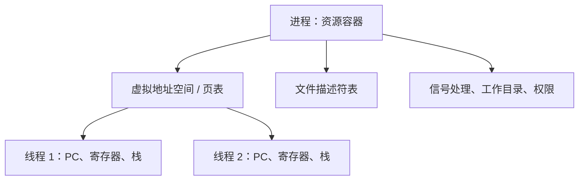
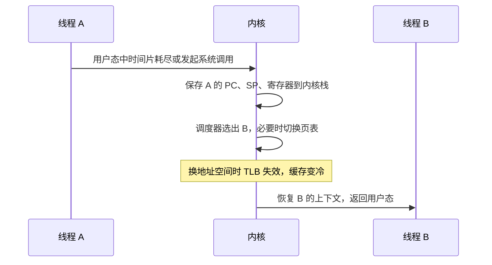

进程是资源分配的容器，线程是容器里被 CPU 真正调度的执行流。所以切线程通常只换寄存器和栈，切进程往往还要换掉整个地址空间。抓住这条主线，共享与独占、切换代价、协程为何便宜、线程该开多少，都能顺着推出来。

## 本质差别：一个管资源，一个管调度

操作系统给进程配的不是一块 CPU 时间，而是一整套资源：独立的虚拟地址空间与页表、文件描述符表、信号处理方式、工作目录、权限、内存映射。它们构成隔离边界——同一个指针值在两个进程里指向无关的物理内存，一个进程的野指针踩不坏另一个。这就是「进程是资源分配的基本单位」。

线程是执行流本身，需要的状态极少：程序计数器指向下一条指令，栈指针指向自己的调用栈，再加一组通用寄存器和少量线程局部数据。CPU 只认这些——这就是「线程是调度的基本单位」。

Linux 上两者都是 `task_struct`，clone 时用共享标志位区分：共享地址空间即线程。所谓轻量级进程，区别只在标志位。



- **共享**：代码段、堆、全局与静态变量、文件描述符表、工作目录、信号处理函数、内存映射。
- **独占**：程序计数器、寄存器组、栈、线程局部存储、`errno`、信号掩码、调度属性。

栈必须私有：返回地址和局部变量都按「当前这条流」压栈，共用只会互相覆盖。堆共享，数据竞争与可见性问题都从同一份对象长出来。fd 常被忽略：线程共享同一张表，一个线程 `close` 的 fd 其他线程立刻用不了；fork 的子进程拿到副本，副本指向同一打开文件描述、共享偏移，但表各管各的。

> [!NOTE]
> 「局部变量天然安全」的前提是地址没泄露给别的线程。把栈上对象的引用塞进共享容器，私有就变成了共享；线程池复用线程却忘了清理 ThreadLocal，也一样。

## 上下文切换：切的是寄存器、栈和页表

切换的本质是保存一条流的现场、恢复另一条的现场。现场包括程序计数器、栈指针、通用寄存器、浮点与 SIMD 状态、条件码，以及页表基址。陷入时内核已把部分寄存器压在该线程的内核栈上，切换时再换内核栈指针。

一次完整的线程切换含两次特权级切换：用户态陷入内核（系统调用、中断或时间片耗尽）→ 内核选出下一个可运行线程 → 切到它的内核栈与寄存器 → 返回用户态。所以一次切换里藏着两次用户态与内核态的跨界，每次都要做权限检查、换栈。

真正贵的是两件看不见的事。

- **TLB 失效**：地址空间一换，页表基址寄存器（x86 上是 CR3，ARM 上是对应寄存器）跟着换，缓存的映射全部作废，之后每次访存都要重新走页表遍历。PCID、ASID 能给 TLB 项打地址空间标签，少刷一部分，但消除不了失效。同进程线程共享页表，切换不换页表基址，TLB 仍有效——这是线程比进程便宜的主因。
- **缓存变冷**：缓存里装的是上一个线程的工作集，新线程上来几乎必然 miss，分支预测器的历史也被稀释。这部分不出现在任何计时器上，却实实在在吃掉吞吐。

> [!WARNING]
> 别把「一次切换多少微秒」当常数去估容量。它随工作集、缓存命中率、是否跨核迁移而变，跨核还要处理缓存一致性。拿测出来的平均值做规划，误差可能是一个数量级。



顺带分清：系统调用只是一次模式切换，不一定换线程；线程切换必然包含它。协程省掉的正是后者。

## 协程与 1:1、N:1、M:N：把调度权换个位置

协程把「什么时候切」的决定权拿回用户态。切换点由程序显式给出——await、yield、channel 操作——运行时只保存少量被调用者保存寄存器与栈指针，不陷入内核、不经过调度器、不换地址空间，TLB 与缓存基本不受影响。省掉的是特权级往返和随之而来的 TLB 失效、缓存变冷，而不是「保存寄存器」这个动作。

有栈协程切栈指针；无栈协程（async/await）把局部状态编译成状态机放在堆上，切换只改一个指针。代价是协作式：一个协程不让出，同线程其他协程只能等；一次阻塞式系统调用会卡住整个线程。虚拟线程用载体线程加挂起，把阻塞调用变成让出点，本质仍是 M:N。

线程模型是另一层选择。

- **1:1**：每个用户线程对应一个内核调度实体，如 NPTL、Java 平台线程。能真正并行，一个阻塞不影响别人；代价是创建切换都要进内核，每个线程占一份栈，数量有上限。
- **N:1**：多个用户线程挂在一个内核线程上，如 green threads、早期 JVM。切换在用户态完成，极快，但无法利用多核，一个阻塞全阻塞。
- **M:N**：M 个用户线程映射到 N 个内核线程，如 goroutine 与 Java 虚拟线程。兼顾轻量与并行，代价在调度器：阻塞点让出、栈增长与迁移，还要和内核调度叠加。

::: code-group labels=[虚拟线程, 两种切换的差别]

```java
// 平台线程：1:1，每个都占用一个内核调度实体
Thread platform = new Thread(task, "worker");
platform.start();

// 虚拟线程：M:N，由 JVM 调度到少量载体线程上
Thread virtual = Thread.ofVirtual().name("vt-worker").start(task);
```

```text
协程切换（同一内核线程内）
  保存：少量被调用者保存寄存器、栈指针
  不碰：页表基址、内核栈、调度器

线程切换
  保存：完整寄存器上下文 + 内核栈
  可能更换：页表基址（跨进程时）
  成本：两次特权级切换 + TLB 失效、缓存变冷
```

:::

## IPC：四种方式各自的适用场景

进程之间有地址空间隔离，交换数据要么让内核帮忙，要么让内核把同一段物理内存映射给双方。四种方式的差别可归到两个问题：数据要不要在内核里拷一遍，双方在不在同一台机器上。

- **管道与命名管道**：内核里的一段缓冲区，按字节流读写。匿名管道靠 fork 继承，只能用于有亲缘关系的进程；FIFO 出现在文件系统里，无亲缘也能打开。适合流式、生产者—消费者、命令行管道。限制是半双工、无消息边界、容量有限，写满即阻塞。
- **消息队列**：内核维护的队列，消息有边界，可带类型或优先级，收发双方不必同时在线。适合异步解耦、按类型分流、要求消息边界的场景。代价是两次拷贝，大消息不合适。
- **共享内存**：同一段物理页映射进两个地址空间，读写像访问本地内存，不经过内核，是四种里最快的。但内核只管映射不管同步，必须自己配信号量、互斥量或原子操作。适合大块高频数据，如图像缓冲、索引缓存。
- **socket**：最通用，本机用 Unix domain socket，跨机器用 TCP 或 UDP，把寻址和传输语义一并包住。代价是协议栈开销，比共享内存多几次拷贝。

选型：本机大块且能自己管同步，用共享内存；本机流式、有亲缘关系，用管道；要异步、要消息边界，用消息队列；跨机器或要统一抽象，交给 socket。信号与信号量更偏控制而非传数据，通常与上面几种搭配。

## 线程数与核数：并行度有上限，切换有代价

N 个核就是 N 条真正并行的流。纯计算任务，线程数超过核数不会更快：多出来的线程只能轮流上 CPU，每次轮换都付切换成本，总计算量一点没少。三个副作用还会叠加。

1. **切换频率上升**：线程越多，单位时间内切换次数越多，直接成本与缓存污染一起涨，吞吐在某个点之后反而下降。
2. **缓存工作集被摊薄**：每个线程都有自己的热数据，超过缓存能装下的量，命中率下降，内存带宽成为瓶颈。
3. **内存与调度开销**：每个线程要预留栈，线程数上去，虚拟内存与内核结构跟着涨；调度队列变长，延迟与公平性变差。

IO 密集型不同：线程大部分时间在等网络或磁盘，让出 CPU 是合理的，所以线程数可以超过核数。经典估算把等待比算进去：`N = 核数 × (1 + 等待时间 / 计算时间)`，等待比必须实测。它还有两个硬约束：不能超过下游的并发容量（连接池只有那么多连接时，多开的线程只是换个地方排队），以及 Amdahl 定律——串行部分的比例决定并行能带来多少收益。

所以该问的不是「开多少最快」，而是「可并行度多少、等待多少、下游能接住多少」。

## 自检清单

- 一个进程里哪些资源线程共享、哪些每个线程独占？文件描述符属于哪边，`close` 之后谁受影响？
- 一次线程切换里，哪部分是保存寄存器，哪部分是 TLB 与缓存？为什么同进程线程切换更便宜？
- 协程省掉的具体是哪几项开销？遇到阻塞式调用或纯计算，它为什么反而不占优势？
- 你们的线程模型是 1:1、N:1 还是 M:N？一次阻塞的系统调用会卡住多少条执行流？
- IPC 是按「要不要拷贝、要不要跨机器」选的，还是顺手用了最熟的那个？
- 线程数是按核数与等待比估出来的，还是越多越好？下游连接池上限是多少？

这几条能答上四条，说明「谁在调度、切了什么、代价在哪」已经形成了自己的模型；答不上来的那条，往往就是线上抖动出现的位置。
