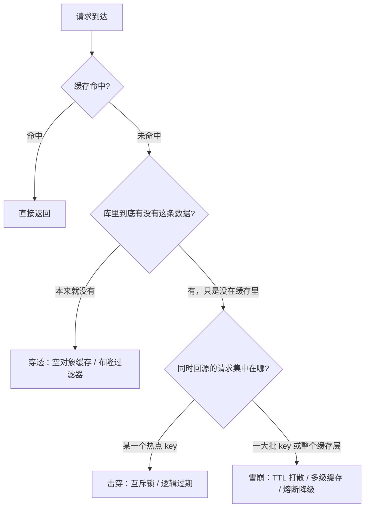
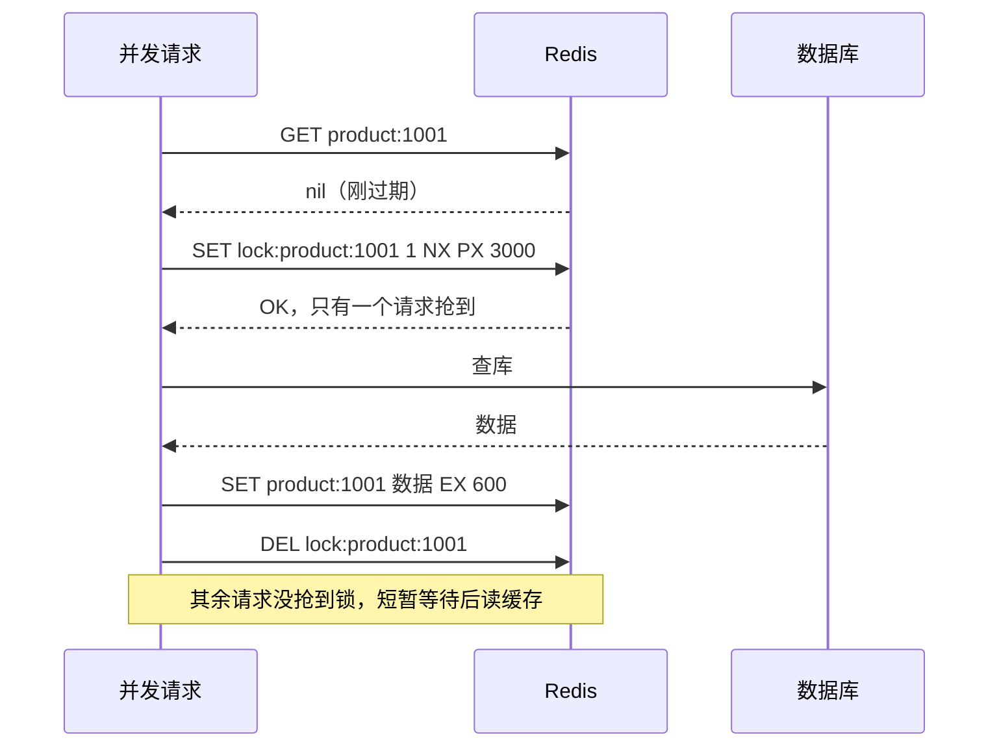

缓存穿透、击穿、雪崩这三个词经常被混着用，但真正难分的只有前两个：**穿透和击穿的现象几乎一样，都是缓存没命中、请求一路压到数据库**，区别在于被查的那条数据在库里到底存不存在。雪崩是另一个量级的问题，它坏的不是某一条数据，而是一批 key 或者整个缓存层。下面先用一张判断路径图把边界划清楚，再逐个谈解法和代价，最后给一张对照表。

## 穿透：查的是一条不存在的数据

穿透的定义很窄：请求查的 key 在数据库里**本来就没有**。缓存里当然也不会有，于是每次请求都穿过缓存直接打到数据库。单个请求没什么，但如果有人拿一个不存在的 id 反复查，或者爬虫扫站，缓存就彻底失去了意义——它只缓存「存在」的东西。

**空对象缓存**是最直接的解法：查不到时也往 Redis 里写一条，value 用特殊标记（比如空字符串或 `{"miss":true}`），TTL 设得比正常数据短一些。下次同样的 key 进来就能命中这个标记，不会回源。它就是一个普通的 String 键值对，不需要额外的数据结构。

代价有两个：

- **内存浪费**：不存在的 key 没有上限。如果请求方用的是完全随机的参数，缓存里会堆满只被访问一次的垃圾 key。
- **数据不一致**：空标记有 TTL，但如果这期间数据真的被创建了，就会出现「库里已经有了、接口还返回空」的窗口。所以写路径要顺手删掉这个标记，不能只等 TTL 到期。

> [!WARNING]
> 空对象缓存只对「同一个不存在的 key 被反复查询」有效。随机 key 打过来时它反而会放大内存压力，这类场景要先用布隆过滤器或参数校验把请求挡在缓存之前。

**布隆过滤器**的思路是前置一层「存在性判断」：一个很长的二进制向量加若干哈希函数，写入时把算出来的位置置 1，查询时只要有一位是 0，就说明元素一定不存在。放在缓存前面能挡掉绝大部分不存在的 key。Redis 里一般用 RedisBloom 模块，或者用 String 的 `SETBIT` / `GETBIT` 自己拼一个位图。它的结构本身不是重点，重点是它能给出什么保证。

它的代价更硬：

- **误判率**：说「不存在」一定可信，说「存在」不一定可信。误判率随元素数量增加而上升、随位数组变长而下降，所以容量要提前估。
- **不能删除**：位是被多个元素共享的，清掉一个元素的位置可能误伤别的元素。数据频繁删除的场景只能用计数型变体，或者干脆换结构。
- **要同步**：数据库新增数据必须同时写进过滤器，否则新数据会被误判成不存在；重建过滤器则要全量扫描。

接口层的参数校验（id 格式、范围、权限）成本最低，应该先做，但它拦不住所有穿透。

## 击穿：一个热点 key 刚好过期

击穿是**点状**的：某一个访问量极高的 key 到了过期时间，在失效的那一瞬间，大量并发请求同时发现缓存没了，一起回源查数据库。它和穿透的区别在于数据确实存在，只是那一刻不在缓存里；和雪崩的区别在于范围只有一个 key——但因为它是热点，这一个 key 的并发量足以打穿数据库。

解法有两条路线。

**互斥锁**：只允许一个请求回源，其余请求等待或者短暂重试。实现上就是 `SET lock:key 1 NX PX 3000`，抢到锁的请求查库、写缓存、释放锁。代价是延迟：没抢到锁的请求要么等、要么拿兜底值、要么降级返回。锁本身也有坑——业务执行时间超过锁的 TTL 会被人抢走，需要续期或者把 TTL 放大；释放时还要防止误删别人的锁，一般把唯一标识放在 value 里，删除前比对。更现实的问题是「等待」在高并发下会占满线程池，所以等待必须设上限。

**逻辑过期**：不设置真实 TTL，把过期时间写进 value 里。读的时候比较 `expireAt`，一旦逻辑上过期，就让一个线程去异步重建，其余请求立刻返回旧值。好处是没有等待，吞吐不受影响；代价是**返回的数据可能是旧的**，不一致窗口等于重建耗时，业务上必须能接受「稍旧」这种语义。异步重建失败、线程池打满这些情况都要单独兜底，复杂度明显高于互斥锁。

## 雪崩：一批 key 同时失效，或者缓存整体故障

雪崩是**面状**的，成因有两类，处理方式完全不同：

1. **大批 key 在同一时间失效**。常见于批量预热时把 TTL 写成同一个值、零点定时刷新、活动开始瞬间。Redis 的过期删除是惰性删除加定期删除，定期删除用贪心扫描，短时间内集中到期除了让请求一起回源，还会让 Redis 自身出现延迟毛刺。
2. **缓存层本身出问题**。Redis 挂了、网络分区、主从切换、集群某个分片不可用。这时不是「没命中」，而是「根本没有缓存」，请求全部直接打到数据库。

针对第一类，最有效也最便宜的是**给 TTL 加随机抖动**：在基础过期时间上叠加一段随机偏移，把原本同一秒到期的 key 摊开到一个时间窗里。它几乎零成本，但只是把风险摊平，既不解决缓存层故障，也不适合本来就该同时失效的数据（比如整点刷新的榜单）。

针对第二类，需要几层防线：

- **多级缓存**：本地缓存（Caffeine 这类）加 Redis。Redis 不可用时本地还能挡一层。代价是本地缓存和 Redis 之间的一致性最难处理——多实例各持一份副本，更新要靠广播或者靠短 TTL 自然过期，内存也变成本地成本。
- **熔断降级**：数据库压力超过阈值时直接返回兜底数据、静态页或者稍后重试的提示，主动放弃一部分请求来保住数据库。代价是用户体验下降，降级逻辑要长期维护，阈值定低了白降级、定高了没效果。
- **缓存预热**：上线或活动前把热点数据提前灌进去，避免冷启动时一拥而上。代价是选哪些数据、预热期间给数据库多大压力、脚本谁维护，都是成本。
- **缓存层高可用**：哨兵、集群、主从只能降低「整体故障」的概率，切换窗口期依然存在，降级还是要有。

## 代价与取舍

把这几个解法的代价放在一起看，取舍会清楚很多：

- 空对象缓存：换内存，也换一致性维护（新增数据要删标记）。
- 布隆过滤器：换误判率，还背上「不能删除」和「必须同步」两个包袱。
- 互斥锁：换延迟，复杂度在锁的续期、释放和等待上限。
- 逻辑过期：换数据新鲜度，复杂度在异步重建。
- TTL 抖动：只能缓解集中过期，对缓存层故障无效。
- 多级缓存：一致性成本最高。
- 熔断降级：拿功能可用性换数据库存活。
- 缓存预热：拿运维成本换冷启动时的平稳。

没有哪个是免费的。选哪个，取决于你更怕什么：怕数据库被打死，就上锁和降级；怕用户看到旧数据，就别用逻辑过期；怕内存被打满，就别用空对象缓存去挡随机 key。

## 怎么选：一张判断表

| 你观察到的情况 | 优先考虑 | 主要代价 | 不建议用的场景 |
| --- | --- | --- | --- |
| 反复查同一个不存在的 id | 空对象缓存 + 短 TTL | 内存占用、创建后的一致性窗口 | 随机 key 攻击，会把内存打满 |
| 大量分散的非法 key 打进来 | 布隆过滤器 + 参数校验 | 误判率、不能删除、要同步重建 | 数据删除频繁、集合变化剧烈 |
| 单个热点 key 过期瞬间回源 | 互斥锁 | 等待延迟、续期与误删 | 回源很慢，线程池容易被占满 |
| 热点 key 不能有任何等待 | 逻辑过期 + 异步重建 | 读到旧值、异步复杂度 | 业务必须读最新值 |
| 大批 key 在同一时间到期 | TTL 加随机抖动 + 预热 | 只是摊平，不解决故障 | 本来就该同时失效的数据 |
| Redis 故障时数据库被打穿 | 多级缓存 + 熔断降级 + 高可用 | 一致性、降级体验、运维成本 | 读路径要求强一致 |

## 小结

三个概念的分界线其实只有两条：**数据在不在**决定是穿透还是另外两个，**失效是点还是面**决定是击穿还是雪崩。解法则是沿着这两条线长出来的——不存在就想办法不查库，单点失效就控制回源的并发，批量失效或整体故障就得多层兜底。

> [!TIP]
> 排查时先分清是「点」还是「面」：一个 key 出问题看击穿，一类 key 或整体异常看雪崩，一个本来就不该存在的 key 看穿透。三者的监控口径也不一样——穿透看未命中的来源是否集中，击穿看单个 key 的回源并发，雪崩看整体命中率和数据库连接数。

最后提醒一句：这些解法都在缓存这一侧，真正决定上限的仍是数据库的承受能力和降级预案——没演练过的降级开关，故障当晚大概率拉不动。
