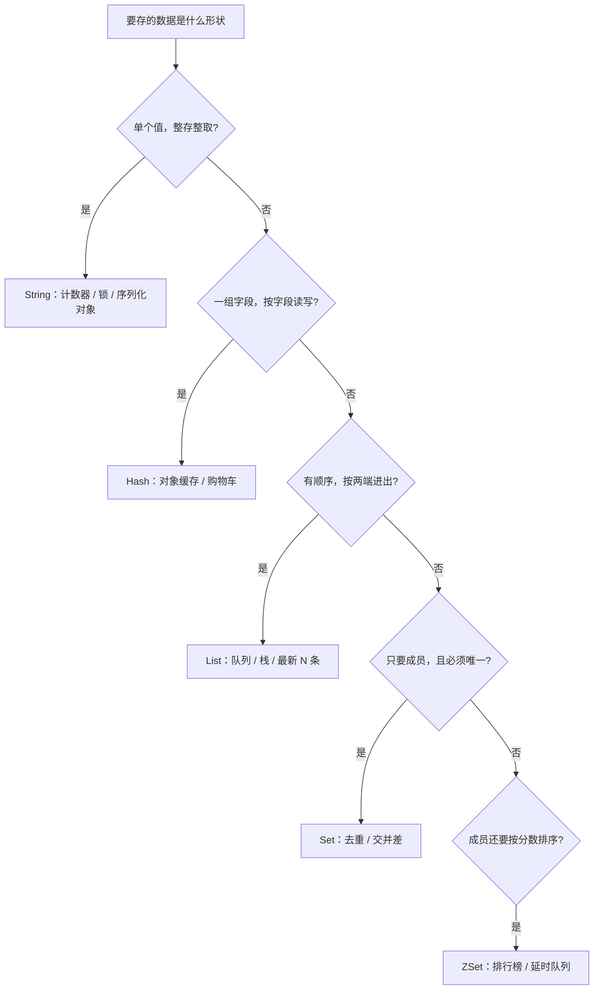

选 Redis 结构，先看数据长什么样，再看要做什么操作，最后才谈性能。五种基础结构没有谁更快，只有谁更贴合操作形态：要整存整取就 String，要按字段改就 Hash，要顺序进出就 List，要去重和集合运算就 Set，要按分数排序就 ZSet。真正决定内存占用和延迟的其实是底层编码，而编码会随数据量自动切换。下面把结构和编码放在一起讲，再补上单线程下会阻塞的操作、过期与淘汰的区别，以及为什么该用 `SCAN` 而不是 `KEYS`。



## 五种结构，各自对应一类操作

**String 是唯一能直接当数字用的结构。** 底层是 SDS，一个带长度字段的字节数组，二进制安全，`INCR`、`DECRBY`、`INCRBYFLOAT` 都是原子的。计数器、分布式锁（`SET key val NX PX 3000`）、token 与验证码、把对象序列化成 JSON 整存整取，用的都是它。代价也在"整存整取"上：只想改对象里的一个字段，也得把整串读出来、改完、再写回去。

**Hash 把对象拆成字段。** `HSET user:1 name tom` 只改一个字段，`HMGET` 只取需要的那几个，网络流量和并发冲突面都比整串小。字段多、读得散的场景适合它：用户资料、商品属性、购物车（field 是商品 id，value 是数量）。多字段计数也常用 `HINCRBY`，比给每个计数器单独建一个 String key 更好管理。

**List 是唯一保留插入顺序的结构。** 两头进出都是 O(1)，`LPUSH` 加 `BRPOP` 就是最省的队列，`RPUSH` 加 `RPOP` 是栈，`LTRIM` 能只留最新 N 条。但它没有 ACK 和消费组，当消息队列用会丢消息，要可靠投递得换 Stream。

**Set 解决的是"在不在"和"共同好友"。** 成员无序唯一，`SADD` 天然去重，`SISMEMBER` 判断存在，`SINTER`、`SUNION`、`SDIFF` 直接做交并差。UV 统计、点赞名单、标签、抽奖（`SRANDMEMBER`、`SPOP`）都属于它。只需要基数、不需要具体成员时，HyperLogLog 更省内存。

**ZSet 在 Set 之上加了一个分数。** 成员仍然唯一，但按 score 自动排序，`ZINCRBY` 加完分会重新归位，`ZREVRANGE ... WITHSCORES` 直接拿榜。排行榜是这个结构的标准答案；把时间戳当 score，它还能当延时队列和滑动窗口限流的容器。

## 底层编码：小数据省内存，大数据换结构

同样一条 `HSET`，元素少时和元素多时，value 在内存里根本不是同一个东西。

String 有三种编码：值落在 long 范围内的整数走 int，数字直接存在 redisObject 的指针位里；长度不超过 44 字节走 embstr，redisObject 和 SDS 一次分配、内存连续；再长就是 raw，指针分开。SDS 自己还有预分配策略：小于 1MB 时扩容翻倍，超过 1MB 每次只多给 1MB，上限 512MB。

Hash 和 ZSet 在元素少时用 listpack（7.0 之前叫 ziplist）：把若干 field-value 或 member-score 连续排在一块内存里，没有指针。超过阈值（Hash 默认 128 个字段且单值不超过 64 字节，ZSet 默认 128 个成员且 member 不超过 64 字节）才换成 hashtable 或 skiplist。List 的 quicklist 是折中：外层双向链表，每个节点里塞一个 listpack（7.0 之前是 ziplist），节点大小由 `list-max-listpack-size` 控制，既避开裸链表每元素三个指针的浪费，又不会让单个连续块大到搬不动。Set 若全是整数用 intset —— 一段有序整数数组，二分查找，默认上限 512 个；7.2 之后小 set 也走 listpack，否则才是 hashtable。

省内存的原因很具体：hashtable 每个条目除了 key 和 value，还要一个 dictEntry（三个指针，24 字节），jemalloc 再按 8 或 16 字节对齐吃掉一些；连续编码把这些全省了，还顺带拿到 CPU cache 局部性。代价是插入和查找要在内存里搬移，O(N)。所以阈值不是玄学，它就是"搬移成本超过指针与分配器开销"的那个分界点。


> [!NOTE] 编码基本是单向升级：listpack 涨过阈值会转成 hashtable 或 skiplist，之后把元素删到阈值以下也不会自动变回来，只能重写这个 key。所以调大阈值未必立刻省内存，调小也不会让存量 key 瘦身。

## 单线程模型下，哪些操作会阻塞

Redis 用一个线程串行执行命令（6.0 起的 IO 多线程只分担读写和协议解析），一条慢命令会挡住后面所有客户端。风险不在 `GET`，而在复杂度 O(N) 的命令和"大 key"：

- `KEYS *`：遍历整个库，还要把结果一次性攒在内存里。
- 大集合的全量读：`SMEMBERS`、`HGETALL`、`LRANGE 0 -1`、`ZRANGE 0 -1`。O(N) 构建响应，内存和网络一起涨。
- 大 key 的删除：`DEL` 是同步释放，几百万元素的 hash 要一个个还内存，这段时间线程就卡住。
- 集合运算与批量删除：`SINTERSTORE`、`SUNIONSTORE`、`ZREMRANGEBYSCORE` 覆盖大区间。
- 其他：跑很久的 Lua 脚本、`DEBUG SLEEP`、RDB 或 AOF 重写 fork 时的页表复制。

::: code-group labels=[同步删除, 异步删除]

```bash
# 几百万元素的 hash，DEL 会阻塞主线程直到内存释放完
DEL user:big:hash
```

```bash
# UNLINK 只把 key 从键空间摘掉，真正的内存释放交给后台线程
UNLINK user:big:hash
```

:::

> [!WARNING] 大 key 不只是删得慢。写入、读取、过期删除、集群迁移、持久化都会放大代价；一个几百万元素的 hash 扩容时还要整表渐进式 rehash。把成员数量控制住（比如分成 `user:1:part:0` 这样的多个 key），比事后优化划算得多。

## 过期与淘汰不是一回事

过期管的是单个 key 的寿命，淘汰管的是整个实例的内存水位。两套机制经常被混着说，出问题时的表现却完全不同。

过期删除是"惰性删除加定期删除"。惰性指访问时才检查 TTL，过期就删掉并返回空：好处是 CPU 只在必须时花，坏处是没人访问的 key 会一直占着内存。定期删除补这个洞：每秒大约 10 次，从过期字典里随机抽 20 个 key，删掉其中已过期的，如果这 20 个里过期比例超过 25% 就再来一轮，单轮有时间上限（默认 25ms）防止卡死。所以"TTL 到了、内存没降"是正常现象；从库更明显，从库不主动过期，要等主库的 `DEL` 同步过来。

淘汰只在内存达到 `maxmemory` 之后才触发，按策略挑 key 删：

| 策略 | 从哪些 key 里挑 | 按什么挑 |
| --- | --- | --- |
| `noeviction`（默认） | 不淘汰 | 写操作直接报错 |
| `volatile-lru` | 只限设了 TTL 的 | 最久未使用 |
| `volatile-lfu` | 只限设了 TTL 的 | 访问频率最低 |
| `volatile-random` | 只限设了 TTL 的 | 随机 |
| `volatile-ttl` | 只限设了 TTL 的 | 剩余寿命最短 |
| `allkeys-lru` / `allkeys-lfu` / `allkeys-random` | 全体 key | 同上三种维度 |

两个坑：volatile 系列在"所有 key 都没设 TTL"时等于 noeviction，写入会直接失败；allkeys 系列会连没设过期时间的数据一起淘汰。LRU 是近似实现，不维护完整链表，而是每个 key 记一个访问时间戳，淘汰时随机采样几个挑最旧的。LFU 记访问频次并做时间衰减，更抗"偶发一次全量扫描"的干扰，适合热点相对稳定的缓存。

## 用 SCAN 代替 KEYS 的原因

`KEYS pattern` 是 O(N) 且一次性返回。不只是遍历慢，结果集还得在内存里拼好再发出去，几十万个 key 足以把输出缓冲区打爆，甚至触发客户端输出缓冲限制被断开连接。

`SCAN` 把一次遍历拆成很多次：每次带一个游标，服务端返回一小批结果和下一个游标，游标为 0 表示结束。单次调用是 O(1) 量级，主线程不会被长时间占住。

```bash
SCAN 0 COUNT 100 MATCH user:*
```

它给出的保证只有一条：从遍历开始到结束一直存在的元素，至少会被返回一次。由此推出三件事：可能返回重复元素，客户端要自己去重；遍历期间新增或删除的元素不保证出现；顺序不保证。`COUNT` 只是提示值，实际返回数量可能更多。`MATCH` 在服务端过滤，但仍然要扫完再筛，不是索引。

还有一点容易忽略：`SCAN` 只是不阻塞，遍历完整库的总成本仍然是 O(N)。真正常用的 key 应该单独维护一个索引 Set，或者按业务前缀分桶，而不是每次都扫全库。`HSCAN`、`SSCAN`、`ZSCAN` 是同一套逻辑在 Hash、Set、ZSet 上的版本。

## 自检清单

- 选结构时，是先看数据形状和操作形态，还是先看"哪个更快"？
- 这个 key 的成员数量上界是多少？超过十万条，读的时候有没有用 `HSCAN` / `SSCAN` / `ZSCAN` 分批？
- 删除或覆盖大 key 时，用的是 `DEL` 还是 `UNLINK`？
- ZSet 的 score 是不是真的承担了排序职责？如果只是去重，该不该退回 Set 或 HyperLogLog？
- 淘汰策略选的是 allkeys 还是 volatile？关键数据有没有设 TTL 而被 volatile 系列误伤？
- 遍历用的是 `KEYS` 还是 `SCAN`？`SCAN` 的重复结果有没有去重？
- 是否假设过"TTL 一到内存立刻下降"？从库上的过期数据是怎么被清掉的？

结构选错只影响性能和内存，编码和阻塞这两件事才会影响线上稳定性。
