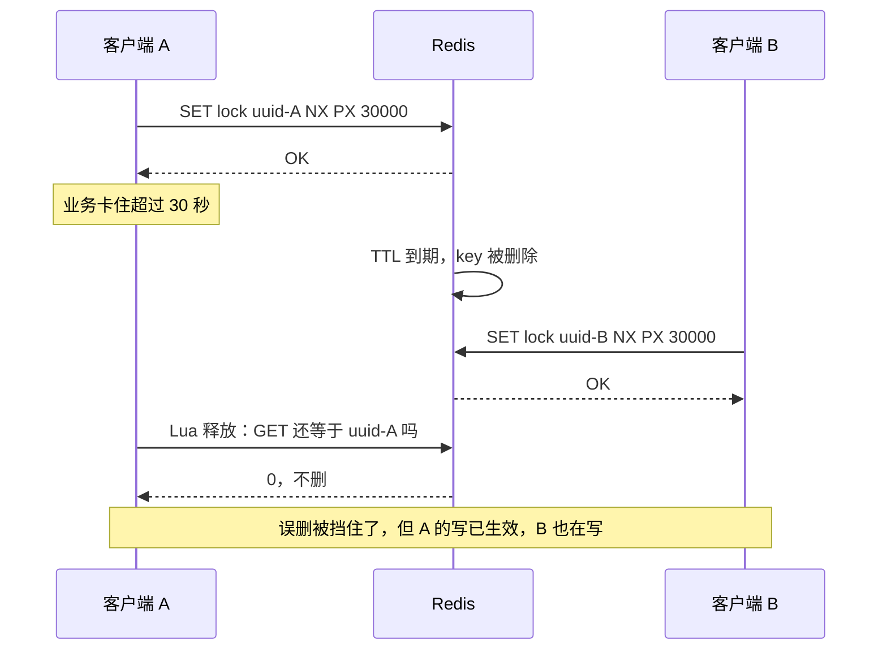
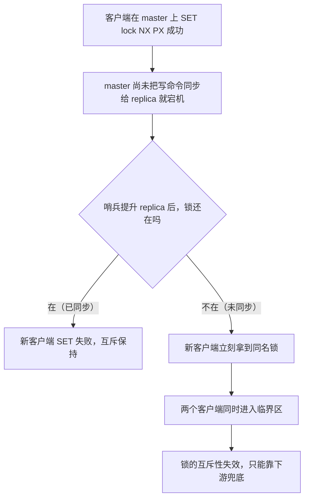

分布式锁真正的难点不在怎么加锁，而在加完锁之后假设了什么。`SET NX PX` 加 Lua 释放能应付多数场景，前提却是 Redis 单点可靠、业务在 TTL 内跑完、主从切换不丢键、临界区允许重复执行。前提破一个，锁就从互斥保证退化成降低冲突概率。下面按演进顺序把坑走一遍，最后给一张选型表。

## 为什么 JVM 的锁管不到另一台机器

`synchronized` 和 `ReentrantLock` 的互斥范围是一个 JVM 进程内的对象：monitor 记录和 AQS 的 `state` 都在堆里，两个进程各有一份，互相看不见。服务只要部署两个实例，JVM 锁就变成每个实例各自排队，临界区照样被并发进入。

分布式锁把「谁有权进入临界区」这个状态从进程私有内存搬到共享存储。它多给三样东西：跨进程、跨主机的互斥；带租约的锁，持有者崩溃后能被接管；可观测的远程操作，能设超时。它也给不了三样东西：跨资源的事务、被保护数据的正确性、网络分区下同时满足互斥与可用。这是 CAP 的硬约束，不是实现水平问题。所有方案本质上都是在「失效窗口多大」和「窗口出现时谁兜底」之间选择。

## 从 SETNX 到 SET NX PX：一条命令的三次演进

第一版几乎人人会写：`SETNX` 占位，成功后再 `EXPIRE` 设过期。

::: code-group labels=[先 SETNX 再 EXPIRE, 一条 SET 完成]

```bash
# 第一条成功、第二条没来得及执行：锁永远不过期
SETNX lock:order:1001 1
EXPIRE lock:order:1001 30
```

```bash
# Redis 2.6.12+：存在性判断和过期时间在同一条命令里完成
SET lock:order:1001 "$TOKEN" NX PX 30000
```

:::

问题在于这是两条命令。`SETNX` 返回 1 之后、`EXPIRE` 之前，客户端崩溃、被 kill、断网，key 就永久存在，一把没有过期时间的锁比没有锁更糟；如果 `SETNX` 失败却仍执行 `EXPIRE`，等于给别人的锁续期。原子性缺口不是理论问题，发布脚本和异常分支里很常见。

第二版是 Redis 2.6.12 的 `SET key value NX PX milliseconds`：`NX` 仅当 key 不存在时写入，`PX` 同时设毫秒级过期，两个语义在同一条命令里完成。Redis 单线程执行命令，命令内部不会被插入，判断存在和设置过期之间不再有窗口；`EX` 是秒级版本，`XX` 用于只在已存在时更新。

第三版不是新命令，而是 value 的语义升级：从占位的 `1` 换成全局唯一标识（UUID 加线程 id 或请求 id），为释放时验明身份铺路。

命令原子，不等于「客户端认为自己持锁」的时刻准确。`SET` 执行成功到客户端收到 `OK` 隔着一次网络往返，业务开始一定晚于锁生效——所有租约式算法的计时误差都从这里来。

## 释放、超时与续期：三个必须一起考虑的问题

最直觉的释放是 `DEL`，但锁一旦超时就会出事：A 持锁 30 秒，业务跑了 35 秒；锁过期，B 拿到锁；A 执行完顺手 `DEL`，删掉的是 B 的锁；C 又能拿到锁，A、B、C 可能同时在临界区里。

修法是把唯一标识写进 value，删前比较，且比较和删除必须原子：

```java
String token = UUID.randomUUID().toString();
jedis.set("lock:order:1001", token, SetParams.setParams().nx().px(30_000));

String unlockLua =
    "if redis.call('get', KEYS[1]) == ARGV[1] then "
  + "  return redis.call('del', KEYS[1]) "
  + "else return 0 end";

Long released = (Long) jedis.eval(unlockLua, List.of("lock:order:1001"), List.of(token));
// 返回 1 说明删的是自己的锁；0 说明锁已过期或被别人持有
```

Lua 执行期间不会插入其他命令，`GET` 与 `DEL` 之间没有窗口。它解决的是「误删别人的锁」，解决不了 A 在锁过期后仍在写：脚本只保证 A 不删 B 的锁，不保证 A 的写不生效。问题从三个客户端同时持锁缩小到两个客户端同时写，剩下一半得靠 TTL、续期或下游的版本校验。

TTL 设多长没有最优解：短了业务没跑完，长了持有者宕机后别人干等。固定 TTL 等于假设业务耗时有上界，而线上最不缺长尾。

**看门狗**是工程妥协：加锁时不写死 TTL，起后台任务按 TTL 的三分之一周期续期，业务结束停止。Redisson 默认 `lockWatchdogTimeout` 30 秒、每 10 秒续一次；显式传 `leaseTime` 则不启用。续期同样要校验 token，否则会把别人的锁续上：

```java
String renewLua =
    "if redis.call('get', KEYS[1]) == ARGV[1] then "
  + "  return redis.call('pexpire', KEYS[1], ARGV[2]) "
  + "else return 0 end";

ScheduledExecutorService renewer = Executors.newSingleThreadScheduledExecutor();
renewer.scheduleAtFixedRate(() -> {
    Long ok = (Long) jedis.eval(renewLua, List.of(KEY), List.of(token, "30000"));
    if (ok == null || ok == 0L) {
        renewer.shutdown(); // 锁已不属于自己，停止续期，业务尽快退出
    }
}, 10, 10, TimeUnit.SECONDS);
```

它依赖续期线程按时调度、续期请求能到达 Redis。一次超过续期周期的 STW、容器被 `SIGKILL`、网络分区，都会让续期静默失败，而客户端仍然以为自己持锁。



> [!WARNING]
> 看门狗只能覆盖「进程活着且网络通畅」。STW、容器被强杀、网络分区都会让续期静默失效，客户端却仍认为自己持锁。锁的「我以为」和「实际」之间永远有一条缝。

补缝的东西是 **fencing token**：锁服务每次授予时返回单调递增的版本号，客户端带着它写下游，存储拒绝更小的版本号，旧持有者醒来也写不进去。代价是要求下游配合，做不到就只能靠幂等。

## 主从切换、Redlock 和一场没有结论的争论

单机 Redis 加主从，锁会凭空消失。复制是异步的：客户端在 master 上 `SET NX PX` 成功，master 没把写命令传给 replica 就宕机，哨兵提升 replica，新 master 上根本没有这把锁。另一个客户端立刻拿到同名锁，两个客户端同时认为自己持锁。



`WAIT` 能等部分副本确认，降低概率，但缩不小 failover 窗口，也挡不住旧 master 在脑裂期间继续接受写。

Redlock 换掉主从这个前提：N 个（通常 5 个）完全独立、不互为副本的 master，客户端依次 `SET NX PX`，单次超时远小于 TTL；多数派（至少 N/2+1 个）成功且总耗时小于 TTL 才算拿到；有效期还要减去获取耗时和时钟漂移；失败则释放所有已加的锁。它不依赖复制和 failover，靠投票抵抗单点故障和网络分区。

争议两边都值得听。

反方（Kleppmann）认为，Redlock 依赖网络延迟有界、进程停顿有界、时钟漂移有界。GC 长停顿、虚拟机迁移、页交换都能让客户端在锁过期后才继续执行，而它仍以为自己持锁。没有 fencing token，下游分不清当前持有者和过期持有者，锁就不能为正确性负责。只为效率，单实例就够；要为正确性，必须有 fencing。Redlock 卡在两者之间，既不够安全也不够高效。

正方（antirez）回应：任何超时锁都绕不开时钟与延迟假设，这是租约模型的边界，不是 Redlock 独有；Kleppmann 的攻击需要暂停超过 TTL，工程上可以用合理 TTL、监控和快速失败压低概率；fencing 并非处处可用，很多存储不支持版本校验，不能因此否定锁；效率场景下 Redlock 比单实例更能抗单点故障。

两边争的其实是「锁能不能单独承担正确性」。下游能校验版本号，时序就没那么关键；不能，任何租约式锁都有窗口，必须靠幂等或条件更新兜底。

> [!NOTE]
> 判断一场锁的争论对自己有没有意义，可以只看一个问题：下游存储能不能拒绝「过期持有者」的写？能，锁只需负责减少冲突；不能，再精巧的锁算法也只是把窗口变窄。

## 比锁更可靠的兜底

临界区的操作本身幂等，锁失效就不再是生死问题。常见兜底有三类。

**数据库唯一索引**：锁表上 `lock_name` 唯一，`INSERT` 成功即持锁，失败即被占用，释放时按持有者 `DELETE`；加 `expire_at` 和定时清理，防止崩溃留下死行。它不引入新组件，必要时能和业务同库同事务；代价是数据库成了锁的单点，锁表会膨胀，清理有延迟。

**ZooKeeper / etcd 的租约**：ZK 用临时顺序节点，序号最小者持锁，其余监听前一个节点，会话断开节点自动删除；etcd 用 lease 加事务 compare-and-create，返回的 revision 可当 fencing token。两者都是 CP、写要过半，延迟和运维成本高于 Redis，但语义更接近真正的锁。

**业务幂等**：去重表、唯一业务号、状态机条件更新（`UPDATE ... WHERE status = 'INIT'`）、消息消费去重表。它不阻止并发，但保证重复执行不产生重复副作用。

三类手段和 Redis 锁是分层关系：锁把并发挡在外面，幂等负责锁失效时错误不扩散。

| 场景 | 建议 | 理由与代价 |
| --- | --- | --- |
| 单机多线程共享变量 | `synchronized` / `ReentrantLock` | 不跨进程，开销最小 |
| 多实例、临界区短、能容忍极低概率重入 | 单 Redis `SET NX PX` + Lua + 看门狗 | 简单、吞吐高；主从切换窗口仍在 |
| 下游能校验单调版本号 | etcd / ZK 租约 + fencing token，或 Redlock | 时序不再关键，存储能拒绝旧持有者 |
| 跨机房且下游不支持版本校验 | Redis 锁 + 幂等或唯一约束 | 投票补不上过期持有者的写 |
| 订单防重、秒杀扣减 | 唯一索引、状态机条件更新 | 锁只削峰，正确性交给唯一约束 |
| 审批、长流程、人工处理 | 状态机 + 乐观锁，不持锁 | TTL 覆盖不了人工时长 |
| 已有 ZK / etcd 且团队熟悉 | 临时节点 / lease | 复用 CP 组件，少维护一套依赖 |

多数线上事故不是忘了加锁，而是以为加了锁就安全。

## 自检清单

- [ ] 开头结论落在「锁的假设」上，而不是复述定义。
- [ ] `SETNX` + `EXPIRE` 的缺口、`SET NX PX` 的合并、value 唯一标识三步齐全。
- [ ] 释放锁讲清了为什么只 `DEL` 会误删，以及 Lua 为什么必须原子。
- [ ] TTL 两难、看门狗、STW 与 fencing token 串成了一条线。
- [ ] 主从丢锁的现象、Redlock 的多数派流程、正反两方论点都写到了。
- [ ] 判断表覆盖 JVM 锁、Redis 锁、CP 锁、唯一索引与幂等四类选择。
