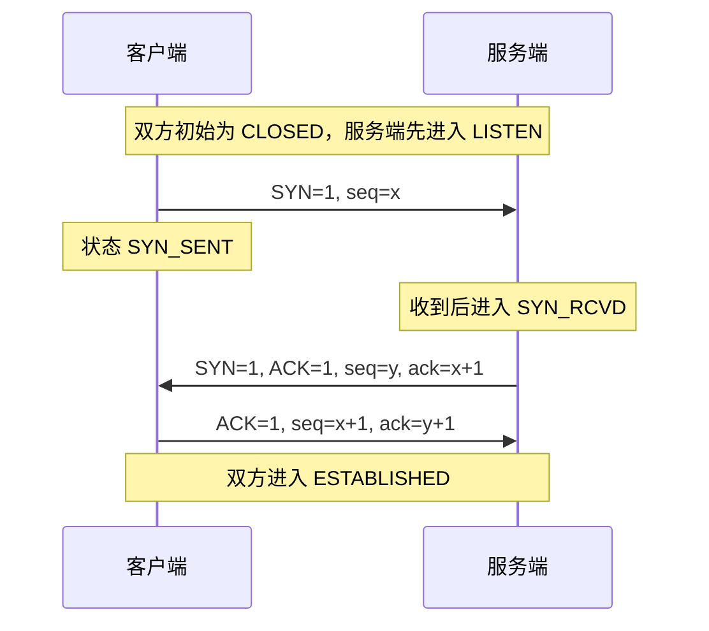
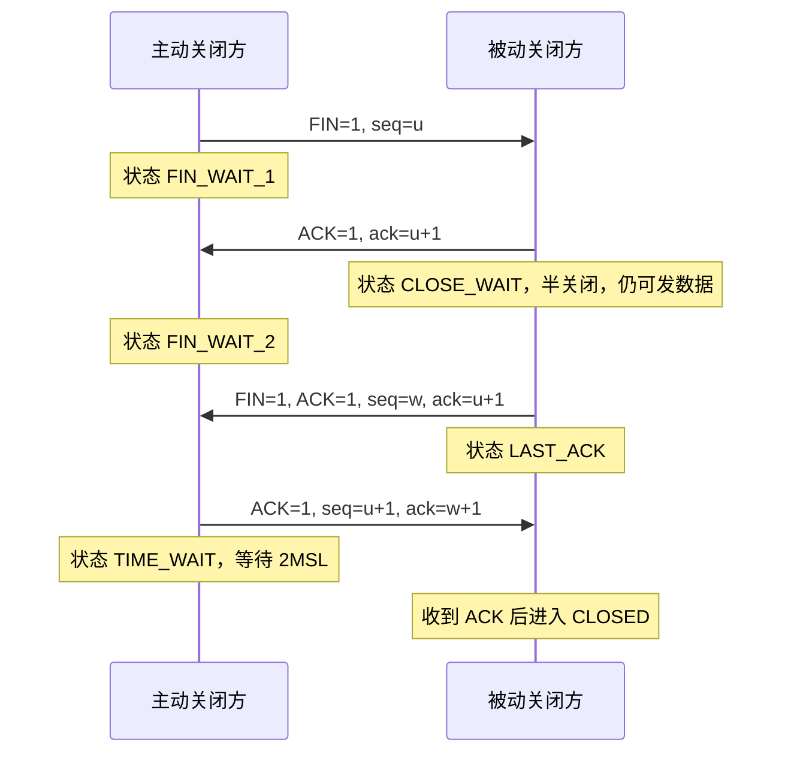

TCP 建立连接必须三次，是因为「我能发、你能收」这件事要双向各确认一次，同时双方还要就初始序列号达成一致；两次不够，四次多余。关闭连接要四次，是因为 TCP 是全双工的，两个方向的数据流各自独立关闭，一方说「我说完了」并不代表另一方也说完了。把这两句话拆开，每个报文和每个状态都可以自己推出来。

## 三次握手：每一步在做什么

在发出第一个数据字节之前，TCP 要先落实三件事：

1. **对方可达**：我发的报文对方能收到；
2. **对方能发**：对方发的报文我也能收到，即双向通路都是通的；
3. **初始序列号已同步**：后面所有数据的编号都从这里起步，确认号才有意义。

### 先搞清楚 seq 和 ack

序列号不固定从 0 开始，而是随机选取。原因有两个：一是避免上一次连接残留在网络里的旧报文被误认为新连接的数据；二是让外部难以猜出序号，压缩伪造 RST 或注入数据的空间。

TCP 把连接中传输的每个字节都编上号。`seq` 是这个报文段第一个字节的编号；`ack` 是「我期待你下一个字节的编号」，等于收到的 `seq` 加上数据长度。握手阶段不携带数据，所以 `ack = seq + 1`。另外，SYN 和 FIN 这两个标志位各占一个序列号，这也是为什么确认号总要 +1。

### 报文与状态的变化



各步骤的字段变化，可以对照下表：

| 步骤 | 标志位 | 序列号 / 确认号 | 服务端状态 |
| --- | --- | --- | --- |
| 1. 客户端发 SYN | SYN=1, ACK=0 | seq=x | 仍为 LISTEN |
| 2. 服务端回 SYN+ACK | SYN=1, ACK=1 | seq=y, ack=x+1 | 变为 SYN_RCVD |
| 3. 客户端回 ACK | ACK=1 | seq=x+1, ack=y+1 | 变为 ESTABLISHED |

第一步里客户端把自己的初始序列号 `x` 交给对方，这一步只能确认「客户端能发」。第二步服务端一次性做了两件事：确认 `x`（`ack=x+1`），并把自己的初始序列号 `y` 报出去。第三步客户端回 `ack=y+1`，才算完成「服务端能发」的确认。

一个容易记错的地方：**第三次握手的 ACK 已经可以携带数据**，前两次不行。因为此时连接已基本可用，客户端不需要再空跑一个 RTT；而 SYN 报文本身不允许携带应用数据。

## 为什么不是两次，也不是四次

**两次不够**，问题出在服务端。如果只握两次，服务端收到 SYN 并发出 SYN+ACK 后，就认为连接已建立、可以发数据了。但它无法确认这个 SYN+ACK 是否被客户端收到。万一它丢了，客户端仍认为连接没建好，会忽略服务端随后发来的数据，只等一个确认；服务端却在超时重传数据。双方都在等对方先动，形成死锁。

更根本的是序列号。两次握手结束时，客户端知道自己的 `x` 已经发出，却不知道对方是否接受；服务端的 `y` 则从未被客户端确认过。第三次的 ACK 让服务端确认：客户端不仅收到了我的 SYN+ACK，也接受了我的初始序列号。这一次确认，是「双向同步」的最后一环。

两次握手还会放过**历史连接**。设想一个很早以前发出的 SYN 在网络上被延迟了很久，直到原连接都关闭了才到达服务端。两次握手下，服务端会立刻建立一条「僵尸连接」，把内核资源绑在一个早已不存在的客户端上。三次握手中，客户端收到这个来路不明的 SYN+ACK 时，会发现其序列号对不上自己当前任何一条连接，于是直接回 RST，让服务端撤销。旧的 SYN 就这样被拦在门外。

**四次多余**，因为第二次的 SYN+ACK 已经把「确认对方的 SYN」和「发起自己的序列号同步」两件事压进了一个报文。再拆成 ACK 和 SYN 两个包，只会让服务端多等一个 RTT 才能确认客户端的接收能力，没有任何收益。

> [!NOTE]
> 三次是「最少够用」，不是「最优」。为了把第三次确认与数据合并、省掉一个 RTT，才有了 TCP Fast Open 这类扩展。但基础握手之所以停在三次，上面这些理由是绕不开的。

## 半连接队列与 SYN Flood

服务端处于 LISTEN 时，收到 SYN 并不会立刻建好连接。内核先把它放进 SYN 队列（半连接队列），状态记为 SYN_RCVD；等第三次 ACK 到达，才移到 accept 队列（全连接队列），等待应用调用 `accept()` 取走。

两个队列都有长度上限，**默认值随内核版本而异**，不能照抄数字。队列满之后的处理方式（丢弃还是回 RST）也由内核策略决定。

SYN Flood 攻击的正是这个时间窗：攻击者伪造大量源 IP 发送 SYN，却从不发第三次 ACK。服务端为每一个 SYN 分配状态并等待，半连接队列很快被占满，正常用户的新连接被直接丢掉。常见的缓解手段是 SYN cookies：不保存状态，把连接信息编码进 SYN+ACK 的序列号里，等 ACK 回来再还原，从而让「等待中的连接」不再消耗队列槽位。

排查时可以先看队列有没有被撑满：

::: code-group labels=[ss, netstat]

```bash
# LISTEN 状态下，Recv-Q 是当前全连接队列长度，Send-Q 是上限
ss -lnt
```

```bash
# 观察因队列溢出而丢弃的连接计数
netstat -s | grep -i -E "listen|overflow"
```

:::

## 四次挥手：多出来的那一次是「我这边还没说完」



关键在于理解 FIN 的含义：它只表示「我这个方向没有数据要发了」，并不表示「我不能接收」。所以被动关闭方收到 FIN、回了 ACK 之后，进入 CLOSE_WAIT，此时仍可以继续向对方发送剩余数据。这就是**半关闭**（half-close）：一条连接的两个方向被拆开，各关各的。等应用处理完、调用 `close()`，内核才发出自己的 FIN，进入 LAST_ACK。

这就是挥手比握手多一次的原因。握手时，服务端收到 SYN 后没有数据要发，可以立刻把「同意 + 我的初始序列号」合成一个 SYN+ACK；挥手时，ACK 由内核收到 FIN 就立即返回，而 FIN 要等应用层调用 `close()`，中间可能隔很久（比如响应还没写完）。两个动作的触发者不同、时机不同，自然合并不了。

也正因为如此，**CLOSE_WAIT 堆积几乎总是应用的问题**。要么某条错误分支忘了 `close()`，要么连接池泄漏、异常时没有释放。表现是文件描述符持续上涨、连接一直停在 CLOSE_WAIT。这时候调内核参数没有意义，得回去看代码。

## TIME_WAIT 与 2MSL

TIME_WAIT 只出现在主动关闭的一方，作用有两个。

**第一，保证最后的 ACK 能送到。** 这个 ACK 一旦丢失，服务端会停在 LAST_ACK，超时重传 FIN。客户端此时还在 TIME_WAIT，可以重发 ACK 并重置计时器。如果客户端直接进入 CLOSED，收到重传的 FIN 只能回一个 RST，服务端就会以异常方式终止。

**第二，让旧连接的残留报文在网络里彻底消亡。** 等待 2MSL 之后，本连接产生过的任何报文都不会再出现，新的连接（很可能复用同一个四元组）不会被旧报文污染。

MSL 是任何报文在网络中的最长存活时间，取值由内核实现决定，它不是 RTT。所以 2MSL 也不等于两个往返时延。

TIME_WAIT 的代价是四元组在等待期内无法复用：主动关闭方的端口被占着。高并发短连接的服务如果频繁主动关闭，本地端口会被耗尽。正确的方向是复用长连接、使用连接池，而不是把 TIME_WAIT 的保护关掉。

> [!WARNING]
> 不建议照抄老文章的「调参大法」。`net.ipv4.tcp_tw_recycle` 在较新内核中已被移除，`tcp_tw_reuse` 只对出向连接生效且有前提条件，它们的行为和默认值都随内核版本而异。先查清楚是谁在频繁主动关闭连接，再谈参数。

## 自检清单

- 能否说出 `seq` 和 `ack` 在三次握手中如何变化，以及为什么确认号要 `+1`
- 能否解释两次握手下「服务端已建连、客户端还在等」的死锁
- 能否说明第三次握手为什么可以携带数据，前两次为什么不行
- 能否区分半连接队列与全连接队列，并指出 SYN Flood 打的是哪一个
- 能否解释挥手为什么是四次：ACK 由内核立即回，FIN 等应用调用 `close()`
- 能否判断 CLOSE_WAIT 堆积应该查代码还是查内核参数
- 能否说出 TIME_WAIT 的两个作用，以及它为什么只出现在主动关闭方
- 能否解释 2MSL 为什么不是「两个 RTT」
